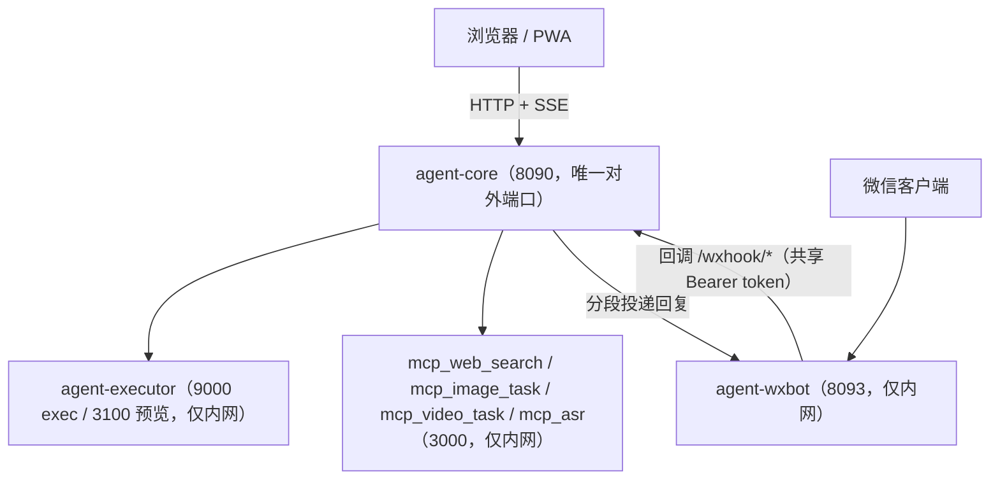

# AGENTS.md — 仓库总览

本文件写给在本仓库里动手的 AI / 开发者：系统由哪些进程组成、边界在哪、哪些约束一碰就坏。
用户视角的能力、部署与配置说明见 [README.md](README.md)；`app/`（agent-core）的内部实现见
[app/AGENTS.md](app/AGENTS.md)。

## 一句话架构

自托管的单实例 Agent 任务台：浏览器或微信发来任务 → `agent-core` 调度模型（OpenAI 兼容
`/chat/completions`）→ 模型调用内置工具 / MCP / 技能 → 命令在 `agent-executor` 隔离容器里执行 →
产物落在会话工作目录并回传。每个会话 = 一个真实 Linux 工作目录 + 一条 SQLite 会话记录。

设计基调：**单进程内存模型 + SQLite 同步 API**（JS 单线程，不存在跨进程竞争）；**配置冷加载**
（改 `config.yml` 需重启，少数写盘接口例外）；**单租户**（登录只把门，不做资源级授权）。

## 仓库结构

| 路径 | 职责 | 形态 |
|---|---|---|
| `app/` | **agent-core**：Express + better-sqlite3 + 免构建 H5 | Node 20，容器 `agent-core` |
| `app/server/` | 后端全部代码（入口 `server.js`） | 见 `app/AGENTS.md` |
| `app/server/public/` | 前端静态资源，经典脚本按序加载，共享全局作用域 | 无构建步骤 |
| `executor/` | **agent-executor**：`/exec` 隔离命令执行 + Office 预览网关 | 零依赖 Node，独立容器 |
| `wxbot/` | 微信 iLink 协议调制解调器（多实例） | 独立容器 `agent-wxbot` |
| `mcp/` | 同栈 MCP 服务：`web_search` / `image_task` / `video_task` / `asr` | 四个容器，仅内网 |
| `skills/` | 目录式技能（`SKILL.md` + `run.py`/`run.sh`） | 运行时挂载，`skills/deps` 为依赖层 |
| `scripts/` | `init.sh` 生成 `.env` + `config.yml`；`init_host.sh` 裸机初始化 | 幂等 |
| `docs/` | 专题文档：`tool-design.md`（工具接口规范）、`OFFICE.md` | — |
| `tasks/` | **运行时数据**：每个会话一个工作目录 | gitignore |
| `data/` | **运行时数据**：SQLite `.agent.db`、`prompt.txt` 调试产物 | gitignore |
| `docker-compose.yml` | 全栈编排（唯一入口） | — |

`executor/` 已相对稳定，没有单独的 AGENTS.md；改它之前先读 `executor/server.js` 顶部长注释
（隔离模型与 v4 教训），不要凭直觉动 mount/umount 流程。

## 运行时拓扑



- **对外只暴露 `agent-core` 一个端口**（宿主 `AGENT_PORT`，默认 8090）。executor、wxbot、MCP
  一律不映射宿主机端口——MCP 没有鉴权，暴露即被白嫖额度。
- `wxbot` 不直连微信服务器以外的东西；它回调 core 的 `/wxhook/*`，用共享 Bearer token 把门。
- 容器间按容器名访问（`http://agent-executor:9000`、`http://mcp_web_search:3000/`）；
  所有业务容器同在 `agent-mcp-net`（compose 里固定网络名，避免被加上项目名前缀）。
- `agent-executor-init` 是一次性容器：把技能依赖装进 `./skills/deps` 后退出，属正常现象。

### 端口与网络（要改先看这里）

| 服务 | 端口 | 可见性 |
|---|---|---|
| `agent-core` | 8090 | 宿主机映射，**唯一对外** |
| `agent-executor` | 9000（exec）、3100（预览网关） | 仅 `expose`，内网 |
| `agent-wxbot` | 8093 | 仅内网 |
| `mcp_*` | 3000 | 仅内网；compose 里注释掉的 `ports` 仅供本机调试 |

### 数据持久化（bind mount）

| 宿主机 | core 容器内 | executor 容器内 | 内容 |
|---|---|---|---|
| `./tasks/` | `/workspace/tasks` | `/mnt/host-tasks`（启动即遮蔽） | 会话工作目录 |
| `./data/` | `/workspace/data` | — | SQLite、`prompt.txt` |
| `./skills/` | `/workspace/skills` | `/workspace/skills:ro` | 技能与共享依赖 |
| `./config.yml` | `/app/config.yml` | 不挂、不读 | 平台密钥、登录密钥 |
| `./app/server/` | `/app/server` | — | 后端代码（**热挂载**） |
| `./wxbot/data/` | — | `/data`（wxbot） | 微信登录凭证 |

推论：

- 改后端代码 → **重启 `agent-core` 即可**（`docker compose restart agent-core`），不必重建镜像；
  改前端静态资源同理（浏览器刷新即可；只有改图片/JSON 才需要升 `sw.js` 的 `CACHE_VERSION`）。
- 改 `app/package.json` / 依赖 / Dockerfile → 必须 `docker compose up -d --build agent-core`。
- `config.yml` 只给 core 读；**不要**把它挂给 executor / wxbot。

### 环境变量（接线全靠根 `.env` + compose）

`AGENT_CONFIG`、`PORT`、`EXECUTOR_URL`、`EXECUTOR_TOKEN`、`WXBOT_URL`、`WXBOT_TOKEN`、
`ASR_URL`、`VIRTUAL_HOST`、`PREVIEW_PROXIES`、`EXECUTOR_LOG_LEVEL`、`WXBOT_LOG_LEVEL`、`ASR_LOG_LEVEL`。
密钥生成：`./scripts/init.sh`（幂等，重跑不掉登录态）。语音识别的上游 key/base/model 不在 env，
写在 `config.yml` 的 `mcp_servers[name=asr].headers`（容器不存平台密钥）。

## 三条主链路

1. **Web / HTTP**：`app/server/server.js` 装配 → 路由 → `engine.js` 起回合 →
   `llm.js` 组装并流式调用上游 → `tools/executor.js` 执行工具（`terminal` / `skill` 走
   `remote-exec.js` 打进 executor）→ SSE 回推前端。
2. **微信**：`agent-wxbot` 收消息 → 回调 core `/wxhook/inbox` → `wechat.js` 落媒体、注入上下文 →
   `routes/channel.js` 的命令层（`/new` `/switch` `/think` …）→ 同一套 `engine`；回合结束由
   SSE 内部订阅者（`bus.onInternal`）分段推回微信。
3. **定时任务**：`scheduler.js` 每 30s tick → 到期则先 `archiveHistory`（历史整体 `archived`，
   模型等价新会话）→ `engine.postUserMessage` 投递 → 结束后 `wechat.notifyTask` 通知。

## 数据与状态

- **会话工作目录** `tasks/<session-id>/`：`session-id` 形如 `task-YYYYMMDD-NNN`（UTC 日期 + 当日
  递增序号，序号持久化在 `meta` 表）。模型产出、用户上传、`data.db`（`db` 工具用）、`.tmp`
  （容器内 `/tmp` 的宿主实体）、`.imgcache/`（读图压缩缓存）、`.app/`（data-page 技能页面）。
- **唯一数据库** `data/.agent.db`（WAL 模式，`foreign_keys=ON`）。表：`sessions`、`messages`、
  `files`、`model_pool`、`meta`、`scheduled_tasks`、`channel_sessions`、`memory_fragments`、
  `wechat_bindings`、`model_usage`、`user_profiles`；`wait_queue` 是已废弃残留表。
- 备份至少覆盖 `data/`、`tasks/`、`config.yml`（有微信登录态再加 `wxbot/data/`）。

## 全局约束（改之前先读）

1. **单实例、单进程内存态**。`engine.js` 的 `runs`/`titling`、`wechat.js` 的回合投递状态与实例缓存、
   `publicFiles` 的短链表、`download-token` 的随机密钥都在进程内——重启即清空，多实例不共享。
   （微信投递游标 `last_msg_id` 例外，它是落库的。）不要引入需要跨进程一致性的设计。
2. **配置冷加载**。`config.js` 的 `DEFAULTS` 在启动时 deep-merge 并校验；改 `config.yml` 后必须
   重启。例外（写盘后热生效）：用户增删改（`routes/users.js`）、改自己的密码、技能列表刷新。
3. **密钥边界**。`config.yml`、`.env`、`wxbot/data/` 都是敏感数据：不提交、不打印、不挂给
   不需要它的容器。`GET /api/config` 已脱敏，别绕过它把 `api_key` 回显给前端。
4. **单租户**。除配置 / 用户管理 / 重启等管理员接口外，会话、消息、文件、技能 API **只校验已登录**，
   不按用户做资源级授权（按用户的会话列表隔离在前端查询层）。不要把这个实例开放给互不信任的用户。
5. **executor 隔离不可降级**。命令必须在 mount/pid namespace 内跑；只在会话目录可见。任何
   "为了调试方便加个直通" 的改动都会把其它会话的数据暴露给 AI 命令。
6. **模型池 key 是共享并发资源**。没有排队、没有独占、没有租约。调度只在多个 key 之间按
   「回合中会话数 → 在用会话数 → 最久未用」择优（详见 `app/AGENTS.md`）。
7. **运行时目录不入库**。`tasks/`、`data/`、`skills/deps/`、`wxbot/data/` 已被 gitignore；
   不要把样例任务、数据库、密钥当成源码提交。
8. **工具 schema 是每轮全量重发的上下文成本**。新增工具前先读 `docs/tool-design.md`：能用已有工具
   的 `op` 扩展就不要新开工具。

## 开发与验证

```bash
# 本地跑 core（无容器；默认路径是容器内路径，本地调试要改 workspace_root/data_root）
cd app && npm install
AGENT_CONFIG=./config.yml node server/server.js

# 容器栈
docker compose up -d --build
docker compose logs -f agent-core
curl -s http://127.0.0.1:8090/api/health
```

- 本仓库**没有单元测试框架**，也没有 lint。唯一的自动化验证是 `executor/smoke-test.js`
  （覆盖 executor 的鉴权、隔离、取消；隔离用例需 root/CAP_SYS_ADMIN，无权限时自动 SKIP）：
  ```bash
  cd executor && node smoke-test.js
  ```
- 改完 JS 至少做语法自检：`node --check <file>`。
- 排查时先看日志等级：core 用 `config.yml` 的 `log_level`（`debug` 会打印完整交互、SSE 帧、
  工具参数），executor / wxbot 用各自的 `*_LOG_LEVEL`。
- 启动会在 `data/prompt.txt` dump 实际下发的 system prompt 与各 profile 的工具清单——核对
  "模型到底看到了什么"时看它，不要猜。

## 修改时的同步清单

这些地方是"同一事实的多份表述"，改一处要顺手改另一处：

| 改动 | 需要同步 |
|---|---|
| 配置默认值 | `app/server/config.js` 的 `DEFAULTS` ↔ `app/config.example.yml` |
| 内置工具 | `app/server/tools/definitions.json` ↔ `app/AGENTS.md` / README 工具表 ↔ `docs/tool-design.md` 规范 |
| 新增服务 / 端口 / 卷 | `docker-compose.yml` ↔ `README.md` 的部署与安全章节 |
| 新增环境变量 | `.env.example` ↔ compose ↔ README「环境变量」 |
| 发版号 | `app/package.json` 的 `version` ↔ `app/server/routes/system.js` 的 `VERSION` 字面量（两者不自动同步） |
| 技能格式 | `skills/README.md` ↔ `app/server/tools/skills.js` 的解析 |
| 对外 API | `app/server/routes/*` ↔ 前端 `app/server/public/js/*` ↔ README |

## 代码约定

- **注释与用户可见文案用中文**。注释不是复述代码，而是记录"为什么这么做 / 踩过什么坑"；本仓库
  大量关键约束只写在注释里，改逻辑前先读该文件头与函数上方注释。
- 错误统一抛 `Error` 并可选挂 `status_code`；HTTP 层回 `{ error: string }`。工具层错误以
  `Error: ...` 文本形式回给模型（模型能读懂并自我纠正）。
- 定时器一律 `unref()`，fire-and-forget 的后台任务（标题、日记、通知）绝不阻塞消息主路径。
- 需要反向依赖时用**注入**而不是 `require` 成环：`engine` 不 require `wechat`/`scheduler`，
  由 `server.js` 传函数进去。
- 前端是**无构建的经典脚本**：新增文件要同时改 `app/server/public/index.html` 的 `<script>`
  顺序（共享全局作用域，顺序即依赖）。

## 常见任务去哪改

| 想做的事 | 起点 |
|---|---|
| 加一个给模型的工具 | `app/server/tools/definitions.json` + `app/server/tools/executor.js` 的 `HANDLERS` |
| 加一个 HTTP 接口 | `app/server/routes/` 新建/修改 router，在 `app/server/server.js` 挂载 |
| 加一个配置项 | `app/server/config.js` 的 `DEFAULTS` + `app/config.example.yml` |
| 改模型调度 / 绑定 | `app/server/engine.js` 的 `chooseKey` / `chooseModel` / `ensureBinding` |
| 改上下文组装 / 省 token | `app/server/llm.js` 的 `buildMessages` / `trim*` |
| 改微信投递 | `app/server/wechat.js`（业务）+ `app/server/routes/wechat.js`（HTTP/鉴权） |
| 改语音输入 | `app/server/public/js/voice.js`（录音与插入）+ `app/server/routes/asr.js`（代理）+ `mcp/asr/`（转写）；客户端桥契约见 `docs/voice-input.md` |
| 改隔离执行 | `executor/server.js`（先读顶部安全模型注释） |
| 加同栈 MCP 服务 | `mcp/<name>/` + `docker-compose.yml` + `config.yml` 的 `mcp_servers` |
| 加技能 | `skills/<name>/`（`SKILL.md` + `run.py`），见 `skills/README.md` |
