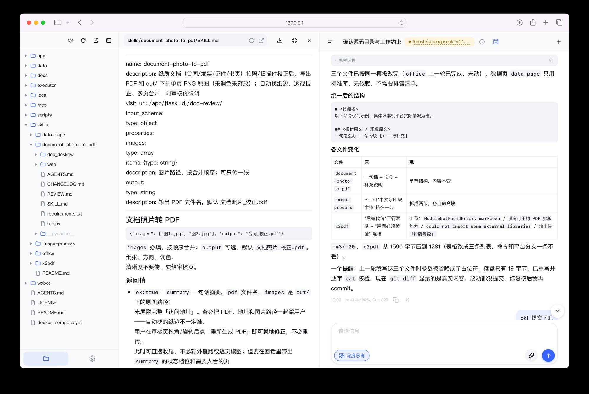

# Agent 任务台

自托管的 Agent 系统。浏览器或微信下发任务，模型在独立工作目录里读写文件、执行命令、调用技能，产物直接回传。



## 快速开始

### 服务器

需要 Docker 与 Compose v2：

```bash
./scripts/init.sh
docker compose up -d --build
```

打开 `http://<服务器 IP>:8090`，用 `admin` / `admin` 登录，先改密码，再到「设置 → 模型」添加平台和 API Key，保存后点「重启服务」。

### 本机运行

macOS / Linux，Node 20+，不需要 Docker：

```bash
./local/start.sh    # 后台启动
./local/stop.sh
```

首次运行会让你选一个工作目录（技能、会话、数据库都在里面）。命令直接在本机执行，没有沙箱隔离，只监听 `127.0.0.1`。

## 组成

| 目录 | 说明 |
|---|---|
| [`app/`](app/README.md) | agent-core：Express + SQLite + 前端静态资源，唯一对外端口 |
| `executor/` | agent-executor：隔离的命令执行、Office 预览网关 |
| [`wxbot/`](wxbot/README.md) | 微信接入 |
| [`mcp/`](mcp/README.md) | 四个 MCP 服务：网页搜索、图片生成、视频生成、语音转写 |
| [`skills/`](skills/README.md) | 内置技能 |
| [`local/`](local/README.md) | 本机模式启动器 |

## 配置

`./scripts/init.sh` 首次生成 `config.yml`，只有 agent-core 读取。日常改动走设置页，保存后点「重启服务」。

```yaml
platforms:
  - name: bigmodel
    url: https://open.bigmodel.cn/api/paas/v4
    models:
      - id: glm-5.3-flash
        vision: true
    keys:
      - api_key: "sk-..."
```

端口与其余环境变量在 `docker-compose.yml` 里。

## 升级

```bash
git pull
docker compose up -d --build
```

数据在 `data/`、`tasks/` 和 `config.yml` 里，升级不受影响。

## 安全

- 对外只开 agent-core 一个端口，其余服务只在 Docker 内网
- 命令在 executor 容器里执行，只挂当前会话目录，根文件系统只读
- 单租户设计：除管理员接口外不做用户级资源隔离，不要开放给互不信任的人
- `config.yml`、`.env`、`wxbot/data/` 存密钥，已加入 `.gitignore`

## License

AGPL-3.0，见 [LICENSE](LICENSE)。
