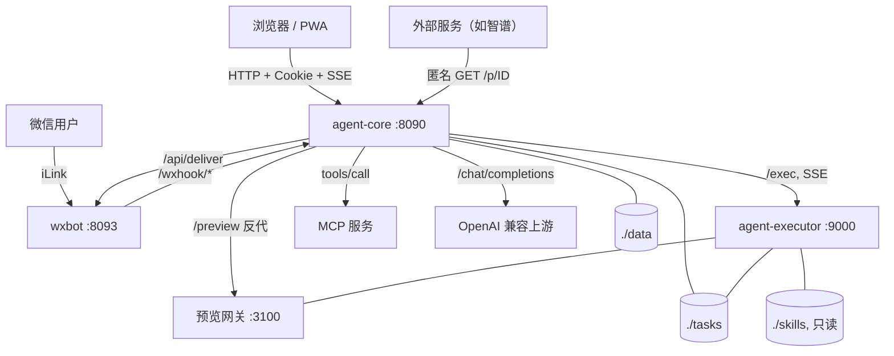
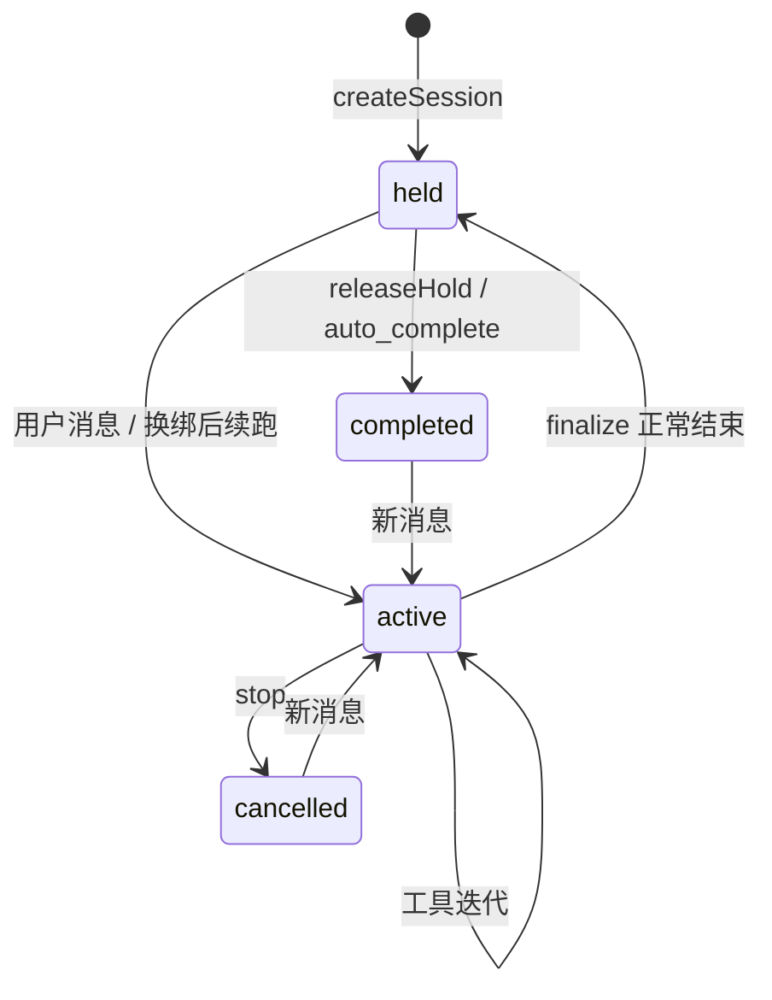
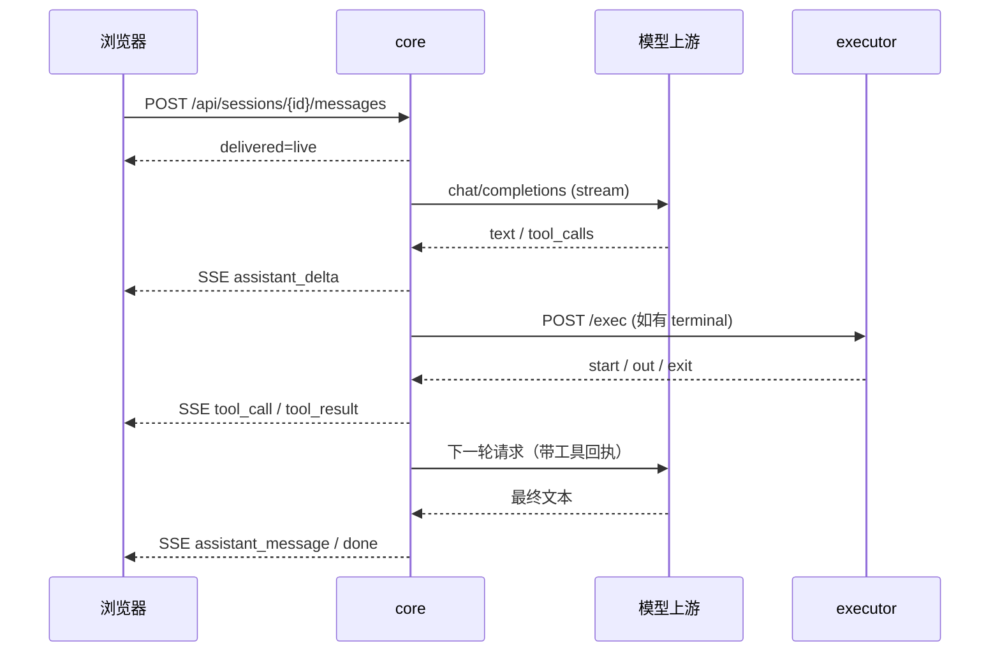

# Agent 内部架构说明

> 面向修改本仓库的开发者。对外能力与部署请看 [`../README.md`](../README.md)。
>
> 本文只记录**代码实际行为**与修改时必须遵守的约束。设计动机写在相关注释里，这里不再重复。

## 1. 运行时拓扑

系统由四个进程角色组成，core 是唯一的业务与状态权威。



| 角色 | 代码 | 持有 | 不持有 |
|---|---|---|---|
| core | `app/server/` | 配置密钥、SQLite、任务卷、模型调度、所有用户状态 | 无 |
| executor | `executor/server.js`、`executor/preview.js` | `EXECUTOR_TOKEN`、任务卷、只读技能卷 | 平台 API Key、登录密钥、SQLite |
| wxbot | `wxbot/app/src/server.js` | `WXBOT_TOKEN`、微信登录凭证 | 业务状态、配置密钥 |
| MCP | 外部进程 | 自身凭据 | core 状态；只通过 HTTP 交互 |

信任边界：

- 浏览器只与 core 通信；executor、wxbot、MCP 不暴露宿主机端口。
- `GET /p/<id>` 是唯一匿名业务端点，安全性完全依赖 22 字符随机 ID 与服务端过期表。
- executor 只拿到共享服务 token，即使被攻破也拿不到模型 Key 或登录密钥。
- MCP 服务是外部依赖，配置里的 `headers` 会随 `tools/call` 发送，按不可信服务对待。

---

## 2. 代码地图

```text
app/server/
├── server.js          装配配置、DB、总线、路由；启动 MCP 发现与监听
├── config.js          YAML 加载/校验/规范化/读写；环境变量接线
├── db.js              SQLite 建表与幂等迁移
├── engine.js          会话、模型池、Agent 主循环、上下文压缩、标题、日记收口
├── llm.js             消息组装、上游流式调用、图片块、历史裁剪
├── sse.js             按会话分组的 SSE 总线 + 进程内订阅
├── auth.js            Cookie/Basic 认证与管理员门禁
├── scheduler.js       cron 轮询、任务投递、完成通知
├── memory.js          长期记忆存储、注入渲染、关键词检索
├── user-profile.js    用户画像存储与快照冻结
├── mcp.js             Streamable HTTP MCP 客户端
├── remote-exec.js     executor 的 /exec 客户端
├── public-files.js    公网临时文件短 ID 表
├── download-token.js  浏览器下载链接签名
├── download-send.js   下载响应头
├── log.js             分级日志
├── version.js         版本与 git 提交号
├── tools/
│   ├── definitions.json  内置工具 schema（14 项）
│   ├── executor.js       工具实现与派发
│   └── skills.js         技能发现、校验、执行
├── routes/                HTTP API（见 §5.15）
├── templates/             system prompt / 压缩 / 标题 prompt
└── public/                H5 前端（无构建，经典脚本按序加载）

executor/                独立的命令执行与 Office 预览服务
wxbot/app/src/server.js  微信 iLink 调制解调器
skills/                  技能目录；deps/ 为共享 Python 依赖
```

仓库根 `docker-compose.yml` 把 `./app/server` 直接挂进 core 容器。改后端代码只需重启 core，不需要重建镜像；改依赖或 Node 版本才需要重建。

---

## 3. 启动顺序

`server.js` 的顺序有依赖，不要随意调整：

1. `loadConfig`：读 `AGENT_CONFIG`，应用 `DEFAULTS`，规范化平台、profile、MCP、公网前缀，并从 env 注入 `executor` / `wxbot` 接线。
2. `log.setLevel`、`llm.setPayloadTrim`。
3. `initDb`：建表、迁移、清理孤儿日记碎片。
4. `createBus`。
5. `engine.setModelPool(cfg, db, bus)` + `engine.init()`：
   - 按配置重建 `model_pool`；
   - 把 `active` / 遗留 `queued` 会话归位为 `held`；
   - 启动空闲扫描定时器（`auto_complete_ms` / `wrap_idle_ms`）。
6. `scheduler.start(engine, notify)`：必须在 `engine.init()` 之后，否则首轮 tick 会看到旧状态。
7. `memory.prune`：按 `retain_days` 兜底裁剪。
8. `wechat.init`：注册总线内部监听。
9. Express 装配，顺序固定：
   - `/wxhook` 专用 JSON 解析器与回调路由，必须早于全局 `express.json`，因为媒体 base64 超过 2 MB；
   - 全局 `express.json({limit:'2mb'})`；
   - `auth.router`（登录等免认证端点）；
   - `/p` 公网文件路由，必须早于 `auth.middleware`；
   - `auth.middleware`；
   - `preview-proxy.earlyGuard`，必须早于静态首页，处理预览页对 `/` 的请求；
   - 静态资源；
   - 业务路由；
   - `data-page`；
   - `preview-proxy.mount`，必须最后，避免兜底吞掉现有路径。
10. `mcp.init`：发现所有 MCP 工具；单个服务失败只告警。
11. 生成技能清单快照并写入 system prompt。
12. `server.listen`。
13. `wechat.restore()` 与 `dumpPromptBundle()` 在监听后 fire-and-forget，失败不阻塞启动。

退出：`SIGTERM` / `SIGINT` 先 `bus.closeAllSessions()`，再 `server.close()`，3 秒后强制退出。

---

## 4. 数据模型

### 4.1 SQLite

数据库默认 `data_root/.agent.db`，WAL 模式，`foreign_keys=ON`。使用 `better-sqlite3` 同步 API。

| 表 | 作用 | 关键字段 / 约束 |
|---|---|---|
| `sessions` | 会话 | `id`（`task-YYYYMMDD-NNN`）、`status`、`model_id`、`model_slot`、`last_model_id`、`user`、`profile_snapshot`、`title_locked`、`journaled_at` |
| `messages` | 对话 | `role`、`content`、`reasoning`、`tool_calls`、`tool_call_id`、`type`、`is_error`、`usage` |
| `files` | 上传/生成文件元数据 | 只记 `filename` / `size` / 时间；真实文件在任务目录 |
| `model_pool` | 模型 key 槽位 | 主键 `平台名#key下标`；只有 `last_used_at` 仍被调度使用 |
| `model_usage` | 每回合 token 用量 | 不建会话外键，删会话后统计保留 |
| `scheduled_tasks` | 定时任务 | 主键 `session_id`，天然「一会话一任务」；`ON DELETE CASCADE` |
| `channel_sessions` | 文本通道当前会话 | 主键 `(user, channel)`；不建外键，懒自愈 |
| `memory_fragments` | 长期记忆碎片 | 主键 `(user, session_id)`，每会话一片；`day` 是事件日 |
| `wechat_bindings` | 微信绑定 | `id` 同时是 channel 后缀与 wxbot 凭证目录名 |
| `user_profiles` | 用户画像 | `user` 主键；`data` 为封闭 JSON |
| `meta` | 持久计数器 | 如 `task_seq:YYYYMMDD` |
| `wait_queue` | 旧版排队表 | 已废弃，代码不读写 |

迁移策略：`CREATE TABLE IF NOT EXISTS` + `PRAGMA table_info` 后按需 `ALTER TABLE`。新增列必须写成幂等迁移，不能假设新库。

### 4.2 文件布局

```text
<workspace_root>/<session-id>/        会话工作目录
├── .tmp/                             会话级 /tmp，跨 terminal 调用保留
├── .imgcache/                        read_file 图片压缩产物
├── .app/                             data-page 技能页面，按 /app/<sid>/ 暴露
├── data.db                           db 工具与 /api/db/<sid>/query
└── ...                               用户上传与 AI 生成文件
<data_root>/.agent.db                 SQLite
<data_root>/prompt.txt                启动时实际下发的 prompt/tools dump
<skills_root>/<skill>/               技能；deps/ 为共享依赖
```

### 4.3 会话状态



- 新建会话立即是 `held`，第一条消息转 `active`。
- `held` 不占任何资源，只是「还能追问」的视觉状态。
- 任何非 `looping` 状态收到消息都会立即开跑，不再有排队。
- 旧库可能有 `queued`，列表按活跃组展示，运行期不再产生。

### 4.4 消息类型

`messages.type` 是消息语义的唯一标记，改动时必须同时检查 `llm.buildMessages`、标题、日记、前端渲染。

| type | role | 语义 | 是否发给模型 |
|---|---|---|---|
| `NULL` | user/assistant/tool | 正常对话 | 是 |
| `archived` | 任意 | 已被压缩摘要替代的旧历史 | 否 |
| `summary` | assistant | 压缩摘要，后续上下文起点 | 是 |
| `errAck` | assistant | 工具参数非法的一轮 | 否，整轮替换为纠错提示 |
| `channel_note` | user | 微信环境说明 | 是 |
| `memory_note` | user | 开场日记注入 | 是 |
| `scheduler_note` | user | 定时任务删除等系统通知 | 是 |
| `wx_media` | user | 微信单发媒体留痕，不唤醒 AI | 是 |
| `summarize_request` | user | 旧版压缩指令 | 仅兼容旧库残留 |
| `task_brief` | user | 已废弃的任务书快照 | 是（仅历史兼容） |

---

## 5. 核心模块

### 5.1 `engine.js`

职责：会话生命周期、模型池调度、Agent 主循环、工具执行编排、压缩、标题、日记收口。

**模型池**

- `cfg.models` 是 `platforms[].keys[] × models[]` 的打平视图。`id = 平台名/模型id`，`mid` 是发给上游的原始模型名，`key_index` 只用于定位物理 key。
- `model_pool` 一行一个 `平台名#key下标`。key 是共享资源，不做独占。
- `chooseKey(preferPlatform, strict)` 排序：
  1. 该槽位正在 `looping` 的会话数；
  2. 绑在该槽位上的 `active/held` 会话数；
  3. `last_used_at` 最久未用；
  4. 槽位 id。
- `strict=true` 时只允许指定平台，找不到返回 `null`。
- `createSession` 优先使用用户锁定模型，其次前端预选模型；不可用时退回全局调度。池为空直接抛 503。
- `applyBinding` 写 `model_id`、`model_slot`、`last_model_id` 并刷新 `last_used_at`。
- `ensureBinding` 在发消息前校验绑定；配置改动导致模型失效时自动改选，优先留在原平台。
- `model_pool.is_busy` / `current_session_id` 是旧独占模型残留列，运行期不读写。

**模型 profile**

`resolveProfileName(session)` 只取 `cfg.models[].profile`。会话级 profile 切换已移除；`sessions.profile` 列不再使用。

**工具集**

`effectiveTools(profileName)` 的过滤顺序：

1. 内置定义 + MCP 工具；
2. 若 profile 配了 `tools_allow`，先按白名单过滤；未配 = 全量；`[]` = 零工具；
3. 再按 `tools_deny` 过滤；profile 未配时继承全局 `tools_deny`，`deny` 优先。

默认全局 `tools_deny: [lab]`；`lab` profile 必须显式写 `tools_deny: []`，否则 `lab` 自己也会被屏蔽。名单只影响模型「看得到什么」，名单外但真实存在的工具被调用时仍会执行。

**主循环**

`postUserMessage`：

1. 落一条 user 消息。
2. 记录 `run.deepThink`。
3. 若会话正在 `looping`，返回 `delivered:'live'`，下一轮迭代会从 DB 重新加载历史。
4. 否则 `ensureBinding` → 置 `active` → `runLoop`。

`runLoopInner` 每轮：

1. 从 DB 重新读会话与历史，记录 `lastIncludedId`。
2. 组装 messages（压缩回合走 `compressMessages`）。
3. 工具集 = 内置 + MCP，经 profile allow/deny 过滤；压缩回合为空。
4. `streamAssistant` 调用模型，流式转发 SSE。
5. 失败重试：无 `upstream_status`、429、5xx 才重试，最多 `agent.max_retries` 次。
6. 参数容错：
   - `unwrapToolArgs` 剥掉 `{"arguments":{...}}` / `{"function":{...}}` 等外层；
   - `schedule` 缺 `op` 且具 create 形状时补 `op=create`；
   - `checkToolArgs` 校验 JSON 与必填；失败则整条 assistant 标 `errAck`。
7. 保存 assistant 消息，写 `model_usage`，更新回合 In token 峰值。
8. 无工具调用：若期间有新 user 消息则继续，否则结束回合。
9. 有工具调用：逐个执行 `executeTool`，落 `tool` 消息，广播 `tool_call` / `tool_result`。
10. 达到 `max_tool_iterations` 时写入停止提示。

**流式事件**

`streamAssistant` 通过 `bus.emit` 发出：

`assistant_delta`、`reasoning_delta`、`tool_call_start`、`tool_call_args`、`assistant_message`。

工具执行阶段发出 `tool_call`、`tool_result`。会话状态变化发出 `status`、`done`、`title`、`auto_compress`、`error`。MCP 卡片走 `ui_card`。

**图片回传**

`read_file` 读图且会话模型 `vision:true` 时返回 `{text, image_rel}`。engine 把 `image_rel` 编成 `image_ref` 块存 DB；`llm.buildMessages` 在每次请求前重新签发公网链，避免回合内过期。同一回合同一张图只投递一次。

**收尾与标题**

`finalize`：

- 用户终止 → `cancelled`；
- 正常结束 → `held`，广播 `done`。

`maybeGenerateTitle` 在收尾时触发：

- 本轮真实执行过工具，或非注入 user 正文 ≥3 条且总字数 ≥30；
- 用当前模型发一次**无 system、无 tools** 的请求；
- 结果清洗后写 `sessions.title` 并广播 `title`；
- 已有标题不覆盖；失败静默，下回合重试。

空闲扫描收口前 `wrapTitleFallback` 会无条件补题一次。

**上下文压缩**

- 手动：`POST /:id/summarize` → `run.summarizing=true` → 开一个正常回合。
- 该回合 `compressMessages`：正常 system + 正常历史 + 末尾 `prompt-compress.txt`，不传 tools。
- 收尾答复落库后标 `type='summary'`；它之前的消息标 `type='archived'`。
- 后续请求从摘要开始，`archived` 行只留在 UI。
- `run.summarizing` 只在内存，重启丢失；压缩中禁止再次压缩或清空。
- 自动提议：回合结束后若 `run.turnMaxPt >= agent.auto_compress_tokens`，延迟 1.5 秒发 `auto_compress` 事件；每会话最多一次，且只有存在 SSE 客户端时计数。

**空闲扫描**

`startHeldSweeper` 的间隔取两个阈值较小者的 1/4，夹在 1 秒到 60 秒：

- `sweepAutoComplete`：`held` 超过 `agent.auto_complete_ms` → `completed`。
- `sweepJournalWrap`：未收口且 `updated_at` 超过 `memory.wrap_idle_ms` 的 `held/completed` 会话 → `journalFragment`；成功后归档 `held`、删除 `channel_sessions` 绑定。每批最多 5 个，避免重启后集中烧模型。

**日记与定时收口**

- `journalFragment` 用候选模型链：原绑模型 → 同平台其它 → 配置顺序其它，最多 3 个。
- 转录只保留正常 user/assistant 文本；跳过 `archived`、`channel_note`、`scheduler_note`、`memory_note`。
- 成功或降级都写 `memory_fragments`，并写 `sessions.journaled_at` 防止重复摘要。
- `taskClockOut`：本回合通过 `schedule` 工具创建任务后，`run.taskWrap=true`；`finalize` 广播 `done` 后调用。用任务 `brief` 生成模板化碎片（不调 LLM），归档 `held`，删除通道绑定。

**删除与清空**

- `deleteSession`：停止回合 → 删消息/文件元数据/会话 → 删日记碎片 → 清 SSE 客户端；可选删任务目录。
- `clearSessionMessages`：删全部消息、清 `.tmp`、清标题与 `journaled_at`、重新冻结画像快照；保留会话、模型绑定和任务目录。
- 若该会话仍是定时任务「专柜」，清空时不删日记碎片，也不清 `journaled_at`。
- `deleteMessage`：删 assistant 时连带删其 tool 回执；删 tool 回执时同步从父 assistant 的 `tool_calls` 摘除，保持调用与回执成对。

### 5.2 `llm.js`

**System prompt**

- 默认模板 `templates/profile-default.txt`，进程启动读一次。
- `{APP_SKILLS_SECTION}` 由技能清单替换；自定义 profile prompt 没有占位符就不注入技能段。
- 末尾追加 `## Reply Language`。
- 结果按 `(profile, language)` 缓存。技能清单变化时清缓存。
- 目标是**进程内字节恒定**，保护上游前缀缓存。

**消息组装**

`buildMessages` 顺序：

1. `system`；
2. `profile_snapshot`（会话创建/清空时冻结的画像）；
3. 历史消息。

历史处理规则：

- `archived` 跳过；
- `errAck` 整轮跳过，替换为一条纠错 user 消息，并回显模型上轮提交的参数形状；
- `tool` 回执按 `tool_call_id` 与 assistant 配对；
- 图片用 `{"__blocks__":[...]}` 哨兵 JSON 存储；发送时还原为 `text` + `image_url`；
- 未被消费的图片不放在 `tool` 消息里（非标准、上游支持差），而是收集到该批回执之后的一条 user 消息，先列逐图说明，再按顺序附图；
- 已消费的图片替换为文字标记；
- 历史裁剪：`write_file` 参数正文、`fetch` / `read_file` 回执，距尾超过配置轮数且正文超过 600 字时换成单行占位；DB 与 UI 不变。

**上游调用**

`callModel` 请求 `POST <url>/chat/completions`：

- `body.model` 用 `mid`；
- 合并 `extra_params`；
- `deepThink` 为真时合并 `thinking_params`，可覆盖 `extra_params`；
- `reasoning_ack_field` 非空时，把历史中的 `__reasoning` 按该字段名写回 assistant 行，然后删除内部键；
- 解析 SSE，累积 content、reasoning、tool_calls 分片；
- 兼容 `reasoning` / `reasoning_content` 两种思维链字段；
- 支持 abort 与取消检查。

标题回合 `titleMessages`：无 system、无 tools，历史只保留 `NULL` / `summary` / `task_brief`，末尾追加 `prompt-title.txt`。

压缩回合 `compressMessages`：`buildMessages` 原样 + 末尾 `prompt-compress.txt`，必须与上一轮常规请求字节同构，只追加尾部指令，否则前缀缓存失效。

### 5.3 `tools/executor.js`

**路径沙箱**

`resolveInTask(taskDir, p)`：

- 相对路径解析到当前会话目录；
- 绝对路径必须落在会话目录内；
- `/tmp` 重写为 `<taskDir>/.tmp`，与 executor 容器内 `/tmp` 的 bind 对齐；
- 越界抛错。

`@<session-id>/<rel>` 由 `resolvePastPath` 解析：

- 会话必须存在；
- 必须与当前会话同一 `user`；
- 只允许 `list_directory`、`read_file`、`copy_path` 的源路径；
- `write_file`、`edit_file`、`copy_path` 目标一律拒绝 `@`。

**内置工具**

| 工具 | 实现要点 |
|---|---|
| `read_file` | 文本行号前缀；>16 KB 返回大纲；>32 MB 拒绝；图片经 `sharp` 压缩到 `.imgcache`，仅 vision 模型回传像素 |
| `write_file` | 自动建父目录；`content` 缺失或为 `null` 拒绝，避免误清空 |
| `edit_file` | 精确匹配优先，失败走忽略空白的模糊匹配；多处命中报错；保留缩进重排 |
| `list_directory` | 单层、最多 200 项；隐藏项不列；支持 `@` |
| `copy_path` | 文件或目录递归；符号链接拒绝；200 文件 / 200 MB 上限；目标不可覆盖 |
| `terminal` | 有 `EXECUTOR_URL` 走远端；否则本地 `spawn`。超时与用户终止都杀进程组；输出按 `head_lines` / `tail_lines` 选段 |
| `fetch` | HTML → Markdown；流式读取限 `max_bytes`；返回限 `max_chars`；`offset` 续读使用回合缓存；私网地址拒绝，重定向逐跳复查 |
| `mint_public_link` | 校验文件存在、在会话目录内、`realpath` 未越界；TTL 夹在 1 分钟到 24 小时 |
| `db` | 会话目录 `data.db`；每次调用开→用→关；`exec` / `query` / `insert` / `tables` / `schema`；查询上限 500 行 / 100 KB |
| `schedule` | 委托 `scheduler.js`；`op=create` 只作用于当前会话，并标记 `run.taskWrap` |
| `skill` | `list` / `get` / `run`；`visit_url` 在成功后补公网访问地址 |
| `profile` | 委托 `user-profile.js`；写操作只影响下个会话的快照 |
| `recall` | 委托 `memory.js`；`search` / `days` / `day`，只读当前用户 |
| `lab` | 元工具：`lab(tool, args)` 转发任意内置或 MCP 工具；`help` 是伪工具；禁止嵌套 `lab` |

**派发**

`executeTool` 先查 `HANDLERS`，未命中再查 `mcp.hasTool`。工具返回字符串；`read_file` 读图可返回 `{text, image_rel}`。未知工具返回 `Error: 未知工具 <name>`。

### 5.4 `tools/skills.js`

- 技能根目录：`cfg.skills_root`，缺省为 `workspace_root/../skills`。
- 技能名必须是单层目录，拒绝 `/`、`..`、`.` 开头、`deps`。
- `SKILL.md` 解析 YAML front matter：`description`、`input_schema`、`required`、`visit_url`。
- `run` 前把相对路径参数按会话目录转绝对路径。
- 入口优先 `run.py`（`python3`），其次 `run.sh`（`bash`），唯一参数是 JSON 字符串。
- 有 executor 时命令交给远端，cwd 为会话目录；否则本地执行，cwd 为技能目录。
- 超时默认 120 秒，杀整个进程组；用户终止同样杀组。
- 技能目录在 executor 中只读，不允许运行期写回。

### 5.5 `mcp.js`

- 传输：Streamable HTTP，JSON-RPC over POST；响应可能是普通 JSON，也可能是 SSE 帧。
- 启动时逐服务 `initialize` → `notifications/initialized` → `tools/list`。
- 服务返回 `Mcp-Session-Id` 时缓存；非 initialize 请求带 `Mcp-Session-Id`。400 且错误含 session 时重新握手并重试一次。
- 每个服务可配 `tools_allow` / `tools_deny`，在重命名之前按原始工具名过滤。
- 与内置工具或已存在 MCP 工具重名时，发送名加 `服务名__` 前缀。
- `tools/call` 时下发：
  - `X-Session-Dir`：会话任务目录；
  - `X-Public-Base`：公网前缀。
- 返回内容中的 `ui_card` 块不进入模型文本，转成 `ctx.onCard` → SSE `ui_card`。
- 运行期不重新发现工具；改 MCP 配置需重启 core。

### 5.6 `remote-exec.js`

- `POST /exec` 返回 SSE：`start` / `out` / `err` / `exit`；每 15 秒 `: ping`。
- `run` 合并 stdout/stderr 为单个字符串，保留到达顺序。
- 本地取消与超时通过 `DELETE /exec/:id` 杀远端进程组；本地看门狗在 `timeout_ms + 15s` 后兜底。
- 句柄注册到 `run.procs`，`remoteKill` 供 `engine.stop` / 清空 / 删除时调用。
- `killPreviewSession` 尽力清理 executor 侧的预览槽，失败只静默。

### 5.7 `agent-executor`

`executor/server.js` 是零依赖单文件 HTTP 服务。

隔离模型：

1. 宿主机 `./tasks` 挂到 `EXECUTOR_ISOLATION_BASE`（默认 `/mnt/host-tasks`），该路径不在 `EXECUTOR_ROOTS` 内。
2. 每条命令在 `unshare --mount --pid --ipc --fork --propagation private` 中执行；有 Office 预览牢笼时先 `nsenter` 进同一 PID namespace。
3. 先把当前会话目录 bind 到私有 tmpfs 的 anchor，再用空只读 tmpfs 遮盖 `/mnt`，最后把 anchor bind 回 `/workspace/tasks/<session>`。
4. 会话 `.tmp` bind 到容器 `/tmp`，实现同一会话跨命令保留临时文件。
5. 根文件系统只读；`/dev/shm`、`/var/tmp`、`/run` 每次私有化；executor 自身代码目录用 tmpfs 遮盖。
6. 启动自检验证 `ISOLATION_BASE` 是挂载点、`DEFAULT_CWD` 是空目录、`unshare` 可用、`/mnt` 遮盖不会封死工作区。
7. cwd 必须落在 `EXECUTOR_ROOTS`，不得是任务根本身，不得含 `..`、空段、符号链接或指向基路径。
8. 拒绝来自容器自身网卡 / 回环的 `/exec`：隔离没有独立 net namespace，否则 token 泄漏后可借 `/exec` 绕过隔离。
9. 资源限制在 compose：2 CPU、2 GB 内存、512 PID、单文件 2 GB；`cap_drop: ALL` + `SYS_ADMIN`；`no-new-privileges`；`apparmor=unconfined`。

预览网关 `executor/preview.js`：

- 监听 3100，只走内网。
- 每个 `.docx/.xlsx/.pptx` 一个 `officecli watch` 槽位，闲置回收，访问时冷启动。
- core 的 `/preview/**` 反代是唯一公网入口。
- 详细链路见 [`OFFICE.md`](OFFICE.md)。

`executor/init-skills.js`：一次性把技能的 `requirements.txt` 装进 `skills/deps`，把 `install.sh` 的资产落到技能卷。系统层依赖仍由镜像的 `skills` 构建阶段烘入。

### 5.8 `scheduler.js`

- 表 `scheduled_tasks`，主键 `session_id`，每会话最多一条。
- 轮询周期 30 秒；cron 时区 `Asia/Shanghai`。
- `validateCron` 要求 cron 可解析且相邻两次间隔 ≥1 小时。
- 触发前先把该会话全部消息标 `archived`，再 `postUserMessage` 投递提示词；顺序不可反，否则回合会带旧上下文开跑。
- 若会话仍 `active`，本次标记 `skipped`，不投递。
- `running` 状态没有回合结束回调，靠下一轮 tick 看到会话非 `active` 推断为 `ok`。
- 完成/失败通过 `fireNotify` 交给 `wechat.notifyTask`；通知正文取触发后最后一条纯文本 assistant 消息，附件取触发后新增文件。
- `schedule` 工具的 `list` 可跨会话查看当前用户全部任务；`create` 只作用于当前会话。
- 通过 Web 弹窗手动创建的任务直接调用 `scheduler.createTask`，不经过 `run.taskWrap`，因此不会触发 `taskClockOut`；只有 AI 工具路径会在回合收尾时把当前会话收口为任务专柜。

### 5.9 `memory.js`

- `memory_fragments(user, session_id PK, day, text, created_at)`。
- `day` 是来源会话最后活跃日，不是补记日。
- `appendFragment` 用 `INSERT OR IGNORE`，`(user, session_id)` 主键天然去重。
- `journalFor` 取最近 `inject_max` 片，按 `day DESC, created_at DESC`；渲染为 `## id=<sid>, day=<day>` + 正文。
- `injectedIds` 与 `journalFor` 共用同一选取顺序，供调试页标「已注入」。
- `searchFragments` 在内存里做关键词打分：空白/标点分词，CJK 长词用二元字组过半模糊命中。
- `retain_days=0` 永久保留；正数按 `day` 硬删。
- `dropFragment` 在删会话或清空会话时调用。
- `journalFragment` 的摘要生成在 `engine.js`，`memory.js` 只做存储与读取。

### 5.10 `user-profile.js`

- 三个字段：`honorific`、`industry`、`preference`。
- `preference` 是顿号分隔的标签列表；工具只做增量 add/remove，不整段覆写。
- 会话创建或清空时 `freezeSnapshot` 把渲染文本写入 `sessions.profile_snapshot`。
- `buildMessages` 每轮把它作为 system 后首条 user 注入；字节恒定，且不在 `messages` 表里，压缩和归档都碰不到。
- 写操作只影响下个会话；停用 `enabled=0` 时拒写不拒读。
- 与 `model_profiles` 是两回事：后者是 prompt + 工具组合。

### 5.11 `auth.js`

- `auth.users` 为空 → 认证整体关闭。
- 登录成功签发 `payload.signature` 的 HMAC token，写入 `agent_token` Cookie：`HttpOnly`、`SameSite=Lax`、可配 TTL。
- 身份解析 cookie 优先，`Authorization: Basic` 兜底。
- `/api/login_restore` 用 Bearer 验签恢复 Cookie，服务 WebView 冷启动。
- 管理员接口：`/api/config`、`/api/users`、`/api/system/restart`。
- 未认证访问 API 返回 401，页面 302 到 `/login?next=...`。
- 注意：认证是**外围门禁**，不是资源级 ACL；除管理员接口外，业务路由只检查「已登录」。

### 5.12 `sse.js`

- `clients: session_id -> Set<res>`。
- `emit` 先跑内部订阅者，再写 HTTP 客户端；没有客户端时静默丢弃。
- `onInternal` 供 `wechat.js` 监听回合事件，不受「无观看者」影响。
- `closeAllSessions` 用于进程退出，先掐断长连接，`server.close` 才能返回。

### 5.13 `channel.js` + `wechat.js` + `wxbot`

**文本命令层**

- `channel_sessions(user, channel)` 记录每个接入端的当前会话。
- 命令只在 `POST /api/channel/send` 与微信 `handleSend` 中解析；Web 聊天里以 `/` 开头的内容照常发给模型。
- 命令表：`/new`、`/list`、`/switch`、`/rename`、`/delete`、`/models`、`/think`、`/stop`、`/compact`、`/clear`、`/status`、`/help`。
- 首词是 `/纯 ASCII` 但不在命令表 → 回「未知命令」，不转发模型；其他 `/xxx` 按普通消息处理。
- 命令动作本身不落消息行；`/new` 的尾随文本与普通消息照常入库。
- 数据面全部复用 `engine`，不维护第二套会话逻辑。

**微信桥**

- `wechat_bindings` 是 core 用户 ↔ wxbot 实例的唯一权威。
- wxbot → core：`POST /wxhook/inbox`（消息）与 `/wxhook/hook`（状态）。挂在全局 JSON 解析与认证之前，凭 Bearer `WXBOT_TOKEN` 把门，媒体解析上限 32 MB。
- core → wxbot：`/api/instances*` 控制实例与扫码，`/api/deliver` 推文本，`/api/deliver_media` 推附件，`/api/typing` 推「正在输入」。
- 入站普通消息 → `channel.handleSend`；无当前会话则自动新建并绑定。
- 媒体先落会话目录、写 `files` 表，再拼「用户上传了文件：<名>」作为正文；单发媒体写 `wx_media` 留痕，不唤醒 AI。
- 新微信会话注入两类消息：
  - `channel_note`：微信环境说明；
  - `memory_note`：最近 `inject_max` 条日记。
- 出站由总线内部监听驱动，按绑定串行投递，`last_msg_id` 游标防重复。
- 回复预算：iLink 每个 context token 约 10 条。过程消息最多直发 1 条，其余省略并在结论前注记；结论放不下时截头部 + 全文落 `.md` 文件卡片；预算不足则放弃并告警，网页端仍完整可见。
- 正文里的 `/p/<22位>` 链接会转成本地文件卡片，限 5 个、单文件 20 MB，按同用户校验。
- `/think on|off` 写 `wechat_bindings.deep_think`，投递消息时作为 `deepThink` 参数。
- 定时任务通知：优先发创建时记录的 `notify_channel`；没有则发给该用户全部在线绑定；若任务会话仍是该绑定的当前会话且状态为 `ok`，跳过重复通知。

**wxbot**

- iLink SDK 多实例；每个绑定一个实例、一个凭证目录 `bot.storage_dir/<binding_id>/`。
- 不保存业务状态；启动扫描凭证目录拉起实例，状态回报失败不影响上线，首条消息会纠偏。
- 除 `/health` 外全部要求 Bearer `WXBOT_TOKEN`。
- `WXBOT_STRIP_MARKDOWN=1` 时出口剥 Markdown；默认透传（微信已支持渲染）。
- 语音由 iLink 侧转写成文本，按普通文本转发。

### 5.14 `config.js`

- `DEFAULTS` 是运行时默认值；`config.yml` 与之深合并。
- `platforms` 兼容旧版扁平 `models[]`，自动迁移为平台层级。
- 平台内部唯一键：`平台名/模型id`；跨平台允许同名。
- `type` 决定余额查询适配器，缺省取平台名；未知类型查询返回 400，不静默回退。
- `model_profiles` 在加载时把 `system_prompt_file` 读入内存；相对路径基于 `server/templates/`。
- `executor` 与 `wxbot` 不是 YAML 字段，只从 env 读取。
- `public_link.base_url` 优先取 `VIRTUAL_HOST`（`https://<第一个域名>`），其次 YAML；TTL 夹在 1 分钟到 24 小时。
- 设置页写配置：先 `parseAndValidate`，再整份写回；不做临时文件 + rename，因为容器里 `config.yml` 是单文件 bind mount，rename 会 `EBUSY`。
- 读取原文时对 `api_key`、`password`、MCP `headers` 值脱敏；提交时按掩码还原。
- 配置是冷加载：写盘后必须重启 core。

### 5.15 路由与前端

**路由挂载**

| 前缀 | 文件 | 说明 |
|---|---|---|
| `/wxhook` | `routes/wechat.js` | wxbot 内网回调，Bearer 服务 token |
| `/p` | `routes/public-files.js` | 匿名取用公网临时文件 |
| `/api/sessions` | `sessions.js` / `messages.js` / `files.js` | 会话、消息、SSE、上传下载 |
| `/api/skills` | `skills.js` | 技能与技能文件管理 |
| `/api/config` | `config.js` | 配置读写，管理员 |
| `/api/platforms` | `platforms.js` | 余额查询 |
| `/api/system` | `system.js` | 状态与重启；重启仅管理员 |
| `/api/users` | `users.js` | 用户管理，管理员 |
| `/api/profile` | `profile.js` | 当前用户画像 |
| `/api/memory` | `memory.js` | 日记只读调试 |
| `/api/wechat` | `wechat.js` | 绑定管理与二维码 |
| `/api/channel` | `channel.js` | 文本命令接入 |
| `/api/models` | `server.js` | 模型池状态与 token 用量 |
| `/api/health` | `server.js` | 健康检查，免认证 |
| `/app/<sid>/` | `data-page.js` | 任务 `.app/` 静态页 |
| `/api/db/<sid>/query` | `data-page.js` | 任务 `data.db` SQL API |
| `/preview/**` | `preview-proxy.js` | Office 预览反代，登录门禁 |

**前端**

- `index.html` + `js/core.js`、`chat.js`、`sessions.js`、`stream.js`、`files.js`、`settings.js`，按顺序加载，共享全局作用域。
- 无构建步骤；`settings.js` 必须最后加载，因为包含全局初始化。
- `login.html` 只依赖 `css/style.css`。
- `memory.html` 是日记调试页。
- 渲染消息时按 `type` 处理摘要、存档、工具卡、图片、token 用量。
- 历史消息懒加载：`GET /api/sessions/:id?limit=...&before=...`；工具结果单独按消息 id 拉取。

---

## 6. 关键流程

### 6.1 发消息到回复



1. 用户消息落库，`run` 记录 `deepThink`。
2. 会话非 `looping` 则置 `active` 并开跑；正在跑则只投递，下一轮迭代自动带上。
3. 每轮从 DB 重读历史，组装 messages 与 tools。
4. 模型流式输出；工具调用经参数校验、解包、执行、落库、广播。
5. 无工具调用则收尾；有新用户消息则继续。
6. `finalize` 进入 `held`，发 `done`，触发标题与自动压缩检查。

### 6.2 工具执行

- 内置工具在 core 进程内执行，文件类直接在任务目录操作。
- `terminal` 与 `skill` 在有 `EXECUTOR_URL` 时走远端。
- 未命中内置工具则查 MCP 注册表。
- 工具回执先落库再广播，前端工具卡可据此定位消息行。
- 执行抛错转 `Error: ...`，`is_error=1`，模型能看到失败原因。
- 用户终止时 `run.cancelled` 置位，本地杀进程组、远端发 DELETE、中止模型流。

### 6.3 压缩

1. 用户点「压缩」或确认自动提议。
2. `summarizeContext` 置 `run.summarizing`，开一个正常回合。
3. 该回合不传 tools，末尾追加压缩提示词。
4. 收尾答复标 `summary`，之前消息标 `archived`。
5. 前端把摘要卡片之前的消息淡出；后续请求从摘要开始。

### 6.4 定时任务

1. AI 调 `schedule op=create`，`scheduler.createTask` 校验 cron 与间隔。
2. `run.taskWrap=true`；当前回合 `finalize` 后 `taskClockOut`：写任务 brief 碎片、归档、解绑通道。
3. `scheduler.tick` 每 30 秒检查到期任务。
4. 先 `archiveHistory`，再 `postUserMessage`。
5. 下一轮 tick 看到会话非 `active`，标 `ok` 并通知。

### 6.5 微信

1. wxbot 收到消息，`POST /wxhook/inbox`。
2. core 校验绑定，必要时把媒体落盘。
3. `channel.ensureSession` 找到当前会话；没有则新建。
4. 新会话注入 `channel_note` 与 `memory_note`。
5. 普通消息走 `handleSend` → `engine.postUserMessage`。
6. 回合事件经 `sse.onInternal` 进入串行投递链，按预算推给 wxbot。
7. 用户下条消息到达时重置回合预算。

### 6.6 日记收口

1. `sweepJournalWrap` 找到静默超阈值的 `held/completed` 会话。
2. `journalFragment` 组装转录，依次尝试候选模型。
3. 清洗为 `- ` 行，写 `memory_fragments`，写 `journaled_at`。
4. 归档 `held`，删除 `channel_sessions` 绑定。
5. 微信下一条消息自动新建会话，并注入最近日记。

---

## 7. 修改时必须遵守的约束

1. **core 单实例**。`runs`、`titling`、`journaling`、SSE 客户端、`public-files` 表、下载签名密钥都在进程内存。多副本部署会破坏会话状态、SSE 和链接有效性。
2. **配置冷加载**。改 `config.yml` 后重启；运行期不要假设 `cfg` 会变。
3. **system prompt 在两次变更之间字节稳定**。默认模板、技能清单、语言后缀在进程内恒定；按 `profile + language` 缓存，技能清单变化时清缓存。任何每轮变化的内容不要塞进 system 开头，否则前缀缓存全断。
4. **压缩请求与常规请求同构**。压缩只能追加尾部指令，不能删画像快照、不能改中间历史。
5. **`archived` 与 UI 解耦**。UI 展示全部历史，模型只看未归档；不要让前端删除 `archived` 行。
6. **工具调用与回执成对**。删 assistant 必须连带删 tool 回执；删 tool 回执必须从父 assistant 的 `tool_calls` 摘除。
7. **`errAck` 整轮隔离**。参数错误的 assistant 行与关联 tool 行都不进模型上下文，用一条纠错 user 消息替代。
8. **路径沙箱**。所有文件工具必须经 `resolveInTask`；`@` 路径只能读、只能同用户。
9. **公网链接校验**。`mint` 前必须 `realpath` 确认文件仍在任务目录内；`/p` 端只按 ID 查表。
10. **executor 不含密钥**。不要把 `config.yml`、平台 Key、`AUTH_SECRET` 挂进 executor / wxbot。
11. **隔离层只允许 mount，不允许 umount `ISOLATION_BASE`**。容器根 mount table 是 shared，umount 可能传播回父 namespace，导致数据卷被摘。
12. **消息类型改动要全链路检查**。至少覆盖 `llm.buildMessages`、`titleMessages`、`journalTranscript`、前端 `chat.js`。
13. **定时任务一会话一条**。主键 `session_id` 是约束，不要改成多任务而不改 UI 与工具语义。
14. **日记与来源会话同生共死**。删会话删碎片；清空会话默认删碎片，任务专柜例外。
15. **登录不是资源 ACL**。新增业务路由默认对所有登录用户开放；若需要按用户隔离，必须在路由层显式校验 `session.user`。

---

## 8. 扩展点

### 8.1 新增内置工具

1. `tools/definitions.json` 加 OpenAI function 定义。
2. `tools/executor.js` 加 handler，并注册到 `HANDLERS`。
3. 需要出现在 `lab help` 的话，确保在 `definitions.json` 中。
4. 参数遵循 [`tool-design.md`](tool-design.md)：共享资源用 `op` 分派，条件必填写进 description。
5. 默认会被全局 `tools_deny` 过滤；如果希望默认可见，不要加进 `DEFAULTS.tools_deny`。

### 8.2 新增技能

- 在 `skills/<name>/` 放 `SKILL.md` 与入口。
- 需要 Python 依赖：`requirements.txt`，重新构建 `agent-executor` 或运行 `agent-executor-init`。
- 需要系统包：只能改 `executor/Dockerfile` 的 `base` 阶段并重建。
- 设置页创建/改文件后会触发技能清单刷新，不需要重启。

### 8.3 新增 MCP 服务

```yaml
mcp_servers:
  - name: my_service
    url: http://my_service:3000/mcp
    headers: { Authorization: "Bearer ..." }
    enable: true
    timeout_ms: 60000
    tools_allow: [tool_a, tool_b]
    tools_deny: [tool_c]
```

重启 core 生效。服务不可达只告警；重名工具自动加 `my_service__` 前缀。

### 8.4 新增模型或平台

- 平台加在 `platforms`，模型加在平台 `models`。
- 模型内部键自动是 `平台名/模型id`。
- 余额查询：在 `balance.js` 的 `ADAPTERS` 增加 `type` 对应实现。
- 新增 profile：在 `model_profiles` 加条目，模型用 `profile: <名>` 引用。

### 8.5 新增 HTTP 路由

- 在 `app/server/routes/` 新建 `express.Router`。
- 在 `server.js` 挂载，注意放在 `auth.middleware` 之后；需要免认证则显式放在之前。
- 错误统一用 `{error}` JSON；状态码优先取 `err.status_code`。
- 需要按用户隔离时自行校验 `req.user` 与会话 `user`。

### 8.6 新增 SSE 事件

- `bus.emit(sessionId, name, data)`。
- 前端 `stream.js` 增加监听。
- 微信投递只关心 `assistant_message` / `done` / `tool_call` / `tool_result` / `reasoning_delta` / `ui_card`；其他事件不会进微信。

### 8.7 新增预览服务

- 在 `preview-proxy.js` 的 `PREVIEW_PROXIES` 注册 `{name, prefix, host, port}`。
- 服务自行解析前缀后的路径与槽位。
- core 只做登录门禁、头白名单转发、Referer 兜底。
- 预览页硬编码的根绝对路径请求依赖 Referer 识别，设计时尽量避免。

### 8.8 前端改动

- 保持无构建、经典脚本按序加载。
- 新增模块要排在 `settings.js` 之前。
- 消息渲染统一走 `chat.js` 的 `msgNode` / `appendMessagesDom`，不要在别处复制一套。
- 新增设置项优先加到 `settings.js` 的 `CFG_FORM`，走统一配置编辑接口。

---

## 9. 测试与调试

```bash
cd app
npm test                  # mock 上游 + 真 server 的端到端测试
node test/remote-exec.test.js
node test/trim-smoke.js
node test/dep-check.js
cd ../executor && node smoke-test.js
```

- `npm test` 固定使用 8099（server）和 9999（mock 上游）；端口被占用会直接失败，先清理残留进程。
- 已知：`smoke.js` 仍保留旧 API 断言——排队已从运行期移除，`GET /api/sessions/:id` 也不再直接返回 `role=tool` 行（改为按需加载）。当前 `npm test` 会在 `[2] 工具调用` 与 `[5] 排队调度` 失败；改动相关路径时先同步测试。
- 测试使用的配置是 `app/test/config.test.yml`，数据隔离在 `app/test/tmp`。
- core 日志等级：`config.yml` 的 `log_level`；改完重启。
- executor / wxbot 日志等级：`EXECUTOR_LOG_LEVEL` / `WXBOT_LOG_LEVEL`，`debug` 打印完整交互。
- `data/prompt.txt` 是启动时实际下发的 system prompt 与各 profile 工具清单，用于核对「模型到底看到了什么」。
- `/api/system/status` 返回版本、运行时长、路径、模型池、容器负载、上传参数。
- `/memory.html` 查看日记碎片、实际注入文本、已收口会话。
- 调试 executor 隔离：先看启动自检日志；运行中连续 session miss 会打 error。

---

## 10. 已知边界与陷阱

- **认证边界**：会话、消息、文件 API 不做按用户授权；前端列表隔离不等于后端 ACL。
- **`keys[].concurrency` 已解析但未参与调度**。模型池按「最少 looping / 最少在用 / 最久未用」选 key，不读取该字段。
- **`model_pool.is_busy`、`current_session_id`、`wait_queue`、`sessions.profile`、`config.model_hold` 都是历史残留**，不要在新代码里使用。
- **`sessions.assistant_type` 只影响前端图标**，不改变模型、prompt 或工具集。
- **Web 会话不会自动注入长期记忆**。`memory_note` 只在微信新会话创建时写入；Web 会话可用 `recall` 主动查。
- **日记只在空闲收口或定时任务收口时生成**，不是每条消息实时写。
- **清空会话默认删日记碎片**；只有仍是定时任务专柜的会话保留碎片与 `journaled_at`。
- **自动压缩提议是进程内状态**：每会话最多一次，重启重置；没有 SSE 观看者时不计数。
- **`public-files` 与下载签名密钥都在内存**：重启后旧链接、旧下载 token 全部失效。
- **`config.yml` 写盘不是原子替换**：单文件 bind mount 下 rename 会 `EBUSY`，因此采用「先校验后整份写」。
- **executor 没有独立 net namespace**：所以必须靠「拒绝本机来源」防止借用；`EXECUTOR_ALLOW_LOCAL_ORIGIN=1` 只能用于本机测试。
- **executor 是命令沙箱，不是内核级安全边界**：它限制文件视图、能力、资源和可写层，但不防内核漏洞或 `SYS_ADMIN` 滥用。
- **预览与 data-page 的信任模型是「登录 ≈ 运维」**：登录用户可访问任意会话的预览页与 SQL API，与 §7 第 15 条一致。
- **定时任务 `ok` 是推断值**：回合异常结束但没有明确错误时，也可能被标成 `ok`。
- **微信回复配额是经验值**：`REPLY_QUOTA=10`，上游实际额度不可查；预算不足时结论可能未投递，网页端仍完整可见。
- **`VIRTUAL_HOST` 优先于 `public_link.base_url`**：仓库默认 compose 带 `VIRTUAL_HOST=agent.ai.foresh.com`，不接反向代理时会生成错误的公网链接。
- **`my-app-network` 是 external**：首次部署必须先创建，否则 compose 直接失败。
- **技能系统层依赖烘在镜像里**：运行期不能 `apt-get install`；新增系统包必须重建 executor 镜像。
- **`agent-executor-init` 只挂 `./skills`**：它看不到任务数据，也不应该看到。
