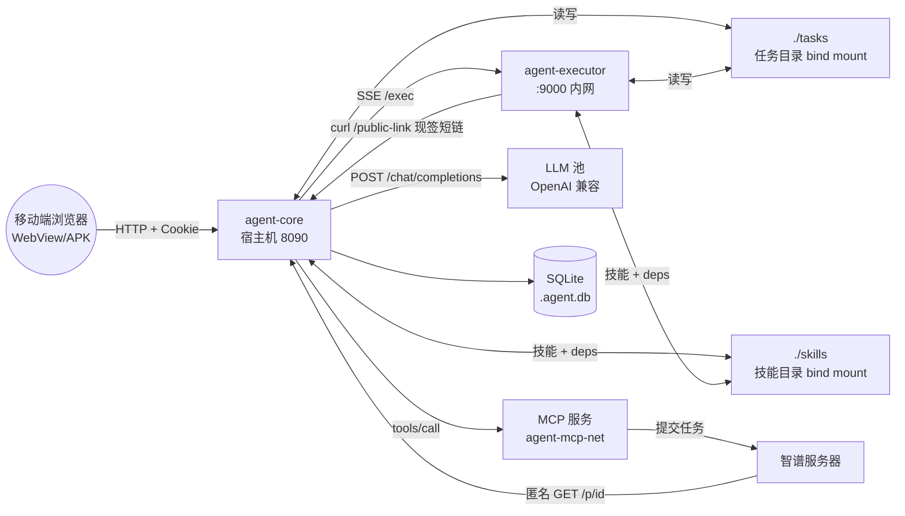
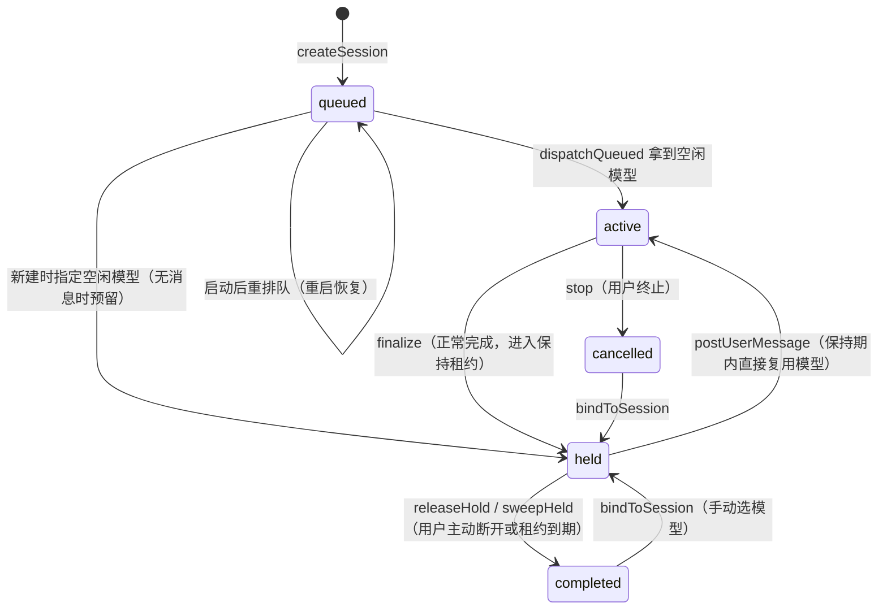
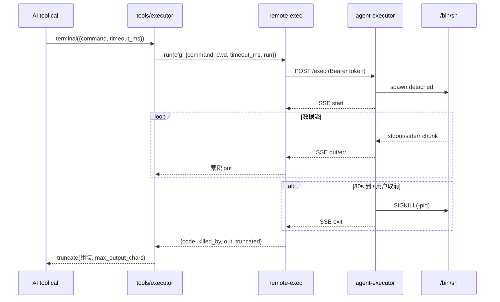
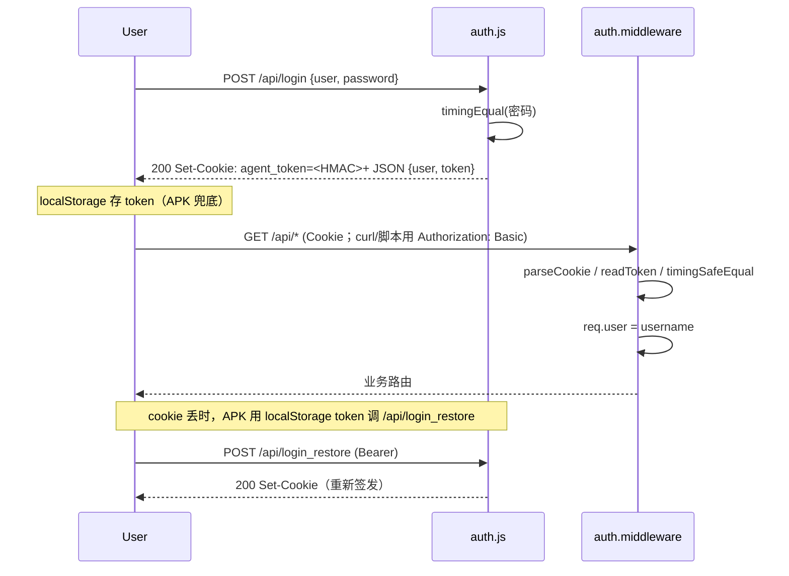

# Agent 项目架构说明

> 本文档是给 AI 助手的代码导览——基于仓库实际代码梳理，不是设计文档（设计层面的内容看 `README.md`）。
> 当需要修改代码时，先按目录结构定位 → 再按模块职责确认改动是否落在正确文件 → 改前先看相应"扩展点"和"约定"两节。

## 0. 项目一句话

自用通用 Agent 系统：**浏览器（移动端 H5 SPA）→ Core（Node 20 + Express + SQLite）→ LLM 池（OpenAI 兼容上游）**，配合可选的 **`agent-executor` 容器**执行 shell 命令与技能脚本。所有 AI 工具调用都在 Core 内统一分派：文件类工具走 Core 本地 fs，命令与技能走远端 Executor（隔离 Python/ffmpeg/libreoffice 等重工具链）。

---

## 1. 目录结构

```
agent/
├── README.md                      设计文档（API/数据模型/部署总览）
├── docker-compose.yml             编排：agent-core + agent-executor 两个服务
├── config.yml                     运行时配置（含密钥，已 .gitignore）
├── data/                          默认数据卷（任务目录、SQLite、prompt dump）
├── tasks/                         任务目录挂载点（同 ./data 顶层等价，二选一）
├── skills/                        技能目录（用户维护的 SKILL.md/run.py）
│
├── app/                           ── Core 服务容器 ──
│   ├── Dockerfile                 node:20-slim，npm install only prod
│   ├── package.json               依赖：express / better-sqlite3 / multer / sharp / yaml / minimatch
│   ├── config.example.yml         配置模板（被复制为顶层 config.yml）
│   ├── scripts/
│   │   └── init.sh                部署入口：生成 .env + config.yml → 起 agent/mcp 服务
│   ├── server/                    后端代码
│   │   ├── server.js              入口：装配 cfg / db / bus / engine / 路由
│   │   ├── config.js              YAML 配置加载、迁移、读写、校验、脱敏还原
│   │   ├── log.js                 分级日志（debug/info/warn/error/none）
│   │   ├── auth.js                多用户会话认证（HttpOnly cookie + HMAC token）
│   │   ├── db.js                  SQLite 初始化 + 表结构 + 增量迁移
│   │   ├── sse.js                 按会话分组的 SSE 事件总线
│   │   ├── engine.js              会话/模型池/Agent 主循环/任务目录（核心调度器）
│   │   ├── llm.js                 上游 OpenAI 兼容 /chat/completions 流式调用 + 消息组装
│   │   ├── mcp.js                 极简 MCP 客户端（Streamable HTTP，init→tools/list→tools/call）
│   │   ├── remote-exec.js         agent-executor 远端执行客户端（SSE 收流）
│   │   ├── balance.js             余额查询适配器（按 platform.type 分发）
│   │   ├── version.js             版本信息（package.json + git 短提交号）
│   │   ├── tools/
│   │   │   ├── definitions.json   内置 15 个工具的 OpenAI function 格式定义
│   │   │   ├── executor.js        工具执行器（文件类 + terminal + skill 委托）
│   │   │   └── skills.js          Skill Manager（list/info/run + 依赖安装 + 路径预处理）
│   │   ├── download-token.js      下载链接签名（浏览器原生下载用；密钥进程内随机）
│   │   ├── download-send.js       单文件下载响应（Content-Disposition / 缓存策略）
│   │   ├── public-files.js        公网临时文件短 ID 表（mint/resolve + 过期）
│   │   ├── routes/
│   │   │   ├── sessions.js        /api/sessions CRUD + 列表分页
│   │   │   ├── messages.js        /api/sessions/:id/messages + SSE 流 + stop/release
│   │   │   ├── files.js           /api/sessions/:id/files 上传/列表/下载/删除
│   │   │   ├── config.js          /api/config 读写（含 api_key/password 脱敏）
│   │   │   ├── platforms.js       /api/platforms/balance 余额查询
│   │   │   ├── skills.js          /api/skills 技能文件管理
│   │   │   ├── public-link.js     GET /public-link 签发公网短链（只挂内网端口）
│   │   │   ├── public-files.js    GET /p/<id> 公网临时文件取用（匿名）
│   │   │   └── system.js          /api/system/status + /restart 优雅重启
│   │   ├── templates/
│   │   │   └── system-prompt.txt  system prompt 静态模板（每次请求复用，利于上游前缀缓存）
│   │   └── public/                前端 H5 SPA（无构建，Vanilla JS + SSE）
│   │       ├── index.html         主页（任务 Tab + 设置 Tab + 技能 Tab）
│   │       ├── login.html         登录页
│   │       ├── v1.html            移动单聊视图（详见 docs/v2-develop.md）
│   │       ├── js/                core.js / tasks.js / models.js / settings.js / skills.js
│   │       ├── css/               style.css / v1.css
│   │       ├── vendor/marked.min.js
│   │       └── sw.js              service worker
│   └── test/
│       ├── smoke.js               端到端冒烟（mock 上游 + 真 server，68+ 用例）
│       ├── remote-exec.test.js    远端执行集成测试（起真 executor + 调 Core）
│       ├── dep-check.js           依赖完整性
│       ├── mock-upstream.js       测试用假 LLM 上游
│       └── config.test.yml        测试配置（隔离 data_root）
│
├── executor/                      ── Executor 服务容器（独立部署）──
│   ├── Dockerfile                 node:20-slim + 系统/Python 工具链（apt + pip）
│   ├── server.js                  零依赖单文件 HTTP 服务（仅 Node 内置 http）
│   └── smoke-test.js              Executor 自身冒烟（/health / exec 流式 / 鉴权 / 取消）
│
└── docs/
    ├── DEPLOY.md                  部署（Docker，IP:端口直连）
    ├── v2-develop.md              v2 移动端单聊视图开发说明
    └── ARCHITECTURE.md            ← 本文件
```

---

## 2. 部署



所有容器都在同一个 `agent-mcp-net` 上（core 与 executor 同时靠它访问 MCP）；外网只暴露 Core
（宿主机端口映射）。注意其中一条**反向**的入站链路：外部服务（如智谱）来拉文件时，走的是 Core 的
`GET /p/<id>`（匿名，22 字符随机 ID + 服务端过期，见 `routes/public-files.js`）；这个 id 由内网
签发入口 `GET /public-link` 现签，所以链接里既没有会话名也没有文件名。

**关键约束**（改 compose 时务必保持）：

- 全部容器同一个网络 `agent-mcp-net`（由本仓库 compose 创建，mcp 侧 external 加入）——core 与 executor 都靠它按容器名访问 MCP 服务（executor 还要靠它 curl core 的签发入口）。
- `agent-core` 与 `agent-executor` 须把**同一份宿主机 `./tasks`、`./skills`**挂到相同的容器路径（默认 `/workspace/tasks`、`/workspace/skills`）。这是文件工具在 Core 本地直接读、命令在远端写，二者能"看到"彼此产物的根本约定。
- **两条公网文件路径分工别搞混**：浏览器原生下载走 `download-token.js` 的签名链接（前端用 `download-token` 接口换 URL，`auth.js` 的 `isSignedDownload` 放行 `?t=`）；外部服务取文件走 `GET /p/<id>` 短 ID。前者需要在 URL 末段带文件名（给安卓下载器猜名），后者刻意不带文件名/会话名。
- **`routes/public-link.js` 只挂在【不映射宿主机】的内网端口上**（`PUBLIC_LINK_PORT`，默认 8081）：它不需要凭据（沙箱里的 AI 带不了凭据），所以安全性完全依赖“外部连不上这个端口”。**绝不要**把它挂到对外的 8090 上，也不要 publish 该端口。
- `GET /p/<id>` 是 Core 上唯一的匿名读取入口：安全性 = 22 字符随机 ID + 服务端过期（`public-files.js` 的内存表）。它**必须挂在 `auth.middleware` 之前**，未命中/过期一律 404。签发侧仍要做路径校验（`workspace_root` 前缀 + 会话表 + realpath 复核，挡 `ln -s` 外泄）；未配 `public_link.base_url` 则不启动签发端口。
- nginx-proxy 前置时**必须 `proxy_buffering off`**，否则 SSE 流被缓冲。详见 `docs/DEPLOY.md`。
- Core 通过环境变量 `EXECUTOR_URL` / `EXECUTOR_TOKEN` 注入 executor 端点（也可用 `config.yml` 的 `executor` 段覆盖）。**token 从 `.env` 读取**（compose 变量替换 `${EXECUTOR_TOKEN:?...}`，未设置直接报错，杜绝静默无鉴权）；`.env` 已 gitignore，模板见 `.env.example`，生成：`openssl rand -hex 32`。
- Executor **拒绝来自容器自身（回环/本机网卡）的 `/exec`**：隔离只 unshare mount+pid，命令与 executor 同 net ns，能打到 `127.0.0.1:9000`；据此即使 token 泄漏也无法在会话内调用 `/exec` 越权读他人会话（core 在另一容器，不受影响）。本机集成测试用 `EXECUTOR_ALLOW_LOCAL_ORIGIN=1` 放行，生产不得设置。
- Executor 镜像分两阶段（`executor/Dockerfile`）：`base` = M（长期不变，仅系统工具 + 预烘 Python 包），`skills` = M' = M + 技能“系统层”依赖。compose 用 `build.target: skills`、上下文为仓库根（`.dockerignore` 只放行 `executor/`、`skills/`）。管理员增删/改动 skills 后 `docker compose build agent-executor` 重建 M'，M 不动。
- `agent-executor-init` 在 executor 启动前一次性执行（`executor/init-skills.js`）：把各技能 `requirements.txt`（`pip --target` 共享 deps）与 `install.sh` 生成的资产落到宿主 `./skills`，跑完即退出；只挂 `./skills`（不挂 `./tasks`，看不到会话数据）、无特权、`read_only`。executor `depends_on` 其 `service_completed_successfully`。
- Executor 在 compose 里加了 cgroup/ulimit 护栏（`cpus 2.0` / `mem_limit 2g` / `pids_limit 512` / `ulimits.fsize 2G`）——详见 `executor/server.js` 头注释。

---

## 3. 启动流程

`app/server/server.js` 顺序：

1. `loadConfig(AGENT_CONFIG)` 读 `config.yml`，跑完整校验与归一化（`config.js` › `parseAndValidate`）。
2. `log.setLevel(cfg.log_level)` 注入全局日志等级。
3. `initDb(cfg.db_path)` 建表 + 增量迁移（`db.js`，含 `held_at` / `last_model_id` / `assistant_type` / `user` 等历史升级）。
4. `createBus()` 建 SSE 事件总线（`sse.js`）。
5. `engine.setModelPool(cfg, db, bus); engine.init()`：清空 model_pool busy 状态、把所有 active 会话退回队列、held 会话直接结版、启动 `holdSweeper` 定时器。
6. `createAuth(cfg)` 装配登录中间件；未配 `auth.users` 则认证关闭（可交给前置 nginx-proxy basic auth）。
7. `express.static(public)` + 路由挂载（`/api/sessions`、`/api/skills`、`/api/config`、`/api/platforms`、`/api/system`）。
8. `mcp.init(cfg).then(...)`：对每个 MCP 服务 initialize → tools/list，发现的工具存在 `mcp` 模块内。
9. `skills.listSkills(...)` → `llm.setSkillListText(...)` 快照注入 system prompt（`llm.js`）。
10. `server.listen(PORT)`，打 startup 行：workspace_root / data_root / models / mcp_servers / auth / log_level。
11. `dumpPromptBundle()` 把"system prompt + tools 列表 + 示例会话上下文"写进 `data_root/prompt.txt`（仅供人核对，失败不阻塞）。

> ⚠️ 配置是**冷加载**：改 `config.yml` 需重启生效，**没有热重载**。设置页修改后必须调 `POST /api/system/restart`（路由层 409 防有活跃回合的强杀，`force=true` 可打断）。

---

## 4. 数据模型

### 4.1 SQLite 表（`db.js`）

```
sessions          id (PK='task-YYYYMMDD-NNN') / title / status / phase /
                  model_id / last_model_id / assistant_type / user /
                  created_at / updated_at / completed_at / cancelled_at / held_at

messages          id PK / session_id FK / role (system|user|assistant|tool) /
                  content (TEXT, 含 __blocks__ 哨兵 JSON 多模态) / reasoning /
                  tool_calls (JSON) / tool_call_id / name / type /
                  is_error / created_at
                  # type 取值: summary / archived / errAck / session_context (name 列 = SESSION_CONTEXT_NAME)
                  # 旧版遗留: summarize_request（压缩指令 user 消息，已废弃，仅 buildMessages 兼容旧库）

files             id PK / session_id / filename / size / created_at
                  # 仅记录元数据；文件本体在 workspace 目录里

model_pool        id (PK='平台/模型id') / display_name / is_busy / current_session_id
                  # 启动时 syncModelPool 按 cfg.models 重建

wait_queue        id PK / session_id / queued_at
                  # 排队调度表（FIFO）

meta              key PK / value
                  # 杂项：如 task_seq:YYYYMMDD（每日任务序号，删除会话不回退）

model_usage       id PK / session_id / model_id /
                  prompt_tokens / completion_tokens / total_tokens / created_at
                  # 故意不建会话外键，删会话后累计统计仍保留
```

**session.status 状态机**（`engine.js`）：



`phase`（planning/execution）只是前端 UI 开关用，**不影响调度**。

### 4.2 文件布局

**任务目录**（`cfg.workspace_root/<session-id>/`）：每个会话一个目录；Core 与 Executor 都可读写；sh 命令默认 cwd 即此目录。

**技能目录**（`cfg.skills_root/<skill-name>/`）：所有会话共享；`deps/` 子目录是 pip `--target` 共享的 Python 依赖，**与技能目录同级**（不是技能子目录）。`RESERVED_DIRS = {deps}` 在 `routes/skills.js` 里被排除以免被当成技能。

**版本与提交号**：git short hash 来自 `version.json`（post-commit 钩子自动写）→ 容器通过 bind mount 读到；无 `version.json` 时回退 `git rev-parse`；都没有则只显示 package.json 版本。

---

## 5. 核心运行时模块

### 5.1 `engine.js` —— 调度与主循环（**最复杂的一个文件**）

| 函数 | 角色 |
|---|---|
| `syncModelPool` | 启动时把 cfg.models 写入 `model_pool` 表，删配置中已消失的；把 active 会话退回队列；启动 `holdSweeper` |
| `bindModel` / `releaseModel` | 标记 `model_pool.is_busy` + 改 `sessions.model_id`/`status` |
| `enqueue` / `dequeue` / `dispatchQueued` | FIFO 调度，空闲模型分配给队首会话（`pickModelFor` 优先回绑 `last_model_id`） |
| `getRun` / `killRunProcs` | 每会话的运行控制（`cancelled` / `procs` / `abortController` / `looping`） |
| `runLoop` / `runLoopInner` | Agent 主循环：buildMessages → callModel → 解包 tool args → 校验 → saveMessage → executeTool → saveMessage(tool) → SSE 广播 |
| `streamAssistant` | 单次上游调用：拿 abortSignal / shouldCancel / 各类回调，把流式 chunk 转 SSE 事件（`assistant_delta` / `reasoning_delta`） |
| `createSession` | 生成 id（`task-YYYYMMDD-NNN`，序号从历史 + `meta.task_seq` 取大）→ mkdir 任务目录 → 决定立即绑/入队 |
| `postUserMessage` | 用户消息入口；识别 active/held/queued 路径并决定是 `delivered:'live'` 还是 `'queued'` |
| `startExecution` / `summarizeContext` / `clearSessionMessages` / `deleteMessage` | 三类收尾 + 上下文压缩 |
| `checkToolArgs` / `unwrapToolArgs` | 工具参数校验 + 部分弱模型参数包裹外层自动解包 |
| `ensureSessionContext` | 注入/刷新"会话上下文"首条 user 消息（日期/任务目录/模型名/vision 能力） |

**关键约定**：

- `run.cancelled = true` 是停止的最终信号；远端子进程通过 `run.procs` 注册（local spawn 用 child、remote-exec 用 `remoteKill` 句柄），`killRunProcs` 按类型分别处理。
- `lastIncludedId` 跟踪本轮已纳入模型请求的最新消息 id；流式期间到达的新 user 消息靠它在下一轮迭代时自动带上。
- **errAck 机制**：工具参数结构性错误（JSON 非法/缺必填）→ 整条 assistant 标 `type='errAck'`，关联 tool 回执一并丢弃，发请求时由 user 错误提示替代（`llm.buildMessages`）—— 防止模型模仿自己的坏样本死循环。
- **archived/summary 机制**（上下文压缩）：`type='archived'` 的消息 UI 照常展示但不再发模型；`type='summary'` 是压缩后的"上下文起点"。压缩回合**不插入任何指令消息、历史也不以 messages 重复发送**：由 `engine.summarizeContext` 在内存 run 上标 `summaryMode`，`runLoopInner` 据此只发一条 system（`server/templates/compress-prompt.txt` 模板，`{{conversation}}` 占位符替换为 `llm.historyTranscript` 序列化的完整历史）+ 一句触发 user，且不传 tools；回合内首条无 tool_calls 的收尾回复即摘要。（`llm.buildMessages` 仍保留旧库 `summarize_request` 行的处理，仅为历史数据兼容。）
- **图片（多模态）**：`messages.content` 列是 TEXT，含图时存 `{"__blocks__":[content...]}` 哨兵 JSON；发请求时还原为 OpenAI `image_url` 块，且**只保留最后一条 assistant 之后的图**（`lastAssistant` 判定）—— 之前的图剥 base64 改成"已省略"文字描述，省 token；DB 始终存全量供 UI 重渲染。
- **保持租约**（`holdSweeper`）：sweeper_ms 巡检（默认 10s）；held 会话无观看者 idle_release_ms 释放（默认 3 分钟），有观看者 active_max_ms 强制释放（默认 30 分钟）。active 闲置（绑了模型但无 run 在跑、无未回应消息）按相同租约处理。

### 5.2 `llm.js` —— 上游调用

| 函数 | 角色 |
|---|---|
| `systemPromptText(language)` | 拼模板 + 技能列表 + 语言指令；进程内缓存（`_promptTextCache`） |
| `setSkillListText(text)` | 技能列表变更后清缓存，强制重拼 |
| `buildMessages(session, lang)` | DB 行 → OpenAI messages 数组；处理 summary/archived/errAck/图片消费 |
| `forEachSSEData(res, onEvent, onMeta, onBadData)` | 通用 SSE 帧解析（空行分隔，data: 行 JSON.parse，注释行走 onMeta） |
| `callModel(cfg, modelId, messages, tools, opts)` | 一次模型调用；`opts.deepThink` 启用时合并 `thinking_params`；返回 `{content, reasoning, tool_calls, finish_reason, usage, aborted, sseFrames}` |

**关键点**：

- 模型内部唯一键 = `平台名/模型id`（`model_id` 列），发上游用原始 `mid`。
- `extra_params` 与 `thinking_params` 通过 `deepMergeInto` 合入 body；`thinking_params` 覆盖 `extra_params` 同名键。
- `reasoning` 字段兼容 `reasoning` 与 `reasoning_content`（各家上游不一致），只走一个。
- 上游错误帧（`choices=[]` 且 `usage` 也无）通过 `onBadEvent` 落 warn 日志，不再静默。

### 5.3 `mcp.js` —— 极简 MCP 客户端

- 协议：Streamable HTTP（JSON-RPC over HTTP，响应可能 SSE 包裹）。
- 启动 `init(cfg)` 对每个服务 initialize → notifications/initialized → tools/list；单个服务失败只 warn，不影响其他。
- 工具名冲突时重命名：`内置名` 或 `其他MCP名` 已占 → 加 `服务名__` 前缀（`toolIndex` 索引走重命名后的名，调用时按索引还原成原始名调 `tools/call`）。
- session 补偿：MCP 规范的 `Mcp-Session-Id` 缓存在 `server.sessionId`；过期（400 + 含 "session" 字样）自动重 initialize 后重试一次。
- 某些老服务无 `initialize` → catch `Method not found` 不阻断。

### 5.4 `tools/executor.js` —— 内置 15 工具的派发器

`HANDLERS` 是 `name → async(ctx, args) → result` 的表；`executeTool(ctx, name, args)` 按 `name` 派发；**未知名直接转发给 MCP**（若 `mcp.hasTool(name)`，调 `mcp.callTool`）。

| 工具 | 实现要点 |
|---|---|
| `read_file` | 走 `resolveInTask` 防路径穿越；图像（PNG/JPEG/WebP/GIF/BMP/TIFF）按 vision 能力走 `sharp` 压缩回传 `image_data_url`（长边 ≤ 2000px，JPEG q=0.85）；大文本/二进制给 outline；行号前缀格式 "`<6位右对齐行号>\\t<原文>`"（`edit_file` 用） |
| `write_file` / `edit_file` | `edit_file` 用模糊定位（Zed 风格）：先精确匹配，失败后用 Levenshtein DP 找最相似行；`old_text`/`new_text` 协议见 `definitions.json` |
| `list_directory` / `create_directory` / `delete_path` / `move_path` / `copy_path` / `find_path` / `grep` | 标准文件操作，全部 `resolveInTask` 约束；`grep` 走 `ripgrep`（`rg`）优先 |
| `terminal` | **唯一一个走 executor 的内置工具**（当 `rexec.isRemote(cfg)`）；本地分支用 `spawn` + `detached` + 进程组 kill；远端分支 `rexec.run` SSE 收流，结果套上超时/截断/取消注解后 `truncate(text, cfg.terminal.max_output_chars)` 返回 |
| `fetch` | `AbortController` + UA + redirect + content-type 简单判断；HTML 用 `htmlToMarkdown` 转 |
| `list_skills` / `get_skill_info` / `run_skill` | 委托 `tools/skills.js` |

`resolveInTask(taskDir, relOrAbs)`：把相对路径或绝对路径解析为绝对路径并校验落在 `taskDir` 之内（含根），防穿越。

### 5.5 `tools/skills.js` —— Skill Manager

- 技能 = 单层子目录，含 `SKILL.md`（YAML front matter 可选，含 `description` / `input_schema`）+ `run.py` 或 `run.sh` 入口（接收 JSON 字符串作为唯一 argv）。
- 依赖：
  - `requirements.txt` → `pip install --target <skills_root>/deps`（共享 `deps/`，`PYTHONPATH` 追加）；`install.sh` → bash 执行。
  - `.deps_installed` 标记文件记录两份 hash，变化才重装。
- `runSkill` 流程：`skillDir` 校验 → `absolutizeArgs`（按任务目录 + 启发式判断路径类参数） → `validateArgs`（按 front matter `input_schema.required`） → `ensureDeps` → 选 `python3 run.py '<json>'` 或 `bash run.sh '<json>'` → `runEntry`。
- **走 executor**：命令拼成 `shq` 转义后的单条 shell 行（`shellLine`），env 只传 `PYTHONPATH=<deps_root>`。
- **cwd 分两类**：`run_skill` 传会话任务目录（`ctx.taskDir`），命中 executor 的 session 隔离与虚拟视图，技能在 `/workspace/tasks/<sid>` 看到的就是本会话数据，`absolutizeArgs` 产出的绝对路径因此有效；入口脚本一律用绝对路径（cwd 已不是技能目录）。`ensureDeps` 的安装命令仍传技能目录（依赖是技能私有资源，且 skills 为 `:ro`，运行期不应安装）。
- **依赖就绪时机**：系统层依赖（apt 等，`install.sh` 的副作用）在镜像 `skills` 阶段烘入 M'；pip 依赖与技能资产（如字体提取）在服务启动前由 `agent-executor-init` 落到宿主 `./skills`（hash/marker 与 `ensureDeps` 同格式）。运行期 skills `:ro`，`runSkill` 的 `ensureDeps` 命中 marker 即跳过；若运行期经 UI 改了依赖，需 `docker compose up -d` 重新 init（否则该技能会报依赖安装失败）。

### 5.6 `remote-exec.js` —— 远端 executor 客户端

`run(cfg, opts)` 流程：
1. 校验 `cfg.executor.url`（即 `isRemote`）。
2. `fetch POST /exec`（body = `{command, cwd, timeout_ms, env}`），得到 SSE 流。
3. 用 `for await` + 手工 `\n\n` 切帧；遇到 `[DONE]` 或 `type:'exit'` 帧 break。
4. SSE 内只发 `out`/`err` 的 chunk；`out` 累积到字符串。
5. `opts.run` 可选传入，句柄挂到 `run.procs`；200ms 轮询 `run.cancelled` 触发 `remoteKill`（`DELETE /exec/:id` + `ac.abort()`）。
6. 看门狗 `timeoutMs+15s` 兜底。

返回 `{code, killed_by, out, truncated}`。

### 5.7 `auth.js` —— 多用户会话认证

- `users: [{user, password}]` 在 config.yml；`secret` 留空则随机生成（重启即掉登录态，建议固定）。
- 签发 HMAC 签名 token（payloadB64url.signature，payload = `{u, exp}`），存 HttpOnly + SameSite=Lax cookie，30 天有效。
- 路由：
  - `POST /api/login` → 校验 + setCookie + 返回 token（WebView 封装 APK 杀进程后 cookie 不一定落盘，token 存 localStorage 备 `login_restore` 恢复）。
  - `POST /api/login_restore`（Authorization: Bearer）→ 验签 + 重新签发。
  - `POST /api/password`（认证中）→ 校验 + 改写 config.yml（保留注释 + 校验失败不动文件） + 内存同步生效。
  - `POST /api/logout` / `GET /logout`。
- 中间件：cookie 或 Authorization: Basic 任一通过（**cookie 优先**，见 §14.16；`/api/me` 与中间件同一解析顺序，保证显示身份 = 数据身份）；公开路径白名单（`/login`, `/api/login` 等）+ 签名下载链接（`?t=...`）放行；其余 API 401、页面重定向 `/login`。
- `req.user` 在中间件通过后挂上，**业务路由不要信客户端传的 user/body 里的 user**。

### 5.8 `config.js` —— 配置加载与读写

- 加载：`loadConfig(AGENT_CONFIG)` 读文件 → `parseAndValidate`。
- 兼容：旧版 `models[]`（扁平）自动迁移到 `platforms[]` 层级；旧版 `web_search.*` 迁移到 `mcp_servers[]`（log.info 提示）。
- 规范化：`normalizePlatforms` 校验 `name/url/type`，key 层 `concurrency`，model 层 `{id, display_name, vision, enable, extra_params, thinking_params}`；同平台内 model id 必须唯一（内部唯一键 = 平台名/模型id）。
- 默认值（`DEFAULTS`）：port=8090、log_level=info、terminal default 30s/10K、agent temperature=1.0、max_tool_iterations=20、max_retries=2、model_hold 3min/30min/10s、上传 1.5MB 阈值/2000px/0.85。
- 读写：`readConfigText` / `writeConfigText`（先校验后写，无原子 rename，因 bind mount 上 rename 会 EBUSY）；`applyEditsToText` 用 `YAML.Document` 保留注释。
- `getConfig` 是浅引用，路由层拿到的就是运行中实例，**改完 in-memory 不影响**（要重启）。

### 5.9 `db.js` —— SQLite 初始化

- 启动建表（`CREATE TABLE IF NOT EXISTS`）+ 增量迁移（`ALTER TABLE` 失败忽略，重复启动安全）。
- 迁移示例：`reasoning`、`type`、`is_error`、`held_at`、`last_model_id`、`assistant_type`、`user` 列。
- 所有表都用自增 PK 或显式 id；`messages` 按 `session_id, id` 索引；`files` 按 `session_id`；`model_usage` 按 `model_id, created_at`。

### 5.10 `sse.js` —— 事件总线

- `Map<session_id, Set<res>>`。
- `emit(sessionId, event, data)` 拼 `event: <name>\ndata: <json>\n\n`；无客户端静默丢弃（消息本身已持久化，重连可回放）。
- SSE 心跳：路由层 15s 一次 `: ping\n\n` 注释行（`X-Accel-Buffering: no` 是给 nginx-proxy 看的）。

### 5.11 `balance.js` —— 余额查询

- 按 `platform.type` 分发到 `ADAPTERS`；已接 `deepseek`（`/user/balance`）与 `bigmodel`（`/api/biz/account/query-customer-account-report`）。
- 上游根地址 = `cfg.platforms[i].url` 去掉尾部 `/` 与 `/v1`（余额端点在站点根）。
- `types()` 返回已接入类型列表，前端设置页据此决定要不要展示余额行。

---

## 6. agent-executor 容器

单文件 Node HTTP 服务（`executor/server.js`），零依赖。镜像 `executor/Dockerfile` 分两阶段：`base`（M，长期不变）与 `skills`（M' = M + 技能系统层依赖，管理员改 skills 后重建）。端点：

- `GET /health` → `{ok, running:[{id, pid, cwd, started_at}]}`，免鉴权。
- `POST /exec` body `{command, cwd（必填）, timeout_ms?, max_output_chars?, env?}` → SSE 流：
  - `start`（带 id + pid + cwd）→ `out`/`err` 增量分块 → `exit` 收尾。
  - 期间每 15s 一条 `: ping` 注释行保活。
- `DELETE /exec/:id` → 杀进程组（`process.kill(-pid, SIGKILL)`）。

**安全约束**（改 executor 时务必保持）：

- `EXECUTOR_TOKEN` 非空时，除 `/health` 外必须 `Authorization: Bearer`（常时间比较）。token 存 `.env`（gitignore），不硬编码进仓库。
- 拒绝**来自容器自身**（回环/本机网卡）的 `/exec`：隔离未 unshare net ns，命令能打到 `127.0.0.1:9000`；据此即使 token 泄漏，会话内也无法回环调 `/exec` 以他人会话 cwd 起命令（core 在另一容器，源地址非本机，不受影响）。`EXECUTOR_ALLOW_LOCAL_ORIGIN=1` 仅供本机集成测试，生产不得设置。
- `cwd` 必须落在 `EXECUTOR_ROOTS`（逗号分隔白名单，默认 `/workspace`）realpath 之下，防穿越。
- `cwd` 不得是任务根本身（realpath 相等即拒）：它是全部会话目录的父目录，在其下执行会暴露所有会话，且隔离 wrapper 在此层无从生效；缺省 cwd 落任务根同样被拒 → 等效必填。
- `timeout_ms` 夹在 `[1000, EXECUTOR_MAX_TIMEOUT_MS=1800000]`。
- 输出按 `max_output_chars`（默认 200000）截断，**截断后仍持续消费管道**（防子进程因 pipe 满阻塞），并设 `truncated=true`。

**启动参数**（环境变量）：

| 变量 | 默认 | 含义 |
|---|---|---|
| `PORT` | 9000 | 监听端口 |
| `EXECUTOR_ROOTS` | `/workspace` | cwd 白名单，逗号分隔 |
| `EXECUTOR_CWD` | `<ROOTS[0]>/tasks` | 默认 cwd |
| `EXECUTOR_MAX_TIMEOUT_MS` | 1800000 | timeout 上限（30 分钟） |
| `EXECUTOR_MAX_OUTPUT_CHARS` | 200000 | stdout/stderr 单向截断阈值 |
| `EXECUTOR_TOKEN` | 空 | 可选 Bearer 鉴权 |
| `EXECUTOR_LOG_LEVEL` | `info` | 分级日志（debug 打满请求/响应交互） |
| `EXECUTOR_ALLOW_LOCAL_ORIGIN` | 空 | 仅本机集成测试：`1` 放行回环/本机来源的 /exec（生产勿设） |

**per-task 挂载隔离**（`server.js` 的 `isolatedCommand`）：cwd 在任务根（`EXECUTOR_CWD`）严格之下的命令，spawn 时包一层 wrapper，在新的 mount namespace 里把任务根覆盖为 tmpfs、只把当前会话根（第一层子目录）bind 回原路径——AI 只能看到/改自己的项目，看不到别的会话；cwd 恰为任务根被 /exec 边界直接拒 400（见上）；cwd 在任务根外（如技能依赖安装跑在技能目录）不隔离直接 spawn（/mnt 仍被遮，看不到任何会话数据）。wrapper 同时 `unshare --pid --fork` 进新 pid ns 并重挂 /proc（flags 对齐 docker）：否则 /proc 仍是宿主视图，`nsenter --mount=/proc/1/ns/mnt` 可借 executor 主进程的 ns 句柄逃逸回原始 mount ns（已实测复现过）；重挂后 /proc/1 即命令自身。新 proc 可写会顶掉 docker 防护，wrapper 逐项还原：/proc/sys 只读 bind（防 core_pattern 宿主逃逸）、/dev/null 遮蔽 kcore/keys/sysrq-trigger（echo b 可重启宿主机）。wrapper 还把 server.js 所在目录（镜像 WORKDIR，容器内 `/app`）tmpfs 盖掉（任务根与之嵌套的开发态跳过）；且下发命令的 env 剥掉 `EXECUTOR_TOKEN`——否则 `env` 一 dump 即得 token，可从容器内回环调 `/exec` 以任意会话目录起命令，绕过隔离。需 compose 配 `cap_add: SYS_ADMIN` + `security_opt: apparmor=unconfined`（不用 privileged：实测 Docker 29，默认 AppArmor profile 拦 `mount(2)`，单加 SYS_ADMIN 不够；默认 seccomp 对持 CAP_SYS_ADMIN 的进程放行 `unshare(2)`/`mount(2)`，无需改动）；`unshare`/`mount`/`mktemp` 来自 debian 基础包 util-linux。

**资源护栏**（compose 层，**不在 server.js**）：
`cpus 2.0` / `mem_limit 2g` / `pids_limit 512` / `ulimits.fsize 2G` —— 防 AI 失控命令。残余缺口（只限单文件不限总量）在 compose 注释里已标。

**根文件系统只读**（compose 层）：`read_only: true` 挡住 AI 命令往镜像层写文件做持久化/篡改；`tmpfs: /tmp /var/tmp /run` 提供必要可写点。**`/run` 必须给**——隔离 wrapper 要在 `/run/agent-exec` 建私有 anchor/rundir，否则 `read_only` 下 `mkdir` 报 EROFS（`set -e` 直接中断每条命令）；正常写盘另走 `handleExec` 的 `HOME=/tmp`/`TMPDIR=/tmp` 与 bind 卷。

---

## 7. HTTP 路由

所有路由走 Express Router，`server.js` 挂到 `/api/...`；静态资源（前端）走 `express.static('public')` 直接托管；其余路径走 auth middleware。

| 路径前缀 | 文件 | 主要端点 |
|---|---|---|
| `/api/sessions` | `routes/sessions.js` | `POST /` 创建、`GET /` 列表（分页 + 搜索 + user 隔离）、`GET /:id` 详情、`PATCH /:id` 改名、`DELETE /:id?delete_dir=...`、`POST /:id/bind` |
| `/api/sessions/:id/messages` | `routes/messages.js` | `POST /` 发消息（`delivered:'live'\|'queued'`）、`POST /start` "开始执行" 模板消息、`POST /stop`、`POST /release`（held→completed）、`DELETE /messages`（清空 + ?keep=summary）、`POST /summarize`（压缩）、`DELETE /messages/:mid`、`GET /stream` SSE 事件流 |
| `/api/sessions/:id/files` | `routes/files.js` | `POST /` 上传（multer，50MB/文件，文件名清洗 sanitizeName）、`GET /` 列表（递归）、`GET /download[-name/...]` 签名下载（5 分钟 TTL）、`GET /zip-token` + `GET /zip[-name/...]` 选中项（含文件夹）打包 zip 流式下载（纯 Node STORE，两遍读：先 CRC 后磁盘流发送）、`DELETE /` 删文件（目录递归删） |
| `/api/skills` | `routes/skills.js` | 技能列表/创建/重命名/删除 + 技能内文件 CRUD + 上传（`?overwrite=true` 覆盖） |
| `/api/config` | `routes/config.js` | `GET /` 原文+生效（脱敏）、`POST /validate`、`PUT /` 整文件保存、`PATCH /` 单项修改（path/value/op[delete\|append]） |
| `/api/platforms` | `routes/platforms.js` | `GET /balance?pi=&ki=` 余额 |
| `/api/system` | `routes/system.js` | `GET /status`、`POST /restart?force=...` |
| `/api/models` | `server.js` | 空闲/占用模型池 + token 用量 |
| `/api/health` | `server.js` | 健康检查 |
| `/api/login` `/api/login_restore` `/api/logout` `/api/password` `/api/me` | `auth.js` | 认证路由（认证前） |
| `/login` `/logout` | `auth.js` | 登录/登出页 |
| `/files/download[-name/...]?t=` `/files/zip[-name/...]?t=` | `auth.js` 白名单 | 带签名 token 的下载/打包下载（认证中免 cookie） |
| `/p/<id>` | `routes/public-files.js` | 公网临时文件取用（匿名，挂认证中间件之前；随机 ID + 过期） |

**SSE 事件**（`/api/sessions/:id/stream`，由 `bus.emit` 触发，前端订阅）：

| event | data | 触发时机 |
|---|---|---|
| `status` | `{session_id, status, phase, model_id, queue_pos}` | 状态变化时；SSE 连接建立时立即发一次 |
| `assistant_delta` | `{text}` | 模型流式文本 |
| `reasoning_delta` | `{text}` | 模型流式思考（`reasoning`/`reasoning_content`） |
| `assistant_message` | `{id, content, reasoning, tool_calls, type, is_summary, mode}` | 整轮 assistant 落库后（含 `type='errAck'` 标识） |
| `tool_call` | `{id, name, arguments}` | 即将执行工具前 |
| `tool_result` | `{tool_call_id, name, content, is_error, image_url, msg_id}` | 工具回执落库后 |
| `phase` | `{phase}` | 阶段切换 |
| `done` | `{status: 'held'\|'cancelled'\|'completed'}` | 回合收尾 |
| `error` | `{message}` | 异常 |

---

## 8. 前端

`app/server/public/` 是 H5 SPA（无构建步骤，本地 `vendor/marked.min.js` 渲染 Markdown，不引外部 CDN）。`index.html` 是主入口，按 Tab 组织：

- `js/tasks.js` —— 任务 Tab：会话列表（活跃/归档分页 + 搜索 + 滑入滑出聊天）、聊天 SSE 流式、文件管理、阶段开关。
- `js/models.js` —— 模型 Tab：模型池状态、token 用量。
- `js/settings.js` —— 设置 Tab：配置编辑（原文 + 单项 PATCH）、版本信息、优雅重启、上传压缩参数展示。
- `js/skills.js` —— 技能 Tab：技能列表/创建/重命名/删除 + 技能内文件编辑/上传。
- `js/core.js` —— 通用工具：`$`/`esc`/`req`/`toast`/`copyText`/`fmtTime`、Tab 切换。

`v1.html` 是移动单聊视图（`v2-develop.md` 详述），`login.html` 单独登录页。`sw.js` 是 service worker。

前端用 `EventSource` 订阅 `GET /api/sessions/:id/stream`；消息体默认 `Content-Type: text/event-stream`，nginx-proxy 必须 `proxy_buffering off` 才能实时下发。

---

## 9. 配置

详见 `app/config.example.yml`（被 `cp` 为顶层 `config.yml` 部署，**已 gitignore**）。要点：

- `platforms[].keys[].models[]` —— 三层层级。内部唯一键 = `平台名/模型id`（用于历史会话回绑、用量统计），**改名等于重建其下所有模型**。
- `agent.max_tool_iterations`（默认 20）—— 单轮迭代上限（含工具调用），到顶自动停止并提示用户继续输入。
- `terminal.max_output_chars`（默认 10000）—— AI 看到的命令输出上限；executor 侧另有 `EXECUTOR_MAX_OUTPUT_CHARS=200000` 兜底。
- `skills.skills_root` —— 缺省取 `workspace_root` 的同级 `skills/`。
- `model_hold` —— 保持租约；详情见 §5.1。
- 上下文压缩 —— 无配置项：压缩回合的 system prompt 整体替换为固定模板 `server/templates/compress-prompt.txt`，该回合不传 tools；调整压缩策略直接改该文件。
- `auth.users` —— 明文密码配在配置里（自用场景）；`secret` 留空则随机生成（重启掉登录态，建议固定随机串）。
- `mcp_servers[].enable: false` —— 启动不加载该服务（配置保留），其余工具不受影响。
- `executor.url` / `executor.token` —— 留空走环境变量 `EXECUTOR_URL` / `EXECUTOR_TOKEN`（compose 默认注入）。

---

## 10. 关键流程

### 10.1 用户发消息到 AI 回答的完整链路


### 10.2 命令 / 技能走 executor 的路径



### 10.3 登录



---

## 11. 扩展点（修改代码时按这里定位）

### 11.1 加一个内置工具

1. 在 `app/server/tools/definitions.json` 末尾追加 OpenAI function 定义。
2. 在 `app/server/tools/executor.js` 的 `HANDLERS` 表加一行 `name: handlerFn`；按需实现文件路径校验（用 `resolveInTask` 防穿越）。
3. 若要走 executor（比如执行命令），参 `terminal` 模板用 `rexec.isRemote` 分流。
4. `definitions.json` 的 `description` 是给模型看的"何时用、怎么用"，写清楚边界（输入/输出/限制）。
5. 跑 `npm test` 验证。

### 11.2 加一个技能

1. 在 `skills/<name>/` 建目录，写 `SKILL.md`（含 YAML front matter `name`/`description`/`input_schema`）+ `run.py` 或 `run.sh`。
2. 入口脚本约定：唯一 argv = `'<JSON 字符串>'`（含全部 `input_args`）。
3. 路径类参数会被 `absolutizeArgs` 自动按任务目录转绝对；如需输出到特定位置，传 `output` / `dest` / `target` 之类的 key 名触发"目录型参数"启发。
4. 依赖：`requirements.txt`（pip）或 `install.sh`（系统级）放同目录；`.deps_installed` 由 `ensureDeps` 自动维护。
5. 改完文件后 **无需重启**——`routes/skills.js` 的 `refreshSkillPrompt()` 会重建 system prompt 段落。

### 11.3 加一个 MCP 服务

直接改 `config.yml` 的 `mcp_servers` 数组加一项 `{name, url, headers, enable?}`。重启生效。`enable: false` 的服务不加载工具（配置保留），单服务失败只 warn 不影响其他。

### 11.4 加一个模型 / 平台

改 `config.yml` 的 `platforms`：加新平台 `{name, url, type, keys:[{api_key, models:[{id, display_name, vision?, enable?, extra_params?, thinking_params?}]}]}`，**或**在已有平台加新 key/新 model。重启生效。`enable: false` 的模型不进模型池。

模型内部唯一键 = `平台名/模型id`（用于历史回绑、token 用量统计）—— **重命名平台等于重建其下所有模型**。

### 11.5 加一个 HTTP 路由

`app/server/routes/` 新建文件，导出 `express.Router`；在 `server.js` 的 `app.use('/api/...', ...)` 挂载。要走认证中间件就放在 `auth.middleware` 之后（已经是默认行为——除 `auth.router` 里白名单的路径）。

### 11.6 加一个平台类型（余额查询）

`app/server/balance.js` 的 `ADAPTERS` 加一项 `async (p, k) => balanceInfo`。`types()` 自动暴露给前端设置页。

### 11.7 加一个"用户进入"/"AI 动作"日志

统一走 `log.info(category, message)`，category 用短标识（`task`/`msg`/`model`/`file`/`sse`/`config`/`auth`/`mcp`/`skills`/`tool`/`startup`/`system`/`engine`）。`log.setLevel(cfg.log_level)` 控制阈值；debug 级别会被多打几项（如 SSE 帧、tool 参数/结果）。

---

## 12. 约定（修改时遵守）

### 12.1 日志

- `require('./log')` 拿全局 logger；四档 `debug/info/warn/error`，外加 `none` 全静默。
- 调用形如 `log.info('category', '具体消息')`（category 走 SSE meta 不发，仅做过滤标签）。
- 关键动作 `info`；可预期的异常状况 `warn`（如失败登录、401 token 缺失、MCP 工具发现失败）；未预期异常 `error`（spawn 失败、runLoop 异常）。
- Error 对象等原生参数透传 `console` 走 `util.format`，不会被字符串化。
- 等级通过 `config.yml` 的 `log_level` 注入（**冷加载**，需重启）。

### 12.2 错误处理

- 业务异常走 `throw Object.assign(new Error('...'), { status_code: 4xx })`；路由层 `wrap(fn)` 的 `sendErr` 读 `err.status_code` 设响应码。
- 工具内部异常被 `executeTool` 捕获包成 `Error: <msg>` 字符串作为 tool 回执（`is_error=true`），不会冒泡。
- async 路由返回 Promise 时 `wrap` 会 `catch` → `sendErr`。
- 不要在异步循环里吞错（除非明确是预期情况）—— 该 warn 的 warn、该 error 的 error。

### 12.3 路径安全

- **所有用户可传入的路径**都必须经 `resolveInTask(taskDir, relOrAbs)` 校验落在任务目录之内（含根），不允许 `..` 穿越。
- 技能文件管理（`routes/skills.js`）走 `safeRel`（`path.posix.normalize` + 拒绝 `../` 前缀 + 拒绝绝对路径）+ `absInSkill`（解析后必须以技能目录开头）。
- `terminal` 命令的 `cd` 同样经 `resolveInTask` 校验。

### 12.4 异步 / DB

- `better-sqlite3` **同步 API**，单进程内无竞争（"JS 单线程 + 同步 DB"在头注释里也强调了）。
- 异步用 `async/await`；`setTimeout`/`setInterval` 走定时器（`holdSweeper` 的 timer 调 `unref()` 不阻止进程退出）。
- 写库用 `db.prepare(...).run/get/all`；复杂查询写 `prepare` 一次复用。

### 12.5 进程组 / 取消

- 任何 `spawn` 派生的进程（`terminal` 本地、skill 本地、pip install）都用 `detached: true` + `process.kill(-child.pid, 'SIGKILL')` 杀进程组，确保 `cat | grep` 这样的管道命令连子子孙孙都死。
- `remote-exec` 的远端进程由 executor 端做同样的进程组 kill。
- 远端句柄用 `run.procs.add({remoteKill() {...}})` 注册，`killRunProcs` 识别后调 `remoteKill()`（不能本地 kill）。

### 12.6 注释 / 语言

- **代码注释、log 消息、SSE 用户可见文案、路由错误消息**——统一中文（README、模板除外）。
- **system prompt、工具 description、definitions.json**——英文（给模型看的，跨模型兼容）。
- 注释风格：函数顶部 1-2 行说明**做什么 + 为什么**（不只 what），关键边界条件点出来（如 `run.cancelled = true` 是停止的最终信号）。

### 12.7 命名 / 风格

- 模块名小写蛇形；函数 camelCase；常量 UPPER_SNAKE。
- `async/await` + `try/catch` 为主，少用 `.then()` 链。
- 中文标点（`，` `。` `（）` `：`）为主，但代码标识符一律英文。
- 状态机用 `s.status`、`run.looping` 这样的对象属性 + 注释说明约束。

---

## 13. 测试

- `app/test/smoke.js` —— 端到端冒烟：mock 上游 + 真 server，覆盖创建/绑定/对话/工具调用/阶段/终止/排队/文件 API 等 68+ 用例。`npm test` 跑。
- `app/test/remote-exec.test.js` —— 集成测试：起真 executor，调 core 的 terminal/skill 走远端。
- `app/test/dep-check.js` —— 依赖完整性。
- `app/test/mock-upstream.js` —— 测试用假 LLM。
- `executor/smoke-test.js` —— executor 自身冒烟（`cd executor && node smoke-test.js`）。

测试配置隔离 data_root（`app/test/config.test.yml`），不会污染生产数据。

跑测试前要确认端口 8099/9999 未被占用（`pkill -f "test/(mock-upstream|server.js)"`）。

---

## 14. 常见陷阱

1. **改了 `config.yml` 没重启** —— 配置是冷加载。改完要走 `POST /api/system/restart`（或 docker compose 重启），不能热生效。
2. **路径穿越** —— 任何用户传 `path` 都要 `resolveInTask`，否则 `../../../etc/passwd` 就能读出去。
3. **跨平台路径** —— Windows/macOS 路径分隔符差异：`resolveInTask` 用 `path.resolve` 适配本地；技能内部用 `path.posix.normalize`（强制 POSIX 风格）。
4. **session.id 序号不复用** —— `genTaskId` 取历史最大 + `meta.task_seq` 取大；删会话后序号不回收。
5. **保持租约 vs 释放** —— `held`（保持中，占用模型免排队）vs `completed`（已结版）vs `cancelled`（用户终止）三种终态在 UI 上要区分。
6. **errAck 误判** —— 弱模型会把参数多包一层 `{"arguments":{...}}`，`unwrapToolArgs` 自动解包；`checkToolArgs` 只看 required 字段是否在顶层。
7. **图片上下文省钱** —— `lastAssistant` 之前的图发请求时被剥 base64 改文字描述，但 DB 存全量，UI 历史重渲染仍能看图；要看原图就 `read_file` 重读。
8. **SSE 被 nginx-proxy 缓冲** —— 必须 `proxy_buffering off`；否则 `assistant_delta` 攒到响应结束才一次性下发，体感卡死。
9. **cookie 兜底（APK 场景）** —— WebView 杀进程后 cookie 不一定落盘，登录响应回 `token` 让前端存 localStorage，下次冷启动调 `/api/login_restore` 恢复。
10. **MCP session 过期** —— 第一次 `tools/call` 可能 400 + 含 "session"，`mcp.js` 自动重 initialize 后重试一次；日志会打 warn。
11. **Executor 截断不中断** —— stdout 撞 `EXECUTOR_MAX_OUTPUT_CHARS` 后**只停止 SSE 推送，仍持续消费管道**（防子进程 pipe 满阻塞），`truncated=true` 在 exit 帧带回。所以 `cat /dev/urandom` 这类命令即使输出无限也不会卡死，只是烧 CPU 到 `timeout_ms` 触发 SIGKILL。
12. **保持期用户发新消息** —— `postUserMessage` 在 `held` 时直接转 `active` + `runLoop`，不重新排队（这就是保持租约的"免排队追问"语义）。
13. **模型 tool_calls 不带 id** —— `runLoopInner` 兜底补 `'call_' + 随机串`（与 `tool_call_id` 落库一致，`buildMessages` 按 id 配对丢弃 errAck 关联回执）。
14. **编辑 SKILL.md 不会立即生效** —— 不需要重启，但需要 `routes/skills.js` 的 `refreshSkillPrompt()` 异步重建 system prompt 段落（fire-and-forget，扫描失败不影响 API 响应）。
15. **`pids_limit` 与 `ulimit` 区别** —— 前者是 cgroup pids 控制器算整个容器的进程+线程；后者是 per-process `RLIMIT_FSIZE` 等。被杀时 OOM kill vs SIGXFSZ 行为不同。
16. **浏览器内双凭据身份分裂** —— 前端 `req()` 曾附加 sessionStorage 里的 Basic 头兜底 cookie，但 sessionStorage 按标签页隔离、刷新后残留（新标签页不继承，复制标签页则继承），cookie 是浏览器全局：A/B 切号登录后刷新旧标签页，会出现 `/api/me`（读 cookie）是 A、会话列表（Basic 优先于 cookie）是 B 的不一致，SSE（EventSource 只能带 cookie）又跟着 A。现已统一：浏览器身份只认 cookie（`req()` 不带 Basic 头，登录页不再存明文口令），服务端 `authUser` 也是 cookie 优先；Basic 仅供 curl/脚本无 cookie 时使用。

---

## 15. 进一步阅读

- `README.md` —— 设计文档（API 设计、SQLite 表结构、任务目录结构、Agent 主循环伪代码、Zed 风格工具定义全集）
- `docs/DEPLOY.md` —— 部署（Docker，IP:端口直连；外部网络、配置绝对路径、SSE 缓冲坑）
- `docs/v2-develop.md` —— v2 移动单聊视图
- `app/config.example.yml` —— 配置模板（每个字段的注释很全）
- `app/server/templates/system-prompt.txt` —— AI system prompt 全文
- `executor/server.js` 头注释 —— executor 协议、安全约束、日志/资源护栏一览
