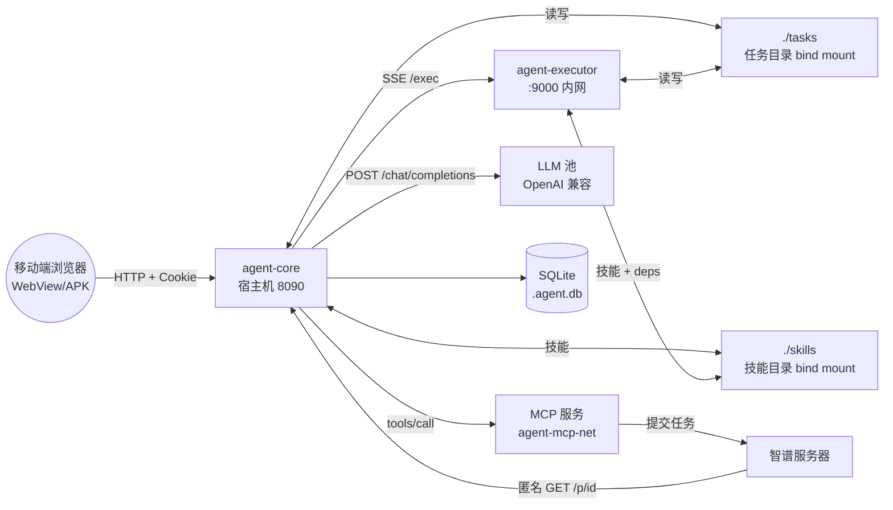
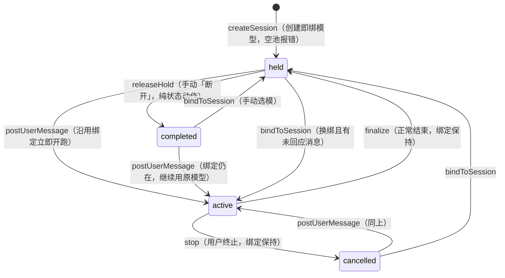
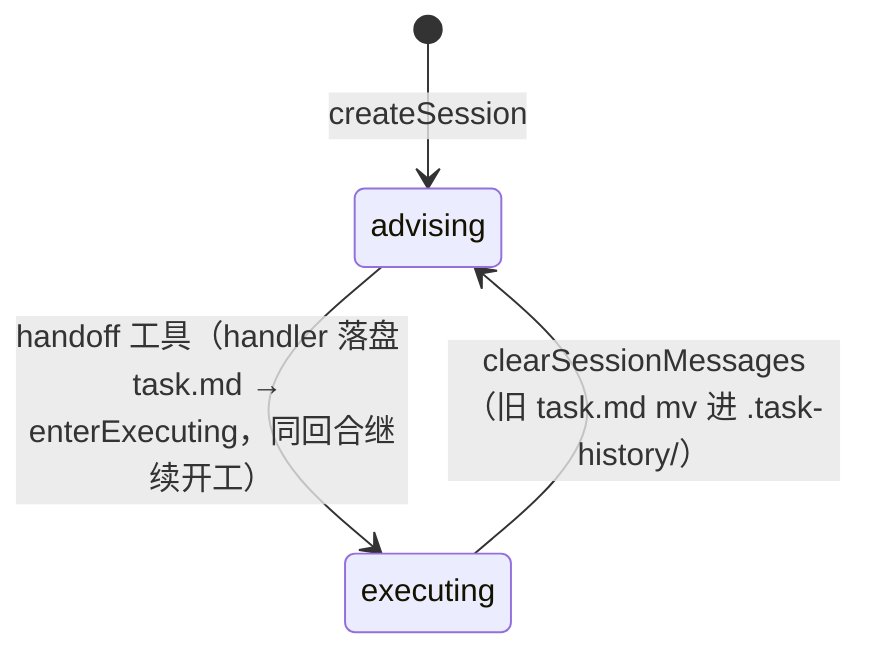
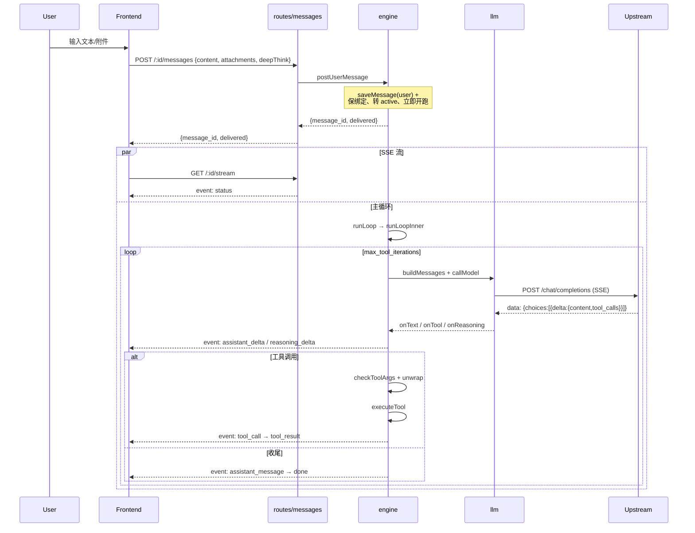
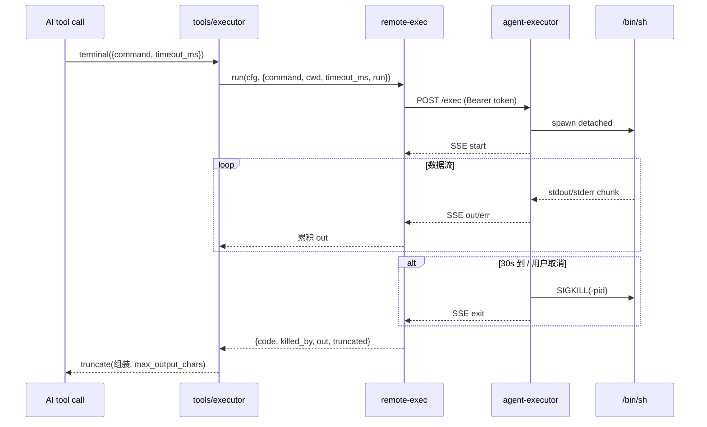
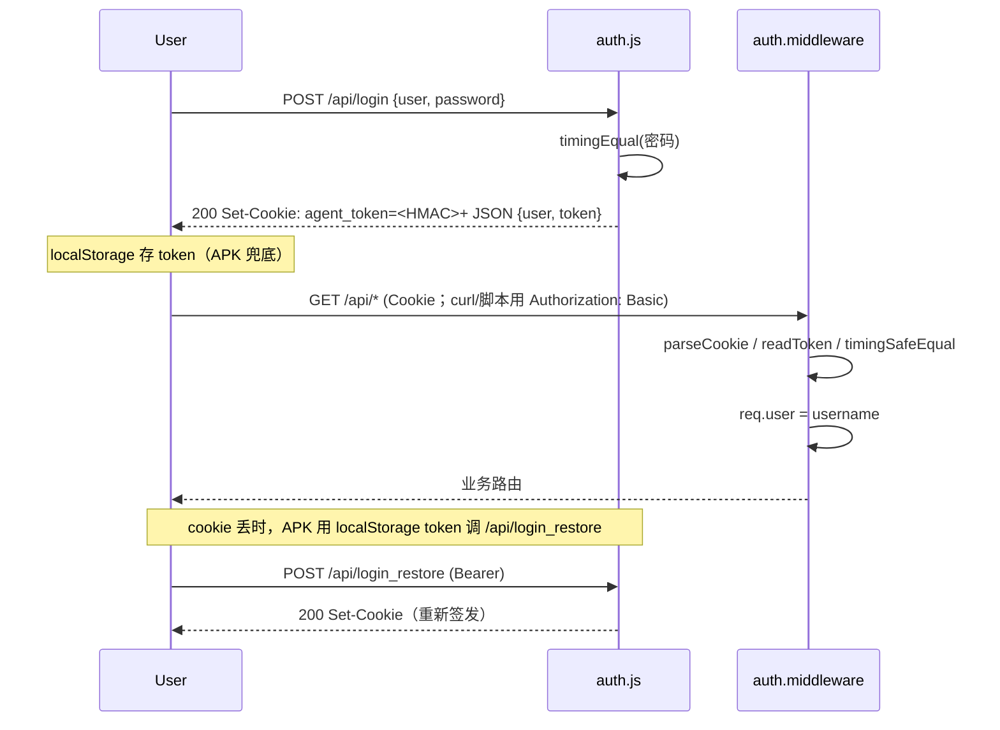

# Agent 项目架构说明

> 本文档是给 AI 助手的代码导览——基于仓库实际代码梳理，不是设计文档（设计层面的内容看 `README.md`）。
> 当需要修改代码时，先按目录结构定位 → 再按模块职责确认改动是否落在正确文件 → 改前先看相应"扩展点"和"约定"两节。

## 0. 项目一句话

自用通用 Agent 系统：**浏览器（移动端 H5 SPA）→ Core（Node 20 + Express + SQLite）→ LLM 池（OpenAI 兼容上游）**，配合可选的 **`agent-executor` 容器**执行 shell 命令与技能脚本。所有 AI 工具调用都在 Core 内统一分派：文件类工具走 Core 本地 fs，命令与技能走远端 Executor（隔离 Python/ffmpeg/libreoffice 等重工具链）。

---

## 1. 目录结构

```
agent/
├── README.md                      设计文档（API/数据模型/部署总览）
├── docker-compose.yml             编排：agent-core + agent-executor 两个服务
├── config.yml                     运行时配置（含密钥，已 .gitignore）
├── data/                          默认数据卷（任务目录、SQLite、prompt dump）
├── tasks/                         任务目录挂载点（同 ./data 顶层等价，二选一）
├── skills/                        技能目录（用户维护的 SKILL.md/run.py）
│
├── app/                           ── Core 服务容器 ──
│   ├── Dockerfile                 node:20-slim，npm install only prod
│   │   ├── package.json               依赖：express / better-sqlite3 / multer / sharp / yaml / minimatch / cron-parser
│   ├── config.example.yml         配置模板（被复制为顶层 config.yml）
│   ├── scripts/
│   │   └── init.sh                部署入口：生成 .env + config.yml → 起 agent/mcp 服务
│   ├── server/                    后端代码
│   │   ├── server.js              入口：装配 cfg / db / bus / engine / 路由
│   │   ├── config.js              YAML 配置加载、迁移、读写、校验、脱敏还原
│   │   ├── log.js                 分级日志（debug/info/warn/error/none）
│   │   ├── auth.js                多用户会话认证（HttpOnly cookie + HMAC token）
│   │   ├── db.js                  SQLite 初始化 + 表结构 + 增量迁移
│   │   ├── sse.js                 按会话分组的 SSE 事件总线
│   │   ├── engine.js              会话/模型池/Agent 主循环/任务目录（核心调度器）
│   │   ├── scheduler.js           定时任务调度器（30s 轮询到期任务，存档历史后投递；需 engine.init() 后启动）
│   │   ├── llm.js                 上游 OpenAI 兼容 /chat/completions 流式调用 + 消息组装
│   │   ├── mcp.js                 极简 MCP 客户端（Streamable HTTP，init→tools/list→tools/call）
│   │   ├── remote-exec.js         agent-executor 远端执行客户端（SSE 收流）
│   │   ├── wechat.js              微信接入桥接（wechat_bindings 权威 / 实例控制 / inbox / 总线投递；wxbot 为仓库内私有组件不入 git，见 §5.13）
│   │   ├── balance.js             余额查询适配器（按 platform.type 分发）
│   │   ├── version.js             版本信息（package.json + git 短提交号）
│   │   ├── tools/
│   │   │   ├── definitions.json   内置 9 个工具的 OpenAI function 格式定义（含元工具 lab）
│   │   │   ├── executor.js        工具执行器（文件类 + terminal + skill 委托）
│   │   │   └── skills.js          Skill Manager（skill 工具的 list/get/run + 路径预处理）
│   │   ├── download-token.js      下载链接签名（浏览器原生下载用；密钥进程内随机）
│   │   ├── download-send.js       单文件下载响应（Content-Disposition / 缓存策略）
│   │   ├── public-files.js        公网临时文件短 ID 表（mint/resolve + 过期）
│   │   ├── routes/
│   │   │   ├── sessions.js        /api/sessions CRUD + 列表分页
│   │   │   ├── messages.js        /api/sessions/:id/messages + SSE 流 + stop/release
│   │   │   ├── files.js           /api/sessions/:id/files 上传/列表/下载/删除
│   │   │   ├── channel.js         /api/channel/send 文本命令接入（IM/CLI 等无 UI 端；当前会话绑定 + /new /stop /compact /clear /status /help）
│   │   │   ├── wechat.js          /api/wechat 绑定管理（设置页）+ /wxhook 内网回调（微信接入，见 §5.13）
│   │   │   ├── config.js          /api/config 读写（含 api_key/password 脱敏）
│   │   │   ├── platforms.js       /api/platforms/balance 余额查询
│   │   │   ├── skills.js          /api/skills 技能文件管理
│   │   │   ├── public-files.js    GET /p/<id> 公网临时文件取用（匿名）
│   │   │   └── system.js          /api/system/status + /restart 优雅重启
│   │   ├── templates/
│   │   │   ├── system-prompt.txt  system prompt 静态模板（每次请求复用，利于上游前缀缓存）
│   │   │   ├── advising-system.txt 顾问阶段提示词（内置 profile:advising，phase=advising 时强制命中，见 §4.1）
│   │   │   ├── compress-prompt.txt 上下文压缩提示词（压缩回合末尾追加为 user 消息，历史照常走 messages）
│   │   │   ├── title-prompt.txt   会话标题自动生成提示词（首次交互结束后触发，{{language}} 填配置语言）
│   │   │   └── profile-prompt.txt 用户画像提取提示词（advising→executing 落槌时触发一次，输出锁三字段 JSON，见 user-profile.js）
│   │   └── public/                前端 H5 SPA（无构建，Vanilla JS 经典脚本多文件 + SSE）
│   │       ├── index.html         主页（HTML+样式；脚本全部在 js/，按序加载共享全局作用域）
│   │       ├── login.html         登录页
│   │       ├── js/                core / chat / sessions / stream / files / settings 六模块（settings.js 尾部含全局初始化，须最后加载）
│   │       ├── css/style.css
│   │       ├── vendor/marked.min.js
│   │       └── sw.js              service worker
│   └── test/
│       ├── smoke.js               端到端冒烟（mock 上游 + 真 server，68+ 用例）
│       ├── remote-exec.test.js    远端执行集成测试（起真 executor + 调 Core）
│       ├── dep-check.js           依赖完整性
│       ├── mock-upstream.js       测试用假 LLM 上游
│       └── config.test.yml        测试配置（隔离 data_root）
│
├── executor/                      ── Executor 服务容器（独立部署）──
│   ├── Dockerfile                 node:20-slim + 系统/Python 工具链（apt + pip）
│   ├── server.js                  零依赖单文件 HTTP 服务（仅 Node 内置 http）
│   └── smoke-test.js              Executor 自身冒烟（/health / exec 流式 / 鉴权 / 取消）
│
└── docs/
    ├── DEPLOY.md                  部署（Docker，IP:端口直连）
    ├── v2-develop.md              v2 移动端单聊视图开发说明
    └── ARCHITECTURE.md            ← 本文件
```

---

## 2. 部署



所有容器都在同一个 `agent-mcp-net` 上（core 与 executor 同时靠它访问 MCP）；外网只暴露 Core
（宿主机端口映射）。注意其中一条**反向**的入站链路：外部服务（如智谱）来拉文件时，走的是 Core 的
`GET /p/<id>`（匿名，22 字符随机 ID + 服务端过期，见 `routes/public-files.js`）；这个 id 由内置工具
`mint_public_link` 在 core 进程内现签（AI 只传文件名，不走任何 HTTP），所以链接里既没有会话名也没有文件名。

**关键约束**（改 compose 时务必保持）：

- 全部容器同一个网络 `agent-mcp-net`（由本仓库 compose 创建，mcp 侧 external 加入）——core 与 executor 都靠它按容器名访问 MCP 服务。
- `agent-core` 与 `agent-executor` 须把**同一份宿主机 `./tasks`、`./skills`**挂到相同的容器路径（默认 `/workspace/tasks`、`/workspace/skills`）。这是文件工具在 Core 本地直接读、命令在远端写，二者能"看到"彼此产物的根本约定。
- **两条公网文件路径分工别搞混**：浏览器原生下载走 `download-token.js` 的签名链接（前端用 `download-token` 接口换 URL，`auth.js` 的 `isSignedDownload` 放行 `?t=`）；外部服务取文件走 `GET /p/<id>` 短 ID。前者需要在 URL 末段带文件名（给安卓下载器猜名），后者刻意不带文件名/会话名。
- `GET /p/<id>` 是 Core 上唯一的匿名入口（只有读、必须挂在 `auth.middleware` 之前，未命中/过期一律 404）：安全性 = 22 字符随机 ID + 服务端过期（`public-files.js` 的内存表）。**唯一的签发入口是内置工具 `mint_public_link`**（在 core 进程内，与 Core 同属一个信任边界，不再额外监听端口），它自己做路径校验（`resolveInTask` 沙箱 + 会话表 + realpath 复核，挡 `ln -s` 外泄）；未配 `public_link.base_url`（且容器 env 没给 `VIRTUAL_HOST`）时工具直接报错：配了 `VIRTUAL_HOST`（nginx-proxy 域名 + HTTPS）时，前缀自动用 `https://<第一个域名>`，env 优先于 config.yml。
- nginx-proxy 前置时**必须 `proxy_buffering off`**，否则 SSE 流被缓冲。详见 `docs/DEPLOY.md`。
- Core 通过环境变量 `EXECUTOR_URL` / `EXECUTOR_TOKEN` 注入 executor 端点（也可用 `config.yml` 的 `executor` 段覆盖）。**token 从 `.env` 读取**（compose 变量替换 `${EXECUTOR_TOKEN:?...}`，未设置直接报错，杜绝静默无鉴权）；`.env` 已 gitignore，模板见 `.env.example`，生成：`openssl rand -hex 32`。
- Executor **拒绝来自容器自身（回环/本机网卡）的 `/exec`**：隔离只 unshare mount+pid，命令与 executor 同 net ns，能打到 `127.0.0.1:9000`；据此即使 token 泄漏也无法在会话内调用 `/exec` 越权读他人会话（core 在另一容器，不受影响）。本机集成测试用 `EXECUTOR_ALLOW_LOCAL_ORIGIN=1` 放行，生产不得设置。
- Executor 镜像分两阶段（`executor/Dockerfile`）：`base` = M（长期不变，仅系统工具 + 预烘 Python 包），`skills` = M' = M + 技能“系统层”依赖。compose 用 `build.target: skills`、上下文为仓库根（`.dockerignore` 只放行 `executor/`、`skills/`）。管理员增删/改动 skills 后 `docker compose build agent-executor` 重建 M'，M 不动。
- `agent-executor-init` 在 executor 启动前一次性执行（`executor/init-skills.js`）：逐行离线探测各技能 `requirements.txt`，只把镜像缺的包 `pip --target` 装进共享 `deps/`，并执行 `install.sh` 生成技能资产，全部落到宿主 `./skills`，跑完即退出；只挂 `./skills`（不挂 `./tasks`，看不到会话数据）、无特权、`read_only`（系统层写不进去，只能写挂载卷）。executor `depends_on` 其 `service_completed_successfully`。
- Executor 在 compose 里加了 cgroup/ulimit 护栏（`cpus 2.0` / `mem_limit 2g` / `pids_limit 512` / `ulimits.fsize 2G`）——详见 `executor/server.js` 头注释。

---

## 3. 启动流程

`app/server/server.js` 顺序：

1. `loadConfig(AGENT_CONFIG)` 读 `config.yml`，跑完整校验与归一化（`config.js` › `parseAndValidate`）。
2. `log.setLevel(cfg.log_level)` 注入全局日志等级。
3. `initDb(cfg.db_path)` 建表 + 增量迁移（`db.js`，含 `held_at` / `last_model_id` / `assistant_type` / `user` / `profile` 等历史升级）。
4. `createBus()` 建 SSE 事件总线（`sse.js`）。
5. `engine.setModelPool(cfg, db, bus); engine.init()`：按 cfg.models 重建 `model_pool` 槽位表；会话状态归位（active/遗留 queued → held，绑定不清）；指向已删/禁用模型的绑定在下次发言时由 `ensureBinding` 自动改选。
6. `scheduler.start(engine)`：启动定时任务轮询（30s 一次，`unref`）。**必须在 engine.init() 之后**——先让会话状态归位，首轮 tick 才看不到脏状态（见 §5.12）。随后 `wechat.init(cfg, db, bus)` 挂上总线内部订阅（微信接入，§5.13；`wxbot.url` 未配时全程静默）。
7. `createAuth(cfg)` 装配登录中间件；未配 `auth.users` 则认证关闭（可交给前置 nginx-proxy basic auth）。
8. `express.static(public)` + 路由挂载（`/api/sessions`、`/api/skills`、`/api/config`、`/api/platforms`、`/api/system`、`/api/channel`、`/api/wechat`）；`auth.middleware` 之前另挂两个内网/匿名入口：`/p`（公网临时文件）与 `/wxhook`（wxbot 回调，共享服务 token 把门）。
9. `mcp.init(cfg).then(...)`：对每个 MCP 服务 initialize → tools/list，发现的工具存在 `mcp` 模块内。
10. `skills.listSkills(...)` → `llm.setSkillListText(...)` 快照注入 system prompt（`llm.js`）。
11. `server.listen(PORT)`，打 startup 行：workspace_root / data_root / models / mcp_servers / auth / log_level。
12. `dumpPromptBundle()` 把"system prompt + tools 列表 + 示例会话上下文"写进 `data_root/prompt.txt`（仅供人核对，失败不阻塞）。

> ⚠️ 配置是**冷加载**：改 `config.yml` 需重启生效，**没有热重载**。设置页修改后必须调 `POST /api/system/restart`（路由层 409 防有活跃回合的强杀，`force=true` 可打断）。

---

## 4. 数据模型

### 4.1 SQLite 表（`db.js`）

```
sessions          id (PK='task-YYYYMMDD-NNN') / title / status / phase /
                  model_id / last_model_id / assistant_type / user / profile /
                  created_at / updated_at / completed_at / cancelled_at / held_at

messages          id PK / session_id FK / role (system|user|assistant|tool) /
                  content (TEXT, 含 __blocks__ 哨兵 JSON 多模态) / reasoning /
                  tool_calls (JSON) / tool_call_id / name / type /
                  is_error / created_at
                  # type 取值: summary / archived / errAck / task_brief (任务书快照，advising→executing 切换后首条上下文) /
                  #   session_context (name 列 = SESSION_CONTEXT_NAME) /
                  #   scheduler_note（定时任务删除通知，未知 type 按普通 user 消息发模型）
                  # 旧版遗留: summarize_request（压缩指令 user 消息，已废弃，仅 buildMessages 兼容旧库）

files             id PK / session_id / filename / size / created_at
                  # 仅记录元数据；文件本体在 workspace 目录里

model_pool        id (PK='平台#key下标') / display_name / last_used_at / is_busy / current_session_id
                  # 启动时 syncModelPool 按 cfg.models 重建；key 为共享资源不再独占（多会话可并发绑同一 key），
                  # 调度只按「最不 active」优先级选 key（engine.chooseKey）；is_busy/current_session_id 为旧版独占残留列，不再读写

wait_queue        （已废弃）旧版 FIFO 排队表；排队语义整体移除（不再等模型），表保留不再读写

meta              key PK / value
                  # 杂项：如 task_seq:YYYYMMDD（每日任务序号，删除会话不回退）

model_usage       id PK / session_id / model_id /
                  prompt_tokens / completion_tokens / total_tokens / created_at
                  # 故意不建会话外键，删会话后累计统计仍保留

scheduled_tasks   session_id PK (FK sessions, ON DELETE CASCADE) / cron_expr /
                  prompt / next_run_at / last_run_at / last_status (ok|error|skipped|running) /
                  last_note (给人看的中文说明，UI 原样展示) / created_at
                  # 定时任务：每会话至多一个（session_id 主键兼防重），按 next_run_at 索引；
                  # 创建只经 AI 工具 schedule；频次/提示词可在会话详情弹窗改（PATCH /:id/schedule，
                  # 改频次后端重校验并重算 next_run_at）；删除走 CASCADE 或 DELETE /:id/schedule（见 §5.12）

channel_sessions  user + channel 复合 PK / session_id / updated_at
                  # 文本命令接入端（routes/channel.js）的「当前会话」映射：接入端无会话列表 UI，
                  # 普通消息与 /new 等命令都路由到绑定的会话；无外键，删会话后懒解析自愈；
                  # /api/channel/send 是唯一读写方，Web 路由不碰这张表

wechat_bindings   id PK（wx+10hex）/ user / status (pending|online|expired|error) / note /
                  bot_account_id / wx_to_user / last_msg_id / created_at / updated_at
                  # 微信绑定权威表（§5.13）：一条 core 用户 ↔ 一个 wxbot iLink bot 实例（一人一绑，换号先解绑）；
                  # id 兼作 channel 键（channel='wx:'+id，复用 channel_sessions 全套机制）与 wxbot 凭证目录名；
                  # last_msg_id 是投递游标（assistant 消息 id ≤ 此值已送微信），落库防 core 重启重发
```

**session.status 状态机**（`engine.js`，无排队版）：



要点：key 非独占、无排队、无保持租约——`held` 只表示「回合已收尾，绑定持续展示」，不会自动到期；
会话永远粘着自己的 model_slot（跨重启/结版/终止保持），换绑只有两条路：用户手动「选择模型」，
或绑定失效（配置删模型/禁用/改名）后由 `ensureBinding` 自动改选（优先留原平台）。

**session.phase 状态机**（advising/executing，`engine.js`）：



- advising（顾问）：profile 被 `resolveProfileName` 强制为内置 `advising` 组合（问答/判意图/引导澄清需求），
  只聊和读不写（`write_file`/`edit_file` 不在其白名单，批内幻觉调用也被 runLoopInner 挡下）；
  唯一出口是 `handoff` 工具：handler 把 `brief` 原样落盘根 `task.md`（reason ∈ ready/user_skip/user_stuck，
  空 brief 拒回不切）；`handoff` 与 `lab` 同入全局 `tools_deny`，advising 组合显式 `tools_deny: []` 独享可见。
- executing（执行）：回到常规 profile 链路（模型配置 > 默认全量）；单会话只解决一个问题，一路走到底，回头路只有「清空」。
- 上下文压缩对 phase 中性（原来什么模式、压完仍什么模式）；定时任务投递前强制 `executing`（无人值守不能被顾问话术卡住）。
- 切换瞬间全史标 `archived`、插一条 `type='task_brief'` user 行（task.md 磁盘快照）作执行阶段唯一上下文起点；
  幂等：执行中再改 task.md 只是普通文件编辑。
- 存量会话启动时统一回填 `executing`（旧值 planning 废弃，见 db.js 迁移）；与 status 状态机正交，不影响模型调度。

### 4.2 文件布局

**任务目录**（`cfg.workspace_root/<session-id>/`）：每个会话一个目录；Core 与 Executor 都可读写；sh 命令默认 cwd 即此目录。`task.md` = 当前轮任务书（由 `handoff` handler 落盘，phase 切换唯一入口）；`.task-history/` = 清空会话时旧任务书归档（点目录，文件列表默认隐藏，同 `.imgcache` 约定）。

**技能目录**（`cfg.skills_root/<skill-name>/`）：所有会话共享；`deps/` 子目录是 pip `--target` 共享的 Python 依赖（只放镜像缺失的包，镜像已带的不重复装），**与技能目录同级**（不是技能子目录）。`RESERVED_DIRS = {deps}` 在 `routes/skills.js` 里被排除以免被当成技能。

**版本与提交号**：git short hash 来自 `version.json`（post-commit 钩子自动写）→ 容器通过 bind mount 读到；无 `version.json` 时回退 `git rev-parse`；都没有则只显示 package.json 版本。

---

## 5. 核心运行时模块

### 5.1 `engine.js` —— 调度与主循环（**最复杂的一个文件**）

| 函数 | 角色 |
|---|---|
| `syncModelPool` | 启动时把 cfg.models 写入 `model_pool` 表，删配置中已消失的；会话状态归位（active/遗留 queued→held，绑定不清） |
| `applyBinding` / `bindingValid` / `ensureBinding` | 会话粘住 key+模型（model_slot/model_id/last_model_id + 刷新槽位 last_used_at）；绑定失效（配置删模型/禁用/改名）时按优先级自动改选，优先留原平台；空池抛 503 |
| `chooseKey` / `chooseModel` | 优先级选 key（**无排队、无独占**）：looping 回合数少 → 在用（active/held）会话数少 → 最久未用（轮转摊平）→ id；具体模型在同平台内选（偏好旧模型 > 绑得最少的） |
| `getRun` / `killRunProcs` | 每会话的运行控制（`cancelled` / `procs` / `abortController` / `looping`） |
| `runLoop` / `runLoopInner` | Agent 主循环：解析 profile → buildMessages → callModel → 解包 tool args → 校验 → saveMessage → executeTool → saveMessage(tool) → SSE 广播。每迭代现解 profile（`resolveProfileName`：advising 阶段强制内置 `advising` 组合 > 模型配置 > 默认全量），prompt 与 tools 集（`effectiveTools` 按 `tools_allow`/`tools_deny` 过滤）跟着组合切换 |
| `streamAssistant` | 单次上游调用：拿 abortSignal / shouldCancel / 各类回调，把流式 chunk 转 SSE 事件（`assistant_delta` / `reasoning_delta`） |
| `createSession` | 生成 id（`task-YYYYMMDD-NNN`，序号从历史 + `meta.task_seq` 取大）→ mkdir 任务目录 → phase 默认 advising → **创建即绑模型落 held**（指定模型优先其平台，无效退回全局；空池直接报错不建吊着会话） |
| `postUserMessage` | 用户消息入口；除 looping（下一迭代自动带上新消息）外任意状态都是「保绑定→转 active→立即开跑」，`delivered` 恒 `'live'` |
| `bindToSession` / `releaseHold` | 手动换绑（任意模型即点即换，仅输出中拒绝，无「占用」概念）；「断开」= held→completed 纯状态动作（无资源可释放，绑定仍在可继续用） |
| `summarizeContext` / `clearSessionMessages` / `deleteMessage` | 收尾 + 上下文压缩（清空同时把 phase 打回 advising 并归档旧 task.md） |
| `enterExecuting` / `archiveTaskBrief` | 阶段切换：批尾接 `handoff` 成功标记（brief 已由 handler 落盘）→ 全史存档 + 插 task_brief 快照 + phase='executing' + SSE 广播；清空时旧 task.md mv 进 `.task-history/` |
| `checkToolArgs` / `unwrapToolArgs` | 工具参数校验 + 部分弱模型参数包裹外层自动解包 |
| `ensureSessionContext` | 注入/刷新"会话上下文"首条 user 消息（日期/任务目录/模型名/vision 能力） |

**关键约定**：

- `run.cancelled = true` 是停止的最终信号；远端子进程通过 `run.procs` 注册（local spawn 用 child、remote-exec 用 `remoteKill` 句柄），`killRunProcs` 按类型分别处理。
- `lastIncludedId` 跟踪本轮已纳入模型请求的最新消息 id；流式期间到达的新 user 消息靠它在下一轮迭代时自动带上。
- **errAck 机制**：工具参数结构性错误（JSON 非法/缺必填）→ 整条 assistant 标 `type='errAck'`，关联 tool 回执一并丢弃，发请求时由 user 错误提示替代（`llm.buildMessages`）—— 防止模型模仿自己的坏样本死循环。
- **archived/summary 机制**（上下文压缩）：`type='archived'` 的消息 UI 照常展示但不再发模型；`type='summary'` 是压缩后的"上下文起点"。压缩回合**不插入任何指令消息**：由 `engine.summarizeContext` 在内存 run 上标 `summarizing`，`runLoopInner` 据此走 `llm.compressMessages`：沿用默认 system prompt + 正常历史 messages，末尾追加一条 user（`server/templates/compress-prompt.txt` 原文，参考标题回合的拼法），且不传 tools；回合内首条无 tool_calls 的收尾回复即摘要。（`llm.buildMessages` 仍保留旧库 `summarize_request` 行的处理，仅为历史数据兼容。）
- **图片（多模态）**：`messages.content` 列是 TEXT，含图时存 `{"__blocks__":[content...]}` 哨兵 JSON。新版 `read_file` 读图：sharp 压缩产物落任务目录 `.imgcache/`（前端文件列表隐带点的项），库里只存 `image_ref` 轻量块；`buildMessages` 发送前经调用方传入的 `mintUrl` 回调现签成公网外链（同 `mint_public_link` 那套 `GET /p/<id>`）填入 `image_url` 块，base64 不进 DB 也不进请求体；签不到降级为文字占位。旧库/用户粘贴附件的 `data:` URL 块原样透传。图块**只保留最后一条 assistant 之后的**（`lastAssistant` 判定），之前的换成"已省略"文字描述；UI 渲染走带 cookie 的会话内下载路由，历史永不裂图。
- **key 共享并发，无租约**：`model_pool.is_busy`/`current_session_id` 已废弃不再读写（旧库残留列，启动时清零）；同一 key 可被多个会话同时绑定并发 looping（上游 key 本身支持多并发）。held 不再自动到期，顶部「保持中 · 模型」持续展示，唯一出口是手动「断开」或换绑。
- **task_brief（任务书锚点，advising→executing 切换）**：runLoopInner 工具批跑完后，若 advising 回合内有 `handoff` 成功返回（brief 已由 handler 原样落盘根 task.md 并记 files 表；批量末尾统一切，防父 assistant 先存档、后落库回执成孤儿行被上游拒收；同批多次 handoff 后写覆盖 last-wins），`enterExecuting` 当场重建上下文：全史标 `archived` → 插一条 `type='task_brief'` user 行（内容 = task.md 磁盘快照，非引用）→ phase='executing' + SSE `phase`/`status` 事件；下一迭代重读历史 + 重解 profile，天然切默认组合、同回合开工。压缩不碰 phase（task_brief 与其它历史一样会被后续压缩存档，漂移可控：压缩本就由用户主导）。
- **profile（prompt+tools 组合）**：顶层 `model_profiles` 定义多套组合，`platforms[].models[].profile` 引用（见 §5.8）——这是唯一的引用来源：运行期手动切换已全部移除（消息级 profile 参数、`sessions.profile` 会话绑定均废弃，列保留不读写）；`advising` 例外，不走引用、由 phase 强制命中。名单外工具被调用不拦（`checkToolArgs` 查不到 def 不报错，`executeTool` 全表照跑），但阶段契约类例外：advising 内 `write_file`/`edit_file` 在批内挡下、`handoff` 在 handler 里带 phase 守卫；tools schema 只活在请求体不进历史，所以切换不脏化旧消息。压缩回合同样跟随（小模型会话点压缩不会回退到默认大模板）。

### 5.2 `llm.js` —— 上游调用

| 函数 | 角色 |
|---|---|
| `systemPromptText(language, profile?)` | 按 profile 名选 prompt 源（缺省 = 默认模板）；`{APP_SKILLS}` 占位符就地替换为技能清单（自定义文件没放占位符 = 无技能段；默认模板没放时兑底尾拼），末尾统一拼语言指令；拼接结果按 (profile, 语言) 缓存（`_promptTextCache` Map） |
| `setSkillListText(text)` | 技能列表变更后清缓存，强制重拼 |
| `setProfilePrompts(map)` | profile 自定义 prompt 注册表（name→全文，文本已随配置加载读入）；engine.init 调一次，运行期选取零 IO |
| `buildMessages(session, lang, mintUrl?)` | DB 行 → OpenAI messages 数组；处理 summary/archived/errAck/图片消费；`image_ref` 块用 `mintUrl` 现签成公网 `image_url` 外链 |
| `forEachSSEData(res, onEvent, onMeta, onBadData)` | 通用 SSE 帧解析（空行分隔，data: 行 JSON.parse，注释行走 onMeta） |
| `callModel(cfg, modelId, messages, tools, opts)` | 一次模型调用；`opts.deepThink` 启用时合并 `thinking_params`；返回 `{content, reasoning, tool_calls, finish_reason, usage, aborted, sseFrames}` |

**关键点**：

- 模型内部唯一键 = `平台名/模型id`（`model_id` 列），发上游用原始 `mid`。
- `extra_params` 与 `thinking_params` 通过 `deepMergeInto` 合入 body；`thinking_params` 覆盖 `extra_params` 同名键。
- `reasoning` 字段兼容 `reasoning` 与 `reasoning_content`（各家上游不一致），只走一个。
- 上游错误帧（`choices=[]` 且 `usage` 也无）通过 `onBadEvent` 落 warn 日志，不再静默。

### 5.3 `mcp.js` —— 极简 MCP 客户端

- 协议：Streamable HTTP（JSON-RPC over HTTP，响应可能 SSE 包裹）。
- 启动 `init(cfg)` 对每个服务 initialize → notifications/initialized → tools/list；单个服务失败只 warn，不影响其他。
- **工具名单过滤**：服务配 `tools_allow`（白名单）/ `tools_deny`（黑名单，allow 之后叠加生效）时，在 tools/list 后按服务端**原始工具名**过滤（重命名之前）；两者都在 `config.js` 归一化（非数组/空数组视作未配）。过滤后剩 0 个会 warn（多半是名字写错）。
- 工具名冲突时重命名：`内置名` 或 `其他MCP名` 已占 → 加 `服务名__` 前缀（`toolIndex` 索引走重命名后的名，调用时按索引还原成原始名调 `tools/call`）。
- session 补偿：MCP 规范的 `Mcp-Session-Id` 缓存在 `server.sessionId`；过期（400 + 含 "session" 字样）自动重 initialize 后重试一次。
- 某些老服务无 `initialize` → catch `Method not found` 不阻断。

### 5.4 `tools/executor.js` —— 内置 9 工具（含元工具 `lab`）的派发器

`HANDLERS` 是 `name → async(ctx, args) → result` 的表；`executeTool(ctx, name, args)` 按 `name` 派发；**未知名直接转发给 MCP**（若 `mcp.hasTool(name)`，调 `mcp.callTool`）。

| 工具 | 实现要点 |
|---|---|
| `read_file` | 走 `resolveInTask` 防路径穿越；图像（PNG/JPEG/WebP/GIF/BMP/TIFF）按 vision 能力走 `sharp` 压缩后落盘 `.imgcache/` 并回传 `image_rel`（长边 ≤ 2000px，JPEG q=80；文件名带源文件 mtime+size 指纹，重读复用不增殖；重编码无收益时不落盘、直指原文件），发送前由 `llm.buildMessages` 现签成公网外链（engine 侧 mint 前 realpath 复核）；大文本/二进制给 outline，超 32MB 拒读并引导 terminal；行号前缀格式 "`<6位右对齐行号>\\t<原文>`"（`edit_file` 用） |
| `write_file` / `edit_file` | `edit_file` 用模糊定位（Zed 风格）：先精确匹配，失败后用 Levenshtein DP 找最相似行；超 32MB 拒绝整文件读写（OOM 防护）；DP 候选区间不连续（中间跳过无关 buffer 行）即弃用，防静默吞行；空 `new_text` = 整行干净删除（精确/模糊两层统一，对齐 `"".lines()` 零行语义）；`old_text`/`new_text` 协议见 `definitions.json` |
| 已移除的工具 | `list_directory` / `create_directory` / `delete_path` / `move_path` / `copy_path` / `find_path` / `grep`：环境固定，文件操作与检索统一走 `terminal`（ls / mkdir / rm / mv / cp / find / rg），内置工具 17 → 10；技能三件套又并为 `skill` 后为 8；再增元工具 `lab` 为 9（默认被全局 `tools_deny` 屏蔽） |
| `terminal` | **唯一一个走 executor 的内置工具**（当 `rexec.isRemote(cfg)`）；本地分支用 `spawn` + `detached` + 进程组 kill；远端分支 `rexec.run` SSE 收流，结果套上超时/截断/取消注解后 `truncate(text, cfg.terminal.max_output_chars)` 返回 |
| `fetch` | `AbortController` 覆盖全生命周期（响应头之后的 body 读流同样被超时/取消打断，取消用与 terminal 同款的 200ms 轮询）；content-type 先行，非文本只回状态/类型/尺寸不读 body；流式读到 `cfg.fetch.max_bytes`（默认 1MB）即断开并标注截断；按响应 charset 解码（full-icu 支持 gbk/gb18030 等，未知编码退回 UTF-8）；HTML 用 `htmlToMarkdown` 转；HTML 实体单遍解码（常见命名实体+数字实体通吃，修 `&amp;` 双重解码）；网络错误解包 `err.cause` 直述 ENOTFOUND/TLS 等真因；engine 不截工具结果，返回值末尾另有 `truncate` 1MB 字符护栏 |
| `mint_public_link` | **唯一的 mint 入口**：与 core 同进程，直接 `publicFiles.mint()`，不绕任何 HTTP；`ctx.taskDir` 就是会话目录，`relOf` 的结果正是取用侧要的 `rel`。校验：`public_link.base_url` 已配 + `resolveInTask` 沙箱 + 确认是文件 + `realpath` 未沿符号链接跳出任务目录；返回单行 URL |
| `skill` | op 分派 list/get/run（三件套合并：同一 `name` 标识空间 + 同一生命周期，见 `docs/tool-design.md` §一）；委托 `tools/skills.js`；`input_args` 仅 op=run 且可缺省 `{}`，缺参由各技能 `input_schema` 校验点名报错；front matter 带 `visit_url` 的技能在 op=run 成功后由 executor 层拼 `public_link.base_url`（与 mint 同源）追加完整「访问地址」行（技能进程不知公网前缀，AI 拿相对路径会原样转给用户） |
| `schedule` | **当前会话**（`ctx.sessionId`，AI 不可指定他会话）定时任务的完整生命周期：op 分派 get/create/update/delete（表主键 session_id → 每会话至多一条，无 id 参数）；条件必填在代码里校验、错误回显 op 与缺失字段；数据层在 `scheduler.js`（cron 可解析 → 间隔 ≥1h → prompt ≤20000 → 查重/存在性检查），delete 不落 scheduler_note；描述里限定「仅用户明确要求时调用」（安全缓解，见 §5.12） |
| `lab` | 元工具统一入口：`tool` + 自由 `args` 转发内置 + MCP 全部能力（目标 schema 定义期不可知，条件校验归内层 handler）；`help` 伪工具做现场发现（无参列名单、带 `args.tool` 出完整 schema），未知名回显全清单，禁嵌套、内层错误冒泡不包装。默认被全局 `tools_deny: ['lab']` 屏蔽，仅 `lab` profile（allow `[lab]` + deny `[]` 清空）下发，见 §5.8 |

`resolveInTask(taskDir, relOrAbs)`：把相对路径或绝对路径解析为绝对路径并校验落在 `taskDir` 之内（含根），防穿越。

### 5.5 `tools/skills.js` —— Skill Manager

- 技能 = 单层子目录，含 `SKILL.md`（YAML front matter 可选，含 `description` / `input_schema` / `visit_url`，后者的完整链接由 executor 层在 op=run 后拼接，见 §5.4）+ `run.py` 或 `run.sh` 入口（接收 JSON 字符串作为唯一 argv）。
- 依赖不由 core 安装（core 只发现与执行）：系统层依赖（apt 等，`install.sh` 的副作用）在镜像 `skills` 阶段烘入 M'（需重建镜像）；pip 依赖与技能资产（如字体提取）在服务启动前由 `agent-executor-init` 一次性落到宿主 `./skills`。
  - init 的 pip 步骤先离线探测（`pip install --no-index --dry-run <逐行>`，不联网）：镜像已带的包直接跳过，只把缺的装进 `deps/`；`.deps_installed` marker（requirements/install.sh 两份 hash）也在那里维护。
  - 外挂层可见性：`skills/deps` 由 compose 放进 executor 容器 env 的 `PYTHONPATH`（`server.js` 白名单同步放行），技能入口与 AI 终端命令都能 import；运行期 skills 与 deps 均 `:ro`，**加包只需改 `requirements.txt` 后 `docker compose up -d`（重跑 init），不需重建镜像**。
- `runSkill` 流程：`input_args` 类型守卫（非对象早拒，免得在 Object.entries 里静默错位） → `skillDir` 校验 → `absolutizeArgs`（按任务目录 + 启发式判断路径类参数） → `validateArgs`（按 front matter `input_schema.required`，缺项报错点名字段） → 选 `python3 run.py '<json>'` 或 `bash run.sh '<json>'` → `runEntry`。
- system prompt 注入（`formatSkillListForPrompt`）按 `- 名字: 描述` 每行一个（listSkills 已按名字排序，行序恒定不破坏前缀缓存；描述压单行）；参数查 op=get、执行 op=run（`skill` 工具），op 间依赖写进工具 description。
- **走 executor**：命令拼成 `shq` 转义后的单条 shell 行（`shellLine`）；env 不额外传，依赖层由容器 env 提供。
- **cwd 分两类**：`skill` op=run 传会话任务目录（`ctx.taskDir`），命中 executor 的 session 隔离与虚拟视图，技能在 `/workspace/tasks/<sid>` 看到的就是本会话数据，`absolutizeArgs` 产出的绝对路径因此有效；入口脚本一律用绝对路径（cwd 已不是技能目录）。

### 5.6 `remote-exec.js` —— 远端 executor 客户端

`run(cfg, opts)` 流程：
1. 校验 `cfg.executor.url`（即 `isRemote`）。
2. `fetch POST /exec`（body = `{command, cwd, timeout_ms, env}`），得到 SSE 流。
3. 用 `for await` + 手工 `\n\n` 切帧；遇到 `[DONE]` 或 `type:'exit'` 帧 break。
4. SSE 内只发 `out`/`err` 的 chunk；`out` 累积到字符串。
5. `opts.run` 可选传入，句柄挂到 `run.procs`；200ms 轮询 `run.cancelled` 触发 `remoteKill`（`DELETE /exec/:id` + `ac.abort()`）。
6. 看门狗 `timeoutMs+15s` 兜底。

返回 `{code, killed_by, out, truncated}`。

### 5.7 `auth.js` —— 多用户会话认证

- `users: [{user, password}]` 在 config.yml；`secret` 留空则随机生成（重启即掉登录态，建议固定）。
- 签发 HMAC 签名 token（payloadB64url.signature，payload = `{u, exp}`），存 HttpOnly + SameSite=Lax cookie，30 天有效。
- 路由：
  - `POST /api/login` → 校验 + setCookie + 返回 token（WebView 封装 APK 杀进程后 cookie 不一定落盘，token 存 localStorage 备 `login_restore` 恢复）。
  - `POST /api/login_restore`（Authorization: Bearer）→ 验签 + 重新签发。
  - `POST /api/password`（认证中）→ 校验 + 改写 config.yml（保留注释 + 校验失败不动文件） + 内存同步生效。
  - `POST /api/logout` / `GET /logout`。
- 中间件：cookie 或 Authorization: Basic 任一通过（**cookie 优先**，见 §14.16；`/api/me` 与中间件同一解析顺序，保证显示身份 = 数据身份）；公开路径白名单（`/login`, `/api/login` 等）+ 签名下载链接（`?t=...`）放行；其余 API 401、页面重定向 `/login`。
- `req.user` 在中间件通过后挂上，**业务路由不要信客户端传的 user/body 里的 user**。

### 5.8 `config.js` —— 配置加载与读写

- 加载：`loadConfig(AGENT_CONFIG)` 读文件 → `parseAndValidate`。
- 兼容：旧版 `models[]`（扁平）自动迁移到 `platforms[]` 层级；旧版 `web_search.*` 迁移到 `mcp_servers[]`（log.info 提示）。
- 规范化：`normalizePlatforms` 校验 `name/url/type`，key 层 `concurrency`，model 层 `{id, display_name, vision, enable, extra_params, thinking_params, profile}`；同平台内 model id 必须唯一（内部唯一键 = 平台名/模型id）；`profile` 引用不存在的名字直接报错。
- `model_profiles`（顶层，`normalizeModelProfiles`）：多套可复用的 prompt+tools 组合，每项 `{tools_allow?, tools_deny?, system_prompt_file?}`，三者至少配一个。`tools_allow` 按**最终发给模型的工具名**匹配（内置 + MCP，含 `服务名__` 前缀，与 prompt.txt dump 同源可对）；未配 = 全量，**空数组 `[]` = 零工具（纯文本组合）**——与 MCP 的 `tools_allow`（空名单视作未配）有意不同。`tools_deny` 在 allow 之后叠加生效（deny 赢）；profile 未配 = 继承全局 `tools_deny`（DEFAULTS 屏蔽元工具 `lab`），`[]` = 显式清空（lab profile 靠它换回元工具），非空 = 替换全局。`system_prompt_file` 相对 `server/templates/`（compose 已 bind-mount ./app/server，宿主直接可改），**配置加载时一次性读入常驻内存**，缺失/为空报错拦在保存/重启预检；自定义文件 = 完全接管模板正文，技能清单靠模板内 `{APP_SKILLS}` 占位符就地插入（不放 = 无技能段；默认模板同机制，见 §5.2），语言指令始终尾拼。运行期切换（前端传参）零 IO、不碰本配置。
- 默认值（`DEFAULTS`）：port=8090、workspace_root/data_root=`/workspace/tasks` `/workspace/data`、log_level=info、terminal 30s/10K、fetch 30s/1MB、agent temperature=1.0、max_tool_iterations=100、max_retries=2、上传 1.5MB/2000px/0.85（旧 `model_hold` 已废弃，字段仅为旧 config.yml 解析兼容保留）；顶层默认 `tools_deny: [lab]`；内置 `model_profiles` 含 `lab`（元工具自测：`tools_allow:[lab]` + 显式清空 deny + `lab-system.txt`）与 `zero`（零工具 + `zero-system.txt`）。`config.yml` 只覆盖 deploy 相关段，其余走默认值；整份清单见 `app/config.example.yml`。
- 读写：`readConfigText` / `writeConfigText`（先校验后写，无原子 rename，因 bind mount 上 rename 会 EBUSY）；`applyEditsToText` 用 `YAML.Document` 保留注释。
- `getConfig` 是浅引用，路由层拿到的就是运行中实例，**改完 in-memory 不影响**（要重启）。

### 5.9 `db.js` —— SQLite 初始化

- 启动建表（`CREATE TABLE IF NOT EXISTS`）+ 增量迁移（`ALTER TABLE` 失败忽略，重复启动安全）。
- 迁移示例：`reasoning`、`type`、`is_error`、`held_at`、`last_model_id`、`assistant_type`、`user` 列。
- 所有表都用自增 PK 或显式 id；`messages` 按 `session_id, id` 索引；`files` 按 `session_id`；`model_usage` 按 `model_id, created_at`。

### 5.10 `sse.js` —— 事件总线

- `Map<session_id, Set<res>>`。
- `emit(sessionId, event, data)` 拼 `event: <name>\ndata: <json>\n\n`；无客户端静默丢弃（消息本身已持久化，重连可回放）。
- 进程内内部订阅 `onInternal(fn)`：先于 HTTP 客户端触发、不受「无观看者早退」影响、单个监听抛错不影响其余——微信投递（wechat.js）靠它拿 assistant_message（微信会话常常没有任何 Web 页面在看）。
- SSE 心跳：路由层 15s 一次 `: ping\n\n` 注释行（`X-Accel-Buffering: no` 是给 nginx-proxy 看的）。

### 5.11 `balance.js` —— 余额查询

- 按 `platform.type` 分发到 `ADAPTERS`；已接 `deepseek`（`/user/balance`）与 `bigmodel`（`/api/biz/account/query-customer-account-report`）。
- 上游根地址 = `cfg.platforms[i].url` 去掉尾部 `/` 与 `/v1`（余额端点在站点根）。
- `types()` 返回已接入类型列表，前端设置页据此决定要不要展示余额行。

### 5.12 `scheduler.js` —— 定时任务调度器

AI 通过 `schedule` 工具为所在会话建周期性任务（`scheduled_tasks` 表，生命周期绑定会话），无人值守时（典型是半夜）自动执行，结果留在会话里供用户次日查看。

- **形态**：`start(engine)` 注入 engine（避免 engine→executor→scheduler 顶层循环 require），`setInterval` 30s + `unref`，单次异常只 `log.error` 不中断定时器。周期/最小间隔是模块常量，不进 config.yml。
- **cron**：`cron-parser@5.10.1`（锁版；v5 API 是 `CronExpressionParser.parse`，与 v4 的 `parseExpression` 不兼容），显式 `tz: 'Asia/Shanghai'`（与容器 TZ 一致，不靠隐式时区）。最小间隔 1h 在创建时校验。
- **tick 两阶段**：A 收尾上一轮 `running`（runLoop 无结束回调，轮询推断：会话转非 active 即标 ok）；B 取到期任务投递——`next_run_at <= now` 且非 running；**防堆积以会话状态为准**：active 直接标 `skipped` 不投递（比 DB 标记时序可靠）。
- **投递 = 存档 + 强制 executing + postUserMessage**（顺序不可换）：先把会话全部消息标 `type='archived'`（`buildMessages` 跳过 → AI 只看到本次 prompt，等价全新会话，上下文不随触发次数增长；UI 照常展示全量），再把 `phase` 强制置 `executing`（无人值守的半夜 prompt 不能被顾问 profile 当白天聊天「引导澄清等人回答」），最后 `engine.postUserMessage`——新调度下恒立即开跑（key 不独占不排队，任何状态都拿模型直接跑；绑定失效自动改选）；仅模型池整体为空会投递失败标 `error`，下个周期重试。
- **补跑语义**：`computeNext` 一律以 `now` 为基准，停机跨过多个触发点后重启只算未来一次，天然不补跑；重启后任务从库自动恢复。
- **安全**：本功能等价给 AI 开持久化后门（prompt injection 可诱使建任务定时执行任意指令）。缓解三件：工具描述限定「仅用户明确要求时调用」+ 会话页常驻状态条（点击弹详情窗，可见 cron/上次下次时间/提示词，能就地改提示词或删除）+ 创建/触发/跳过/删除全打 `scheduler` info 日志。无权限分级/审批/配额。
- **边界**：两次触发之间的用户对话也会被下次触发一并存档（UI 可见、AI 下次看不到，符合设计意图）；多用户：调度器全局遍历不按 user 过滤（投递目标是会话本身，隔离在建任务时的 ctx.sessionId 已有）；`last_status='running'` 的收尾不精确（异常结束的回合也会被标 ok）。

---

### 5.13 `wechat.js` —— 微信接入桥接（wxbot 为私有组件，不入 git）

背景：仓库内 `wxbot/`（未入库）是基于官方 iLink 协议 SDK 的微信「调制解调器」，只挂 `agent-mcp-net` 内网、不暴露公网；身份权威与全部会话逻辑在 core，引擎不感知微信。

- **模型**：一条 `wechat_bindings` = 一个 core 用户 = 一个 bot 实例（一人一绑，换号先解绑）。binding id 三用：实例控制/投递的寻址键、wxbot 凭证目录名、channel 键（`channel='wx:'+id`，因此命令层、会话自动新建、投递游标查询全部白借 §5.4 的 channel 机制，零新逻辑）。iLink 协议保证扫码登录后仅本人可与 bot 单线对话，无陌生人入口，故无联系人授权面。
- **方向三条线**：① Web（设置页→账户→微信绑定）→ `/api/wechat` → wxbot `/api/instances*`（实例控制，QR SVG 代理给页面 ``，服务 token 不出内网）；② wxbot 收信 → `POST core:/wxhook/inbox` → 直调 `channel.handleSend()`（命令回执同步回文本；普通消息不回执，等异步投递）；③ core 总线监听 assistant_message → 分段（~1800 字/段，行优先聚合）→ `POST wxbot:/api/deliver` → `bot.send`。
- **投递游标** `last_msg_id` 落库 + 每绑定串行队列：重启不重发旧回复，wxbot 短暂不可达不丢（下一条连带补齐）；errAck/纯工具轮（空文本）不进微信，`__blocks__` 图消息降级为占位文案。
- **降级承诺**：`wxbot.url` 未配 = 功能整体静默关闭（启动零日志噪声、设置页入口隐藏）；配了但 wxbot 没起 = restore 只留一行 info，面板显示未连接，所有外呼失败只 warn，绝不阻塞/抛出未捕获异常影响 Web 主流程（鉴权/探活失败同样只降级）。
- 鉴权：core→wxbot = wxbot 自身 auth.tokens 白名单（模板直接引用 `${WXBOT_TOKEN}`）；wxbot→core = `/wxhook` 挂 auth.middleware 之前，Bearer 服务 token 哈希后定长比较（同 auth.js 形态），token 未配一律 503（fail closed）。

---

## 6. agent-executor 容器

单文件 Node HTTP 服务（`executor/server.js`），零依赖。镜像 `executor/Dockerfile` 分两阶段：`base`（M，长期不变）与 `skills`（M' = M + 技能系统层依赖，管理员改 skills 后重建）。端点：

- `GET /health` → `{ok, running:[{id, pid, cwd, started_at}]}`，免鉴权。
- `POST /exec` body `{command, cwd（必填）, timeout_ms?, max_output_chars?, env?}` → SSE 流：
  - `start`（带 id + pid + cwd）→ `out`/`err` 增量分块 → `exit` 收尾。
  - 期间每 15s 一条 `: ping` 注释行保活。
- `DELETE /exec/:id` → 杀进程组（`process.kill(-pid, SIGKILL)`）。

**安全约束**（改 executor 时务必保持）：

- `EXECUTOR_TOKEN` 非空时，除 `/health` 外必须 `Authorization: Bearer`（常时间比较）。token 存 `.env`（gitignore），不硬编码进仓库。
- 拒绝**来自容器自身**（回环/本机网卡）的 `/exec`：隔离未 unshare net ns，命令能打到 `127.0.0.1:9000`；据此即使 token 泄漏，会话内也无法回环调 `/exec` 以他人会话 cwd 起命令（core 在另一容器，源地址非本机，不受影响）。`EXECUTOR_ALLOW_LOCAL_ORIGIN=1` 仅供本机集成测试，生产不得设置。
- `cwd` 必须落在 `EXECUTOR_ROOTS`（逗号分隔白名单，默认 `/workspace`）realpath 之下，防穿越。
- `cwd` 不得是任务根本身（realpath 相等即拒）：它是全部会话目录的父目录，在其下执行会暴露所有会话，且隔离 wrapper 在此层无从生效；缺省 cwd 落任务根同样被拒 → 等效必填。
- `timeout_ms` 夹在 `[1000, EXECUTOR_MAX_TIMEOUT_MS=1800000]`。
- 输出按 `max_output_chars`（默认 200000）截断，**截断后仍持续消费管道**（防子进程因 pipe 满阻塞），并设 `truncated=true`。

**启动参数**（环境变量）：

| 变量 | 默认 | 含义 |
|---|---|---|
| `PORT` | 9000 | 监听端口 |
| `EXECUTOR_ROOTS` | `/workspace` | cwd 白名单，逗号分隔 |
| `EXECUTOR_CWD` | `<ROOTS[0]>/tasks` | 默认 cwd |
| `EXECUTOR_MAX_TIMEOUT_MS` | 1800000 | timeout 上限（30 分钟） |
| `EXECUTOR_MAX_OUTPUT_CHARS` | 200000 | stdout/stderr 单向截断阈值 |
| `EXECUTOR_TOKEN` | 空 | 可选 Bearer 鉴权 |
| `EXECUTOR_LOG_LEVEL` | `info` | 分级日志（debug 打满请求/响应交互） |
| `EXECUTOR_ALLOW_LOCAL_ORIGIN` | 空 | 仅本机集成测试：`1` 放行回环/本机来源的 /exec（生产勿设） |

**per-task 挂载隔离**（`server.js` 的 `isolatedCommand`）：cwd 在任务根（`EXECUTOR_CWD`）严格之下的命令，spawn 时包一层 wrapper，在新的 mount namespace 里把任务根覆盖为 tmpfs、只把当前会话根（第一层子目录）bind 回原路径——AI 只能看到/改自己的项目，看不到别的会话；cwd 恰为任务根被 /exec 边界直接拒 400（见上）；cwd 在任务根外（如技能依赖安装跑在技能目录）不隔离直接 spawn（/mnt 仍被遮，看不到任何会话数据）。wrapper 同时 `unshare --pid --fork` 进新 pid ns 并重挂 /proc（flags 对齐 docker）：否则 /proc 仍是宿主视图，`nsenter --mount=/proc/1/ns/mnt` 可借 executor 主进程的 ns 句柄逃逸回原始 mount ns（已实测复现过）；重挂后 /proc/1 即命令自身。新 proc 可写会顶掉 docker 防护，wrapper 逐项还原：/proc/sys 只读 bind（防 core_pattern 宿主逃逸）、/dev/null 遮蔽 kcore/keys/sysrq-trigger（echo b 可重启宿主机）。wrapper 还把 server.js 所在目录（镜像 WORKDIR，容器内 `/app`）tmpfs 盖掉（任务根与之嵌套的开发态跳过）；且下发命令的 env 剥掉 `EXECUTOR_TOKEN`——否则 `env` 一 dump 即得 token，可从容器内回环调 `/exec` 以任意会话目录起命令，绕过隔离。需 compose 配 `cap_add: SYS_ADMIN` + `security_opt: apparmor=unconfined`（不用 privileged：实测 Docker 29，默认 AppArmor profile 拦 `mount(2)`，单加 SYS_ADMIN 不够；默认 seccomp 对持 CAP_SYS_ADMIN 的进程放行 `unshare(2)`/`mount(2)`，无需改动）；`unshare`/`mount`/`mktemp` 来自 debian 基础包 util-linux。wrapper 还会把 `/dev/shm`、`/var/tmp`、`/dev/mqueue`、`/run` 整体换成 per-exec tmpfs，并 `unshare --ipc` 隔离 System V IPC；session 模式的 `/tmp` 另叠一层 bind 指向 `<session>/.tmp`（会话内跨调用共享、随会话目录删除），堵掉跨 exec/跨会话的共享内存、临时文件与运行时状态通道；`/dev/mqueue` 挂不上时回退用 tmpfs 遮盖（队列不可用但不泄漏）。隔离层失败退出码 ≥90 逐个区分（99=会话 /tmp bind，100=/dev/shm，101=/var/tmp，102=/run）。

**资源护栏**（compose 层，**不在 server.js**）：
`cpus 2.0` / `mem_limit 2g` / `pids_limit 512` / `ulimits.fsize 2G` —— 防 AI 失控命令。残余缺口（只限单文件不限总量）在 compose 注释里已标。

**根文件系统只读**（compose 层）：`read_only: true` 挡住 AI 命令往镜像层写文件做持久化/篡改；`tmpfs: /tmp /var/tmp /run` 提供必要可写点。**`/run` 必须给**——隔离 wrapper 要在 `/run/agent-exec` 建私有 anchor/rundir，否则 `read_only` 下 `mkdir` 报 EROFS（`set -e` 直接中断每条命令）；正常写盘另走 `handleExec` 的 `HOME=/tmp`/`TMPDIR=/tmp` 与 bind 卷。

---

## 7. HTTP 路由

所有路由走 Express Router，`server.js` 挂到 `/api/...`；静态资源（前端）走 `express.static('public')` 直接托管；其余路径走 auth middleware。

| 路径前缀 | 文件 | 主要端点 |
|---|---|---|
| `/api/sessions` | `routes/sessions.js` | `POST /` 创建、`GET /` 列表（分页 + 搜索 + user 隔离）、`GET /:id` 详情（含 `schedule` 字段，列表接口不带以免 N+1）、`PATCH /:id` 改名、`DELETE /:id?delete_dir=...`、`POST /:id/bind`（`model_id`=手动换绑：任意模型即点即换、仅正在输出拒绝；原 profile 会话模式绑定已废弃）、`DELETE /:id/schedule`（删定时任务，只落 `scheduler_note` 通知消息不触发 AI）、`PATCH /:id/schedule`（改提示词/频次，cron 经 validateCron 重校验并重算 next_run_at） |
| `/api/sessions/:id/messages` | `routes/messages.js` | `POST /` 发消息（body 可选 `deepThink`；响应 `delivered` 恒 `'live'`（排队已废弃）；原 `profile` 参数已废弃）、`POST /stop`、`POST /release`（held→completed，纯状态动作、无资源可释放）、`DELETE /messages`（清空 + 回 advising）、`POST /summarize`（压缩，phase 中性）、`DELETE /messages/:mid`、`GET /stream` SSE 事件流 |
| `/api/sessions/:id/files` | `routes/files.js` | `POST /` 上传（multer，50MB/文件，文件名清洗 sanitizeName）、`GET /` 列表（递归）、`GET /download[-name/...]` 签名下载（5 分钟 TTL）、`GET /zip-token` + `GET /zip[-name/...]` 选中项（含文件夹）打包 zip 流式下载（纯 Node STORE，两遍读：先 CRC 后磁盘流发送）、`DELETE /` 删文件（目录递归删） |
| `/api/skills` | `routes/skills.js` | 技能列表/创建/重命名/删除 + 技能内文件 CRUD + 上传（`?overwrite=true` 覆盖） |
| `/api/config` | `routes/config.js` | `GET /` 原文+生效（脱敏）、`POST /validate`、`PUT /` 整文件保存、`PATCH /` 单项修改（path/value/op[delete\|append]） |
| `/api/platforms` | `routes/platforms.js` | `GET /balance?pi=&ki=` 余额 |
| `/api/system` | `routes/system.js` | `GET /status` + `/restart?force=...`（原 `model_profiles` 可用名单字段已删，前端无消费方） |
| `/api/profile` | `routes/profile.js` | `GET /` 读画像、`PUT /` 保存（三字段 + enabled）；按 `req.user` 隔离，逻辑全在 `user-profile.js`（快照冻结见 engine `createSession`/`clearSessionMessages`，提取见 `enterExecuting`） |
| `/api/channel` | `routes/channel.js` | `POST /send {channel, text}` 文本命令接入端（IM/CLI 等无 UI 客户端，走 Basic/cookie 鉴权）：命令仅在本入口解析（Web 消息路由不受影响，防误伤路径/代码文本）；严格匹配白名单 `/new[文本] /stop /compact /clear /status /help`，未知斜杠词回提示、不像命令的当普通消息；(user,channel) 经 `channel_sessions` 表绑定当前会话（普通消息无绑定自动建）；命令动作不落消息行（与 Web 按钮对称），AI 回复由接入端复用既有 SSE/详情接口获取；`handleSend()` 另供微信桥接直调 |
| `/api/wechat` | `routes/wechat.js` | 微信绑定管理（设置页，cookie 鉴权 + req.user 隔离）：`GET /`（enabled/alive/我的绑定）、`POST /`（新建绑定，一人一绑）、`GET /:id/qr`（登录二维码 SVG 代理）、`POST /:id/refresh`（重发登录）、`DELETE /:id`（解绑，销毁实例与凭证）；业务全在 `wechat.js`（§5.13） |
| `/wxhook` | `routes/wechat.js`（hookRouter） | wxbot → core 内网回调（**挂 auth.middleware 之前**，形态同 `/p`）：`POST /inbox {id, from, text}` 收信转 channel 层（非 2xx 时 wxbot 把 error 文案回给微信用户）；`POST /hook {id, event}` 实例状态回报；Bearer 共享服务 token（哈希后定长比较，未配一律 503） |
| `/api/models` | `server.js` | 模型池（在用会话数 slots_used / 在用会话列表，非独占展示）+ token 用量 |
| `/api/health` | `server.js` | 健康检查 |
| `/api/login` `/api/login_restore` `/api/logout` `/api/password` `/api/me` | `auth.js` | 认证路由（认证前） |
| `/login` `/logout` | `auth.js` | 登录/登出页 |
| `/files/download[-name/...]?t=` `/files/zip[-name/...]?t=` | `auth.js` 白名单 | 带签名 token 的下载/打包下载（认证中免 cookie） |
| `/p/<id>` | `routes/public-files.js` | 公网临时文件取用（匿名，挂认证中间件之前；随机 ID + 过期） |

**SSE 事件**（`/api/sessions/:id/stream`，由 `bus.emit` 触发，前端订阅）：

| event | data | 触发时机 |
|---|---|---|
| `status` | `{session_id, status, phase, model_id}` | 状态变化时；SSE 连接建立时立即发一次 |
| `assistant_delta` | `{text}` | 模型流式文本 |
| `reasoning_delta` | `{text}` | 模型流式思考（`reasoning`/`reasoning_content`） |
| `assistant_message` | `{id, content, reasoning, tool_calls, type, is_summary, mode}` | 整轮 assistant 落库后（含 `type='errAck'` 标识） |
| `tool_call` | `{id, name, arguments}` | 即将执行工具前 |
| `tool_result` | `{tool_call_id, name, content, is_error, image_url, msg_id}` | 工具回执落库后 |
| `phase` | `{phase}` | 阶段切换（advising↔executing；`status` 事件也携带 phase） |
| `done` | `{status: 'held'\|'cancelled'\|'completed'}` | 回合收尾 |
| `title` | `{title}` | 首次交互结束后自动生成的标题落库时（生成流程见 §9） |
| `error` | `{message}` | 异常 |

---

## 8. 前端

`app/server/public/` 是 H5 SPA（无构建步骤，本地 `vendor/marked.min.js` 渲染 Markdown，不引外部 CDN）。`index.html` 只包含 HTML/CSS 与按序加载的 6 个经典脚本（`<script src>`，无 import/打包）：顶层 `function` 声明仍挂 window 供内联 `onclick` 调用，顶层 `const/let` 进全局词法环境跨脚本可见；每文件各自 `'use strict'`。拆自旧版单一内联脚本，**纯搬运零改动，切分均在顶层语句边界**：

- `js/core.js` —— 架构注释头、通用工具（`$`/`esc`/`req`/`toast`/`copyText`/`fmtTime`/markdown 渲染）、MODES、全局 `state`、视图/模式切换、头部阶段徽标（仅 advising 显灯泡小图标，SSE `phase`/`status` 驱动）。
- `js/chat.js` —— 消息渲染（气泡/思考面板/工具卡）、历史懒加载分页、滚动跟随与回底、typing。
- `js/sessions.js` —— 会话列表（抽屉）、打开/新建/重命名/删除、SSE 静默看门狗与后台挂起、phase-bar、定时任务、上下文压缩。
- `js/stream.js` —— 发送、SSE 流式渲染（delta 合帧/工具早卡）、消息复制、全屏查看器。
- `js/files.js` —— 输入区、任务文件面板（树/选择/下载/拖拽调高）、大图压缩与上传卡片、抽屉与滑动手势。
- `js/settings.js` —— 设置区全部（页面栈/账户/服务/config 编辑器/技能/模型池/MCP）及 `window.sUI`/`window.mcpUI` 对外接口；**文件尾是全局初始化段（load 时直接调 `bindChatScroll()`/`openDrawer()`/`loadSessionList()` 等），必须最后加载**。

新增模块或调整顺序时注意保持与上表一致的加载序（末尾初始化依赖前面所有文件）。`login.html` 单独登录页。`sw.js` 是 service worker：`/api/*` 与 SSE 直接放行；HTML/CSS/JS 网络优先（改完刷新即生效）；图片/JSON 缓存优先（改动需升 `CACHE_VERSION`）。

前端用 `EventSource` 订阅 `GET /api/sessions/:id/stream`；消息体默认 `Content-Type: text/event-stream`，nginx-proxy 必须 `proxy_buffering off` 才能实时下发。

---

## 9. 配置

详见 `app/config.example.yml`（字段与 `server/config.js` 的 `DEFAULTS` 一一对应；顶层 `config.yml` 由 `scripts/init.sh` 生成或手建，**已 gitignore**）。要点：

- `platforms[].keys[].models[]` —— 三层层级。内部唯一键 = `平台名/模型id`（用于历史会话回绑、用量统计），**改名等于重建其下所有模型**。
- `model_profiles`（顶层）—— 多套可复用的 prompt+tools 组合（`{tools_allow?, tools_deny?, system_prompt_file?}`）；模型层用 `profile: <名>` 引用，不配 = 默认全量（仍受顶层 `tools_deny` 屏蔽）。内置 `advising`/`lab`/`zero` 三套默认组合，可用同名覆盖；`advising` 不经模型引用——会话处于顾问阶段时强制命中（见 §4.1 phase 状态机）。元工具自测/纯文本场景用，详见 §5.8；运行期手动切换已全部移除（消息级参数与会话绑定均废弃）。
- `agent.max_tool_iterations`（默认 100）—— 单轮迭代上限（含工具调用），到顶自动停止并提示用户继续输入。
- `terminal.max_output_chars`（默认 10000）—— AI 看到的命令输出上限；executor 侧另有 `EXECUTOR_MAX_OUTPUT_CHARS=200000` 兕底。
- `fetch.timeout_ms`（默认 30000）/ `fetch.max_bytes`（默认 1MB）—— 网页抓取的全生命周期超时与流式抓取字节上限；返回值另有 1MB 字符 `truncate` 护栏。
- `skills.skills_root` —— 缺省取 `workspace_root` 的同级 `skills/`。
- ~~`model_hold`~~ —— 已废弃（旧版保持租约：held 到期自动释放）；新调度下 key 不独占、不排队，held 不再到期，字段仅为旧配置解析兼容保留。
- 上下文压缩 —— 无配置项：压缩回合沿用当前 profile 的 system prompt（无 profile = 默认模板）+ 正常历史，末尾追加一条 user（固定模板 `server/templates/compress-prompt.txt` 原文），该回合不传 tools；调整压缩策略直接改该文件。
- 会话标题自动生成 —— 无配置项：首次交互回合结束（`finalize` 成功分支）后触发，用会话当前 model_id 发一次**不带 system、不传 tools** 的标题请求（历史 user/assistant 原文 + 模板 `server/templates/title-prompt.txt` 作末条 user，`{{language}}` 填 `agent.language`）；结果清洗后写入 `sessions.title` 并 SSE 推 `title` 事件。失败静默（title 仍空，下个回合结束自动重试）；已有标题（建会话时填写或手动重命名）不覆盖。
- `auth.users` —— 明文密码配在配置里（自用场景）；`secret` 留空则随机生成（重启掉登录态，建议固定随机串）。
- `mcp_servers[].enable: false` —— 启动不加载该服务（配置保留），其余工具不受影响。
- `mcp_servers[].timeout_ms` —— 该服务单次 `tools/call` 的最大等待，默认 60000（夹在 1s~10min）；工具发现/握手用固定 15s，不受本项影响。
- `mcp_servers[].tools_allow` / `tools_deny` —— 发现阶段的工具名单（字符串数组，按服务端原始名）：allow 白名单，deny 在其后叠加（deny 优先）；用于压低发给模型的工具数（如浏览器类服务）。
- `executor.url` / `executor.token` —— 留空走环境变量 `EXECUTOR_URL` / `EXECUTOR_TOKEN`（compose 默认注入）。
- `wxbot.url` / `wxbot.token` —— 微信接入（§5.13，可选）：url 留空/未配时功能整体静默关闭；留空时读 env `WXBOT_URL` / `WXBOT_TOKEN`（compose 默认注 `http://wxbot:8093`，`.env` 置 `WXBOT_URL=` 可关）；token 与 wxbot 侧 `.env` 同值，双向共用（出向控制 + 入向 /wxhook 回调）。

---

## 10. 关键流程

### 10.1 用户发消息到 AI 回答的完整链路



### 10.2 命令 / 技能走 executor 的路径



### 10.3 登录



---

## 11. 扩展点（修改代码时按这里定位）

### 11.1 加一个内置工具

1. 在 `app/server/tools/definitions.json` 末尾追加 OpenAI function 定义。
2. 在 `app/server/tools/executor.js` 的 `HANDLERS` 表加一行 `name: handlerFn`；按需实现文件路径校验（用 `resolveInTask` 防穿越）。
3. 若要走 executor（比如执行命令），参 `terminal` 模板用 `rexec.isRemote` 分流。
4. `definitions.json` 的 `description` 是给模型看的"何时用、怎么用"，写清楚边界（输入/输出/限制）。
5. 跑 `npm test` 验证。

### 11.2 加一个技能

1. 在 `skills/<name>/` 建目录，写 `SKILL.md`（含 YAML front matter `name`/`description`/`input_schema`）+ `run.py` 或 `run.sh`。
2. 入口脚本约定：唯一 argv = `'<JSON 字符串>'`（含全部 `input_args`）。
3. 路径类参数会被 `absolutizeArgs` 自动按任务目录转绝对；如需输出到特定位置，传 `output` / `dest` / `target` 之类的 key 名触发"目录型参数"启发。
4. 依赖：`requirements.txt`（pip）或 `install.sh`（系统级）放同目录；镜像缺的包在启动时由 `agent-executor-init` 装进 `deps/`（改完依赖跑 `docker compose up -d`，不用重建镜像），`install.sh` 与 `.deps_installed` marker 也在那里维护。
5. 改完文件后 **无需重启**——`routes/skills.js` 的 `refreshSkillPrompt()` 会重建 system prompt 段落。

### 11.3 加一个 MCP 服务

直接改 `config.yml` 的 `mcp_servers` 数组加一项 `{name, url, headers, enable?, timeout_ms?, tools_allow?, tools_deny?}`。重启生效。`enable: false` 的服务不加载工具（配置保留），单服务失败只 warn 不影响其他。`timeout_ms`（默认 60000，夹在 1s~10min）是该服务单次 `tools/call` 的最大等待。`tools_allow`/`tools_deny` 可按原始工具名只放行要用的那几个（见 §5.3）。

### 11.4 加一个模型 / 平台

改 `config.yml` 的 `platforms`：加新平台 `{name, url, type, keys:[{api_key, models:[{id, display_name, vision?, enable?, extra_params?, thinking_params?}]}]}`，**或**在已有平台加新 key/新 model。重启生效。`enable: false` 的模型不进模型池。小模型可加 `profile: <名>` 引用顶层 `model_profiles` 的 prompt+tools 组合（见 §5.8）。

模型内部唯一键 = `平台名/模型id`（用于历史回绑、token 用量统计）—— **重命名平台等于重建其下所有模型**。

### 11.5 加一个 HTTP 路由

`app/server/routes/` 新建文件，导出 `express.Router`；在 `server.js` 的 `app.use('/api/...', ...)` 挂载。要走认证中间件就放在 `auth.middleware` 之后（已经是默认行为——除 `auth.router` 里白名单的路径）。

### 11.6 加一个平台类型（余额查询）

`app/server/balance.js` 的 `ADAPTERS` 加一项 `async (p, k) => balanceInfo`。`types()` 自动暴露给前端设置页。

### 11.7 加一个"用户进入"/"AI 动作"日志

统一走 `log.info(category, message)`，category 用短标识（`task`/`msg`/`model`/`file`/`sse`/`config`/`auth`/`mcp`/`skills`/`tool`/`startup`/`system`/`engine`/`scheduler`）。`log.setLevel(cfg.log_level)` 控制阈值；debug 级别会被多打几项（如 SSE 帧、tool 参数/结果）。

---

## 12. 约定（修改时遵守）

### 12.1 日志

- `require('./log')` 拿全局 logger；四档 `debug/info/warn/error`，外加 `none` 全静默。
- 调用形如 `log.info('category', '具体消息')`（category 走 SSE meta 不发，仅做过滤标签）。
- 关键动作 `info`；可预期的异常状况 `warn`（如失败登录、401 token 缺失、MCP 工具发现失败）；未预期异常 `error`（spawn 失败、runLoop 异常）。
- Error 对象等原生参数透传 `console` 走 `util.format`，不会被字符串化。
- 等级通过 `config.yml` 的 `log_level` 注入（**冷加载**，需重启）。

### 12.2 错误处理

- 业务异常走 `throw Object.assign(new Error('...'), { status_code: 4xx })`；路由层 `wrap(fn)` 的 `sendErr` 读 `err.status_code` 设响应码。
- 工具内部异常被 `executeTool` 捕获包成 `Error: <msg>` 字符串作为 tool 回执（`is_error=true`），不会冒泡。
- async 路由返回 Promise 时 `wrap` 会 `catch` → `sendErr`。
- 不要在异步循环里吞错（除非明确是预期情况）—— 该 warn 的 warn、该 error 的 error。

### 12.3 路径安全

- **所有用户可传入的路径**都必须经 `resolveInTask(taskDir, relOrAbs)` 校验落在任务目录之内（含根），不允许 `..` 穿越。
- 技能文件管理（`routes/skills.js`）走 `safeRel`（`path.posix.normalize` + 拒绝 `../` 前缀 + 拒绝绝对路径）+ `absInSkill`（解析后必须以技能目录开头）。
- `terminal` 命令的 `cd` 同样经 `resolveInTask` 校验。

### 12.4 异步 / DB

- `better-sqlite3` **同步 API**，单进程内无竞争（"JS 单线程 + 同步 DB"在头注释里也强调了）。
- 异步用 `async/await`；`setTimeout`/`setInterval` 走定时器（scheduler 的轮询 timer、自动压缩宽限期 timer 均调 `unref()` 不阻止进程退出）。
- 写库用 `db.prepare(...).run/get/all`；复杂查询写 `prepare` 一次复用。

### 12.5 进程组 / 取消

- 任何 `spawn` 派生的进程（`terminal` 本地、skill 本地、pip install）都用 `detached: true` + `process.kill(-child.pid, 'SIGKILL')` 杀进程组，确保 `cat | grep` 这样的管道命令连子子孙孙都死。
- `remote-exec` 的远端进程由 executor 端做同样的进程组 kill。
- 远端句柄用 `run.procs.add({remoteKill() {...}})` 注册，`killRunProcs` 识别后调 `remoteKill()`（不能本地 kill）。

### 12.6 注释 / 语言

- **代码注释、log 消息、SSE 用户可见文案、路由错误消息**——统一中文（README、模板除外）。
- **system prompt、工具 description、definitions.json**——英文（给模型看的，跨模型兼容）。
- 注释风格：函数顶部 1-2 行说明**做什么 + 为什么**（不只 what），关键边界条件点出来（如 `run.cancelled = true` 是停止的最终信号）。

### 12.7 命名 / 风格

- 模块名小写蛇形；函数 camelCase；常量 UPPER_SNAKE。
- `async/await` + `try/catch` 为主，少用 `.then()` 链。
- 中文标点（`，` `。` `（）` `：`）为主，但代码标识符一律英文。
- 状态机用 `s.status`、`run.looping` 这样的对象属性 + 注释说明约束。

---

## 13. 测试

- `app/test/smoke.js` —— 端到端冒烟：mock 上游 + 真 server，覆盖创建/绑定/对话/工具调用/阶段/终止/排队/文件 API 等 68+ 用例。`npm test` 跑。
- `app/test/remote-exec.test.js` —— 集成测试：起真 executor，调 core 的 terminal/skill 走远端。
- `app/test/dep-check.js` —— 依赖完整性。
- `app/test/mock-upstream.js` —— 测试用假 LLM。
- `executor/smoke-test.js` —— executor 自身冒烟（`cd executor && node smoke-test.js`）。

测试配置隔离 data_root（`app/test/config.test.yml`），不会污染生产数据。

跑测试前要确认端口 8099/9999 未被占用（`pkill -f "test/(mock-upstream|server.js)"`）。

---

## 14. 常见陷阱

1. **改了 `config.yml` 没重启** —— 配置是冷加载。改完要走 `POST /api/system/restart`（或 docker compose 重启），不能热生效。
2. **路径穿越** —— 任何用户传 `path` 都要 `resolveInTask`，否则 `../../../etc/passwd` 就能读出去。
3. **跨平台路径** —— Windows/macOS 路径分隔符差异：`resolveInTask` 用 `path.resolve` 适配本地；技能内部用 `path.posix.normalize`（强制 POSIX 风格）。
4. **session.id 序号不复用** —— `genTaskId` 取历史最大 + `meta.task_seq` 取大；删会话后序号不回收。
5. **held 的语义** —— held = 「回合已收尾，绑定持续展示」，无排队/租约含义、不会自动到期；completed = 手动「断开」，cancelled = 手动终止；三态 UI 仍需区分，但都不影响模型可用性（key 共享）。
6. **errAck 误判** —— 弱模型会把参数多包一层 `{"arguments":{...}}`，`unwrapToolArgs` 自动解包；`checkToolArgs` 只看 required 字段是否在顶层。
7. **图片上下文省钱** —— `lastAssistant` 之前的图发请求时被剥 base64 改文字描述，但 DB 存全量，UI 历史重渲染仍能看图；要看原图就 `read_file` 重读。
8. **SSE 被 nginx-proxy 缓冲** —— 必须 `proxy_buffering off`；否则 `assistant_delta` 攒到响应结束才一次性下发，体感卡死。
9. **cookie 兜底（APK 场景）** —— WebView 杀进程后 cookie 不一定落盘，登录响应回 `token` 让前端存 localStorage，下次冷启动调 `/api/login_restore` 恢复。
10. **MCP session 过期** —— 第一次 `tools/call` 可能 400 + 含 "session"，`mcp.js` 自动重 initialize 后重试一次；日志会打 warn。
11. **Executor 截断不中断** —— stdout 撞 `EXECUTOR_MAX_OUTPUT_CHARS` 后**只停止 SSE 推送，仍持续消费管道**（防子进程 pipe 满阻塞），`truncated=true` 在 exit 帧带回。所以 `cat /dev/urandom` 这类命令即使输出无限也不会卡死，只是烧 CPU 到 `timeout_ms` 触发 SIGKILL。
12. **任意时刻发言都立即开跑** —— `postUserMessage` 除回合正在跑外不排队不分状态，保绑定后直接 `runLoop`（`delivered` 恒 live）；原模型被配置改动失效时 `ensureBinding` 自动改选（优先原平台），日志有「原绑定失效…自动改选」一行。
13. **模型 tool_calls 不带 id** —— `runLoopInner` 兜底补 `'call_' + 随机串`（与 `tool_call_id` 落库一致，`buildMessages` 按 id 配对丢弃 errAck 关联回执）。
14. **编辑 SKILL.md 不会立即生效** —— 不需要重启，但需要 `routes/skills.js` 的 `refreshSkillPrompt()` 异步重建 system prompt 段落（fire-and-forget，扫描失败不影响 API 响应）。
15. **`pids_limit` 与 `ulimit` 区别** —— 前者是 cgroup pids 控制器算整个容器的进程+线程；后者是 per-process `RLIMIT_FSIZE` 等。被杀时 OOM kill vs SIGXFSZ 行为不同。
16. **浏览器内双凭据身份分裂** —— 前端 `req()` 曾附加 sessionStorage 里的 Basic 头兜底 cookie，但 sessionStorage 按标签页隔离、刷新后残留（新标签页不继承，复制标签页则继承），cookie 是浏览器全局：A/B 切号登录后刷新旧标签页，会出现 `/api/me`（读 cookie）是 A、会话列表（Basic 优先于 cookie）是 B 的不一致，SSE（EventSource 只能带 cookie）又跟着 A。现已统一：浏览器身份只认 cookie（`req()` 不带 Basic 头，登录页不再存明文口令），服务端 `authUser` 也是 cookie 优先；Basic 仅供 curl/脚本无 cookie 时使用。

17. **微信功能必须静默降级** —— wxbot 是可选依赖：未配置/未启动/网络断开时，core 启动与 Web 主流程必须零报错（restore 只留日志、外呼失败只 warn、设置页自动隐藏入口）；改 wechat.js 时不得引入任何会冒到主流程的同步抛错或未 catch 的 promise。

---

## 15. 进一步阅读

- `README.md` —— 设计文档（API 设计、SQLite 表结构、任务目录结构、Agent 主循环伪代码、Zed 风格工具定义全集）
- `docs/DEPLOY.md` —— 部署（Docker，IP:端口直连；外部网络、配置绝对路径、SSE 缓冲坑）
- `docs/v2-develop.md` —— v2 移动单聊视图
- `app/config.example.yml` —— 配置模板（字段与 `DEFAULTS` 一一对应，每个字段一行注释）
- `app/server/templates/system-prompt.txt` —— AI system prompt 全文
- `executor/server.js` 头注释 —— executor 协议、安全约束、日志/资源护栏一览
