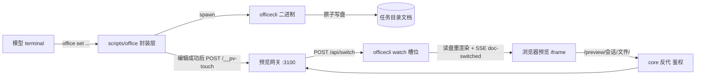

# Office 技能整体架构（docx/xlsx/pptx 创建 · 编辑 · 预览）

> 面向不熟悉背景的读者。看完应能回答：模型怎么操作 Office 文档？预览页面是谁渲染的？URL `/preview/<会话>/<文件>/` 一路经历了什么？编辑后预览为什么会自己刷新？出问题去哪看日志、跑什么命令。

## 1. 一分钟版

- **模型侧**只认识一个命令 `office <command>`（封装脚本），背后是 vendor 的 .NET 二进制 `officecli`。
- **文件本体**就是任务目录（`tasks/<会话id>/`）下的真实 `.docx/.xlsx/.pptx`，没有副本、没有双盘同步。
- **预览**由 executor 容器内的**预览网关**（端口 3100）托管：每个文档对应一个 `officecli watch` 常驻进程（"槽位"），负责把文档渲染成可交互 HTML。
- **入口唯一**：浏览器 → core（`agent-app`，登录鉴权）反代 `/preview/**` → executor 网关 → 槽位 watch。槽位号、watch 端口永不出容器。
- **编辑回显**：模型执行 `office set ...` 落盘后，封装脚本事后打网关一个 `/__pv-touch`，网关让对应 watch `POST /api/switch` 就地重读磁盘，浏览器页面靠 vendor 自带的 `doc-switched` 监听自刷新——不重启进程、不注入 HTML。



## 2. 组件清单

| 组件 | 位置 | 职责 |
|---|---|---|
| 技能说明 | `skills/office/SKILL.md` | 教模型用 `office` 命令动线；预览协作约定 |
| 封装层 | `skills/office/scripts/office` | 命令治理（隐藏 watch/mcp 等）、help 裁剪、`ui_card` 卡片发射、编辑后 touch 通知。模型只见这一层，`officecli` 不进 PATH |
| vendor 二进制 | `skills/office/bin/officecli`（git 不存、镜像不存） | 实际的文档创建/编辑/渲染引擎。`install.sh` 在 init 阶段按 pin 的 sha256 拉到宿主技能卷，executor 以 `:ro` 挂到 `/workspace/skills` |
| 预览网关 | `executor/preview.js`（executor 进程内，监听 :3100） | 槽位注册表、路径→槽位路由、转发与自愈、touch/switch 刷新链、牢笼管理、闲置回收 |
| watch 槽位进程 | `officecli watch <virt路径> --port <端口>` | 每文档一个常驻渲染进程，只绑回环；渲染 HTML、提供交互 API（选区/标注/编辑）与 SSE 推送 |
| core 反代 | `app/server/routes/preview-proxy.js` | `/preview/**` → executor:3100；登录鉴权、头白名单（凭据不出容器）、Referer 兜底（vendor 页硬编码的根绝对 API） |
| 前端预览窗 | `app/server/public/js/preview.js` | 点文件/卡片一律进预览窗；office 类型拼 `/preview/<会话id>/<相对路径>/` 挂 iframe；其余类型走文本/图片渲染 |

## 3. 一次完整动线

1. **创建**：模型跑 `office create demo.pptx`（cwd 即任务目录）→ 封装层透传 `officecli` → 文件落盘。
2. **卡片**：封装层在 stdout 尾行打 `::ui_card {action:"open_preview", arg:"demo.pptx"}::`；core 剥离后转 SSE `ui_card` 事件，聊天流里出现可点的预览卡片（模型对 marker 无感）。
3. **打开预览**：点卡片 → 前端 `openFilePreview` → HEAD 预探（404 = 服务里没有这份文档，给占位卡）→ iframe 挂 `/preview/task-20261019-001/demo.pptx/`。
4. **网关路由**：core 鉴权透传到 executor:3100。网关按 URL 路径查槽位注册表：
   - 命中且就绪 → 剥掉「前缀+页面路径」把内层路径转发给该 watch；
   - 未命中/未就绪 → 回一个 2 秒自动刷新的「正在准备预览」中转页，同时后台 spawn 该文档的 watch（冷启动数秒）；就绪后的下一次刷新直达真实页面。
5. **页内请求**：vendor 页面把交互 API 硬编码成根绝对路径（`/api/selection`、`/events`…）。这些请求不带页面路径，两层 Referer 兜底把它们送回正确槽位：core 层（Referer 命中注册前缀 → 原路径转 executor；含特判根路径 `/`）和网关层（Referer 命中 `/preview/` → 找回来源文档槽位）。
6. **模型回读选区**：用户在预览里选中一段/标注，模型跑 `office get-pos <file>`（改写为 `officecli get <file> selected --json`），读回选区做针对性修改。
7. **编辑回显**：`office set ...` 成功 → 封装层 fire-and-forget `POST /__pv-touch {file}` → 网关命中活槽位 → `POST watch /api/switch {file: 同路径}` = 强制从磁盘重读 → watch 推 SSE `doc-switched` → 页面自刷新。整条链 800ms 封顶、全静默——预览永远不是命令成功的前提。

## 4. 网关与槽位内部

- **槽位 = 缓存而非承诺**（`OFFICE_SLOTS`，默认 4）。链接按任务路径寻址，闲置回收/挤占后再访问由网关原地 revive 冷启动；转发失败对 GET/HEAD 自愈重试一次，不把死槽摊给用户。导航请求（浏览器直开页面）绝不为启动阻塞：未就绪立即给中转页。
- **每文档一实例**：同会话多份文档可同时预览、对照看，各自独立进程与端口。
- **watch 寻址三要素**（vendor 协议实测钉死）：
  1. 命令侧找 watch 的发现键 = 被 watch 路径字符串 hash + 写在 `TMPDIR` 下的 `.port` 文件；
  2. 网关必须让 watch 以「虚拟路径视图」注册：命令侧世界的路径是 `/workspace/tasks/<会话>/<文件>`（`EXECUTOR_CWD`），而盘上真实路径在 `/mnt/host-tasks/...`（`EXECUTOR_ISOLATION_BASE`）；
  3. watch 与命令侧的 `TMPDIR` 都指向**会话目录的 `.tmp`**——发现文件按会话隔离。
- **端口分配**：watch 端口只绑回环、不出容器；按代次轮转领取（领取前确认目标端口无人监听），与上一代（可能被残留进程占着的）端口永不重逢——杜绝"探活探到别人的服务"导致串文件。
- **回收三道**：闲置超时（`OFFICE_IDLE_MS`，默认 6h）；槽满挤占（优先踢无活动连接且最久未用的，开着页面的最后被抢）；mtime+size 指纹（导航时发现外部写入的变更 → 回收重渲染）。
- **失败冷却**：同一文件冷启动刚失败过，8 秒内不再重试，防止中转页自动刷新变成 spawn 风暴。

## 5. 牢笼（jail）：命令侧与 watch 的同居协议

vendor 的原生命名管道通知有 `SO_PEERCRED` 对端 pid 校验，跨 pid namespace 拿不到对端 pid 会**静默退化**（编辑了但页面不刷）。为此：

- 每会话一个常驻 pid ns「牢笼」（holder = `sleep infinity`，句柄 bind 在 `<会话>/.tmp/watchns`）；
- **watch 入笼**：`nsenter --pid=<watchns>` 向下进入牢笼再起 watch；
- **命令沙箱也建在笼内**：`executor/server.js` 的 `/exec` 检测到会话有牢笼时，先 `nsenter` 进牢笼再建 mount/ipc ns 执行命令（内核规则：setns 只允许进自身/后代的 ns）。两者同 ns → 原生管道通知可用，编辑秒级平滑刷新；
- 命令侧另有降级链：牢笼建不起来 / 会话无 watch 时，`OFFICE_JAIL` 不为 1 → 封装层编辑后走 TCP touch 刷新（慢一点，闪一下，但通）。
- watch 进程自身再套一层**私有 mount ns**：摆出 `/workspace/tasks` 虚拟视图 + `/tmp` 指向会话 `.tmp`，两重世界条件齐了才 exec `officecli watch`。self-reported pid 写 `<会话>/.tmp/watchpid-<端口>`，供网关直接 kill。

## 6. 命令治理（模型面 = 可调用面）

`scripts/office` 对 `officecli` 做透传治理：

| 治理 | 行为 |
|---|---|
| `watch`/`unwatch` | 拦截：预览槽位由平台托管，模型不得自起 watch |
| `mcp`/`skills`/`install`/`plugins` | 伪装原生报错 unrecognized（help 同步删行） |
| `view html/screenshot/svg/pdf/forms` | 拦截（需无头浏览器），引导用 `view outline|issues` 或 x2pdf 技能 |
| `get-pos` | 语义糖，改写为原生选中回读 |
| create/open 成功 | 发预览卡片 marker |
| 编辑族成功 | 事后一脚 touch（见 §3.7） |

## 7. 生命周期与自愈

- **托管**：网关随 executor 服务进程（容器内 PID1）启动，watch 跨 `/exec` 存活；网关重启丢槽表，watch 变孤儿由闲置/端口回收兜底（链接不变，重新访问即复活）。
- **删会话**：core 删会话时尽力调 `POST /__session-kill`（Bearer `EXECUTOR_TOKEN`）清该会话槽位与牢笼——牢笼的 mount 绑定不拆，会话目录会 EBUSY 删不掉。fire-and-forget，失败不阻断删除。
- **健康检查**：`GET :3100/gateway-healthz` → `{ok, slots, bin, bin_ready}`；bin 缺失 = init 阶段没拉到技能资产（`docker compose up -d agent-executor-init` 重试）。

## 8. 信任与安全模型

- **唯一入口是 core 的登录态**：`/preview/**` 挂在 auth.middleware 之后，信任模型 = 登录 ≈ 运维；executor:3100 与 watch 端口只走容器内网/IP 回环，不对外映射。
- **头白名单**：cookie/authorization 等凭据在 core 层和网关层被过滤两次，不出容器。
- **路径护栏**：网关只服务「tasks 卷下、会话目录下（≥2 层）、扩展名 ∈ {docx,xlsx,pptx}、存在」的文件，穿越一律拒。
- **文件写回**：watch 内存态改动经 `OFFICECLI_RESIDENT_FLUSH=each` 即时落盘，任务目录里的文件永远是最真的那一份；下载/交付链与预览共用它。

## 9. 环境变量速查

| 变量 | 默认 | 说明 |
|---|---|---|
| `EXECUTOR_ISOLATION_BASE` | `/mnt/host-tasks` | 任务卷-mount 到 executor 的宿主路径视图（网关 guard 的根） |
| `EXECUTOR_CWD` | `/workspace/tasks` | 命令侧虚拟任务的根（watch 注册视图，两边必须一致） |
| `OFFICE_PREVIEW_PORT` | `3100` | 网关监听（= `EXECUTOR_PREVIEW_PORT` 的别名语义，core 反代经 `EXECUTOR_PREVIEW_HOST/PORT` 指过来） |
| `OFFICE_SLOTS` | `4` | 同时可预览的文档数 |
| `OFFICE_WATCH_BASE` / `OFFICE_WATCH_SPAN` | `26315` / `64` | watch 端口轮转窗口 |
| `OFFICE_IDLE_MS` | 6h | 无人看管的槽位闲置回收 |
| `OFFICE_PREVIEW_PREFIX` | `/preview` | 网关侧前缀（core 注册表须一致） |
| `PREVIEW_PROXIES` | 内置 office 一条 | core 预览反代注册表（JSON），后续挂别的预览服务用 |
| `OFFICECLI_BIN` | `/workspace/skills/office/bin/officecli` | 二进制位置（技能卷 :ro） |
| `OFFICECLI_NO_AUTO_RESIDENT` / `OFFICECLI_RESIDENT_FLUSH` | `1` / `each` | 关常驻复用（实测零增益还撞 file_locked）、每命令落盘 |
| `OFFICE_JAIL` | — | 牢笼内执行 =1：原生通知已生效，封装层跳过 touch |
| `EXECUTOR_TOKEN` | — | executor 内部接口的 Bearer 信任凭据（`/exec` 与 `/__session-kill` 同源） |

## 10. 排障手册

日志：`docker logs agent-executor | grep '[preview]'`。常见行：`slotN <abs> watch:<port> page=...`（起槽成功）、`已停止`/`转发失败摘除`/`外部变更，回收重渲染`/`闲置回收`（回收）、`Failed to start watch`（冷启动失败，8s 冷却）。

现场体检三板斧镜像里没有 `ps`/`ss`，用：

```sh
# 1) 现存 watch（pid + 盯的文件/端口）
docker exec agent-executor sh -c 'for d in /proc/[0-9]*; do c=$(tr "\0" " " < $d/cmdline 2>/dev/null); case "$c" in *officecli*watch*) echo "${d#/proc/} $c";; esac; done'

# 2) 网关视角 vs 进程视角，对不上 = 有孤儿占口
docker exec agent-executor curl -s 127.0.0.1:3100/gateway-healthz

# 3) 探某个槽端口的实际身份（头部 120 字节能看出渲染的是哪份文档）
docker exec agent-executor node -e 'require("http").get({host:"127.0.0.1",port:26315,path:"/",timeout:1500},r=>{let b="";r.on("data",d=>b+=d);r.on("end",()=>console.log(r.statusCode,b.slice(0,120)))}).on("error",e=>console.log("ERR",e.code))'
```

| 症状 | 大概率原因 | 处理 |
|---|---|---|
| 预览一直转「正在准备预览」 | 二进制缺失 / 文件不在会话目录 / 冷启动连续失败冷却中 | healthz 看 `bin_ready`；确认文件在 `tasks/<会话>/` 下；看 preview 日志报错 |
| 页面是另一份文档（串文件） | 槽位端口被残留进程占住 + 探活未验身份（老版本曾真实发生） | 跑上面三板斧，`slots` 数与 watch 进程数不等即孤儿实锤；重启 executor 清槽表即可恢复 |
| 编辑后页面不刷新 | 牢笼没建起来且 touch 链断了 | 确认 executor 有 `unshare/nsenter/mount`（util-linux）；看 `[preview]` 是否有 switch 相关日志 |
| 预览页根 API 404 | core 预览反代没挂 / Referer 被剥 | 确认 `preview-proxy.js` 的 mount 在路由最末、earlyGuard 在 static 之前 |
| 删会话报目录非空 | 牢笼 mount 未拆（session-kill 尽力而为失败） | 手动 `docker exec agent-executor umount <会话>/.tmp/watchns` 后再删 |

## 11. 设计沿革（避免重新踩坑）

- **MCP 桥时代**：预览在 mcp/officecli 仓库独立进程，单 ns，原生通知天然可用；迁入 executor 后命令侧多了 pid ns 隔离，才有牢笼与 touch 双链。
- **双盘同步退役**：数据面已改为「预览的文件 = 任务目录的真实文件」，旧同步/push/scratch 动线全部移除。
- **串文件事故复盘**：watch 父进程可能先退而服务进程存活（`--fork`），网关只摸得到包装链 pid；旧版端口 = 槽号，踢槽后新 watch 撞孤儿占的同口、`portUp` 又不认身份 → 页面被转发到上一份文档。现方案 = 端口代次轮转（永不与上一代同口）+ 杀进程组 + pidFile 自报。教训：**探活必须验身份或保证端口唯一**；`gateway-healthz slots` 与进程数对比是长期哨兵。
