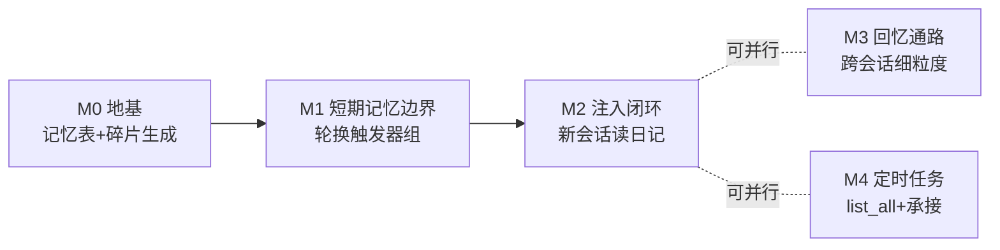

定位吸收了：**微信通道 = 一个有记忆的人**。会话是工作台（短期记忆），按天的日记是长期记忆，轮换即"下班记日记"。方向我认同，且它和刚落地的 30 分钟自动收口正好咬合：轮换留下的旧 held 会话自己归档。

先补三个**代码里发现的硬事实**，它们影响设计，然后给里程碑计划。

## 设计层要碰的三个钉子

**1. 回忆 skill 的数据通路是真坑（你第 4 点里藏着）。** 隔离是刻意的：executor 的 session 模式把其它会话的任务目录遮掉了，`read_file`/terminal 跨不出当前会话目录——skill 脚本从执行器侧**天然摸不到**旧会话的消息流和成果文件。两条出路：
- **方案 A（我推荐）**：回忆仍走 skill（SKILL.md 当"怎么回忆"的操作手册，不占 tool schema），但脚本调 core 的**只读内部接口**（`/api/sessions/:id/messages|files` 已存在，加个 executor→core 的服务 token 即可）——基础设施增量只有一条回连通道；
- 方案 B：不建 skill，加一个极简 `recall` tool（op=days / op=session）——违背你"别撑 tool 描述"的初衷，但通路最短。
这个要你拍板，它决定 M3 的形态。

**2. 碎片摘要绝不能阻塞微信回信。** 轮换发生在入站消息路径上；旧会话摘要是一次 LLM 调用，必须**后台异步**生成（先换绑新会话、先回用户，碎片慢慢落），失败只记日志——日记晚到一分钟无伤大雅。另外碎片生成复用压缩那套基建（`templates/` 加个 journal prompt + 轻量 LLM 调用），不是新子系统。

**3. 定时任务会话和日记有个现成的交集**：scheduler 每次触发前本来就"历史整体存档、AI 只看到任务 prompt"（等价自动换班）。所以**定时任务的每次执行也是天然日记事件**——不需要 LLM，模板化一行（「X 任务按计划执行，结果：…」）直接追加当日条目。这让"纯任务会话"虽不轮换也有记忆痕迹，成本为零。

## 里程碑切割

**M0 — 地基**（`db.js` / `engine.js` / `config.js`）
- `memory_entries(user, day, content)` 表 + 追加/读取/按保留期裁剪（`memory.retain_days` 默认 7、上限 30 截断）；
- `appendFragment(user, day, text)` 与 `journalFor(user)`；碎片 LLM 摘要函数（异步、幂等、失败降级为"仅标题+文件清单"）；
- 当日多碎片 = 机械拼接追加（每片已条目化，不再二次 LLM 合并，省钱且确定性）。

**M1 — 短期记忆边界**（`wechat.js` handleInbox + `engine.js`）
轮换触发器，全部收敛到同一个 `rotateChannelSession()`：① 入站距最后一条 **user** 消息 >4h（排除 scheduler_note 续命坑）；② 微信会话上下文超 `auto_compress_tokens` → 直接换会话不压缩（复用现有阈值，行为按通道分叉）；③ `/new`、`/switch` 换绑时对手动离开的会话产碎片；④ 删会话不产。每次轮换后台产碎片 + 旧会话 releaseHold 收口。

**M2 — 注入闭环**（`wechat.js` ensureChannelContext）
新通道会话创建时把近 7 天日记注入上下文（channel_note 同族的一条 memory_note，第一人称口吻「9月28日 帮他整理了…」）。到这里"这个人"已经能连续地活：**M0-M2 是最小可用闭环**。

**M3 — 回忆通路**（按上面方案 A/B 拍板结果做）
日记条目里带旧会话 id + 成果文件清单索引 → skill/工具按 id 下钻详细消息与文件。

**M4 — 定时任务配套**（`tools/executor.js` + `routes/channel.js`）
- `schedule` 加 `op=list_all`（跨会话：join sessions 出标题/cron/下次/上次状态）——只读全览，改删仍绑当前会话，引导 `/switch`；
- `op=create` 撞主键时错误文案升级为「本会话已有任务 X，如需新闹钟请开新会话承接」→ AI 依你第 5 点走 `/new` 流程；
- 微信 `/tasks` 文本命令（与现有命令同族）+ 定时任务执行结果模板化落日记（第 3 个钉子）。

顺序 M0→M1→M2 串行（每步都可独立验证），M3/M4 并行或调序。**要你拍板的只剩两个**：① 回忆走 A（skill+内部 API 回连）还是 B（极简 recall tool）？② `/clear`（网页端清空回 advising）要不要也产碎片——我倾向产，语义一致。

定了我就从 M0 开干。
